# PFE_CONTEXT.md — Smart Health Room: Master Technical Reference for Thesis Generation

> **Purpose of this file**: this is the single source of truth for an LLM (Claude AI Pro) to write a complete 80–120 page university graduation thesis (PFE) about the "Smart Health Room" project, without needing to re-read the source code. It was compiled from a full, code-verified technical audit of the repository (`backend/`, `web/`, `mobile/`, `iot/`), cross-referenced against `README.md`, `architecture.md`, and package manifests. Where the project's own notes (`README.md`) describe an aspirational/future state that the code does not actually implement, this document flags the discrepancy explicitly rather than silently reconciling it — those discrepancies are themselves useful, honest material for a thesis's "Limitations" and "Future Work" chapters.
>
> **Source basis**: `SMART HEALTH ROOM/allproject.md` (1692 lines, full source-code audit dated 2026-07-20, re-verified 2026-07-22), `SMART HEALTH ROOM/README.md` (project's own design notes — partially aspirational), `SMART HEALTH ROOM/architecture.md` (a historical design note for one feature, "Intelligent Emergency Mode," useful for showing the project's evolution), `backend/package.json`, `web/package.json`, `mobile/pubspec.yaml`, and a listing of `database/*.json` (MongoDB collection exports) and `ProjectImages/` (existing screenshots).
>
> No fact in this document was invented. Anything not traceable to the repository is listed in §19 (Missing Information) or asked about in §20 (Questions Remaining).

---

# 1. Executive Project Overview

## 1.1 Project Name
**Smart Health Room**

## 1.2 Project Description
Smart Health Room is a full-stack IoT healthcare-monitoring platform for a single connected room. An Arduino Mega 2560 reads all physical sensors and drives all local actuators (RFID door lock, LCD, RGB status light, buzzer, lamp). An ESP32 acts as a pure WiFi/network gateway between the Arduino and a Node.js/Express/MongoDB backend. The backend applies all business logic (alerting, emergency detection, sleep scoring, logging, user/order management) and exposes both a REST API and a Socket.IO real-time channel. A Next.js 16 web application and a Flutter mobile application both consume the same backend to provide a live dashboard, an admin back-office, and a deterministic rule-based "AI" health assistant.

The Flutter mobile app (128 Dart files) is a full native client, not a stripped-down companion — it reimplements nearly every web feature (live sensors, remote control, analytics, PDF health report, admin back-office, AI assistant) against the exact same `/api/v1/*` REST and Socket.IO surface, with **zero new backend endpoints** introduced for it. It adds a small number of genuinely mobile-native capabilities the web app has no equivalent for: biometric app-lock, voice input/output for the AI assistant, and native PDF sharing.

## 1.3 Problem Statement
Manually monitoring a room occupant's environment and safety (temperature/gas/humidity extremes, unauthorized access, prolonged inactivity) is unreliable and non-continuous, and typically offers no unified, explainable interface for the occupant or an administrator to understand *why* a given alert fired. Smart Health Room automates this monitoring end-to-end — from raw sensor voltage to a real-time, explainable dashboard alert — while keeping a physical safety response (door unlock, alarm) working even if the network or backend is unreachable, because the Arduino evaluates its own two-tier hazard thresholds locally and reacts autonomously.

## 1.4 Objectives
- Continuously monitor a room's environmental conditions: temperature, humidity, air quality (gas), light level, sound.
- Detect and log room-occupancy/bed-presence and compute a sleep quality score.
- Secure physical access with RFID authentication and an automatically-actuated door.
- Detect dangerous conditions automatically and raise a two-tier (warning/danger) alert and emergency response, including autonomous physical response (open the door, alarm) at the hardware level, independent of network connectivity.
- Present all of the above in real time on a modern, responsive web dashboard, with historical trends, analytics, and PDF reporting.
- Provide a self-service account/order/administration system for provisioning new rooms/users.
- Give the end user natural-language access to their own data through a fully deterministic (non-LLM) "AI Assistant" grounded only in real sensor data.
- Provide a native mobile client (Flutter, Android/iOS) offering the same monitoring/control/analytics/assistant/admin capability set as the web app.

## 1.5 Target Users
| Role | System value | Notes |
|---|---|---|
| **Room occupant / end user** (`role: "user"`) | Views their own room's live status, history, alerts; remote-controls actuators from the dashboard; uses the AI assistant; can place a device order. | The only self-registerable role. |
| **Administrator** (`role: "admin"`) | Manages user accounts, device pairing, order fulfillment, and system-wide monitoring across every registered room. | Seeded once at boot from environment variables; can also be created by another admin. |

Exactly these two roles exist in the system today; no other role (e.g. "doctor", "caregiver") is implemented, despite being mentioned as a future idea in the project's own notes (`README.md` §"Future roles").

## 1.6 Main Features (summary — full detail in §5)
Live IoT monitoring (5 sensors + occupancy), RFID security with an autonomous door/alarm response, a Health Score and Room Quality Index, predictive (trend-based) early warnings, a rule-based AI health assistant with chat, an emergency subsystem (auto door-unlock, email notification, audit trail), self-service registration and a public order-to-account pipeline, an admin back-office with full user/order management, analytics with PDF/PNG export, a day/night-reactive animated dashboard background, a guided onboarding tour, a scripted demo mode, PWA installability on web, and — on the native Flutter mobile app — the same live monitoring/remote-control/analytics/AI-assistant/admin feature set plus biometric app-lock and voice-driven assistant interaction.

## 1.7 Innovation
- **Two independent, redundant safety layers**: the Arduino Mega evaluates its own hazard thresholds and reacts physically (opens the door, alarms) without waiting for any network round-trip; the backend independently re-evaluates the same raw readings for its own emergency/alert/email pipeline. Either layer alone is sufficient to protect the occupant.
- **A genuinely explainable "AI" assistant**: every answer the chat assistant gives is generated by a deterministic rule engine reading the exact same Health Score / Room Quality / Predictive Warning / Recommendation computations the rest of the dashboard already displays — there is no LLM call, no hallucination risk, and every number quoted in an answer is traceable to a live sensor reading and a named threshold.
- **A single merged real-time event model** (`useUnifiedEvents` on web) that feeds three different UI surfaces (Live Event Center, Timeline, and — filtered — the Logs page) from one source of truth, so no event categorization logic is duplicated.
- **A fully non-blocking, watchdog-safe embedded firmware** (both boards) with EEPROM-persisted RFID enrollment, a 12-item self-test at boot, sensor-fault-streak detection, checksummed framed serial protocol with sequence-based duplicate detection between the two boards, and exponential-backoff reconnection on both WiFi and Socket.IO.
- **True cross-client parity by construction**: the mobile app's pure-logic layer (`mobile/lib/core/utils/*.dart`) is a line-for-line Dart port of the web app's `web/src/lib/*.ts` scoring/rule engines (verified in-code comments say so explicitly, e.g. `thresholds.dart`: "Ported verbatim from `web/src/lib/thresholds.ts`"), so the two clients cannot silently disagree on a Health Score or an assistant answer.

## 1.8 Expected Benefits
- Continuous, automated safety monitoring that does not depend on constant human supervision.
- A physical safety response that survives a WiFi/backend outage (a strong, demonstrable engineering argument for a thesis defense).
- A transparent, explainable assistant layer suitable for a safety-relevant domain, where an LLM's hallucination risk would be a genuine liability.
- A realistic three-tier IoT product architecture (embedded firmware → backend services → two independent client apps) that demonstrates competence across embedded systems, backend API/service design, real-time communication, and modern cross-platform frontend engineering — well-suited to an academic jury evaluating full-stack/IoT breadth.

---

# 2. Complete System Overview

The system is a five-tier, single-direction data pipeline with a real-time bidirectional side channel:

```
Sensors → Arduino Mega 2560 (local logic + actuation)
        → Serial1 (framed/checksummed, 9600 baud) → ESP32 (WiFi gateway, no business logic)
        → HTTP POST (REST, /api/v1/*) → Express Backend (Route → Controller → Service → Model)
        → MongoDB (persistence)
        → Socket.IO broadcast → Next.js Web Dashboard (Zustand stores) → React UI
                              → Flutter Mobile App (Provider ChangeNotifiers) → Widget UI
```

The backend also pushes Socket.IO **commands** back down (`lamp-command`, `door-command`, `buzzer-command`, `rgb-command`, `emergency:*`) to the ESP32 → Arduino for remote actuator control and emergency activation, closing the loop in the opposite direction.

**Key architectural fact**: the Flutter mobile app is a **peer real-time client** to the web dashboard, not a downstream consumer of it. Both connect independently to the same Socket.IO server and register the same `userId` room, so either client can trigger an actuator command and both see the result live — a phone in the user's pocket and a browser tab both reflect the exact same state, with no separate mobile-facing backend pipeline. The backend makes no distinction between a browser socket, a mobile-app socket, or the ESP32's own socket — all three simply join the same per-user Socket.IO room (see §16.18 diagram).

**Component responsibilities at a glance**:

| Component | Responsibility | Owns business logic? |
|---|---|---|
| Arduino Mega 2560 | Reads every sensor, drives every actuator, runs its own two-tier hazard evaluation, manages RFID/EEPROM | Yes — local safety logic only |
| ESP32 | WiFi + Socket.IO + HTTP gateway between Arduino and backend | No — pure relay by design |
| Express Backend | Full business logic: thresholds, alerting, emergency state machine, sleep scoring, order lifecycle, admin operations, auth | Yes — the single source of truth |
| MongoDB | Persistence for users, sensor readings, alerts, emergencies, logs, orders | No |
| Next.js Web App | Dashboard, admin back-office, marketing site | No — delegates to stores/lib |
| Flutter Mobile App | Native Android/iOS client, near-full feature parity with web | No — delegates to providers/repositories |

The project explicitly follows one architectural discipline expressed twice: **Route → Controller → Service → Model** on the backend, and **Page → Store (or Hook) → REST/Socket.IO → Backend** on the web frontend, with the identical discipline again on mobile under Flutter-idiomatic names: **Screen → Provider → Repository → `ApiClient`/`SocketService` → Backend**. In all three cases, the rule "never duplicate business logic; reuse the existing service/store/provider" is enforced by convention and — per the source audit — largely followed in practice.

---

# 3. Software Architecture

## 3.1 Frontend (Web)
Next.js 16 (App Router) + React 19 + TypeScript + Tailwind CSS v4. Structure: `app/` (routes and layouts only — every page delegates to a store, hook, or `lib/` function), `components/` (admin/, dashboard/, providers/, ui/, marketing components), `hooks/` (10 custom hooks — React-specific composition over stores/lib), `lib/` (22 pure, framework-agnostic modules — scoring engines, the assistant's rule engine, formatting, PDF/PNG export, weather API client, global search index builder), `store/` (14 Zustand stores — all server-state and cross-component client state, including the app-wide Socket.IO event consumer wiring).

## 3.2 Backend
Node.js + Express 4 (TypeScript, ESM `type: module`), MongoDB via Mongoose 8, Socket.IO 4 for realtime, Winston for logging, Zod for env validation, JWT (`jsonwebtoken`) for auth, `bcryptjs` for hashing. Layering: `routes/*.ts` → `controllers/*.ts` → `services/*.ts` → `models/*.ts`. `config/` holds env parsing, Mongo connection, and the single source of truth for alert/emergency thresholds. `utils/` holds `jwt.ts`, `logger.ts`, `http.ts`. Full detail in §11.

## 3.3 Database
MongoDB via Mongoose, six collections (`users`, `sensordatas`, `alerts`, `emergencies`, `logs`, `orders`). Full detail in §12.

## 3.4 IoT
Two boards, strict separation of concerns: the **Arduino Mega 2560** owns every sensor and actuator and runs local safety logic; the **ESP32** is a pure network gateway carrying no business logic by design. Full detail in §9.

## 3.5 AI
No LLM or external AI API anywhere in the codebase. "AI Assistant" = a deterministic, fully explainable rule engine (intent-matching + live-data lookups) shared (ported verbatim) between the web (`assistantIntents.ts`) and mobile (`assistant_intents.dart`) clients. Full detail in §10.

## 3.6 Authentication
JWT (access + refresh tokens minted at login/register; payload limited to `{userId, email}`), bcrypt password hashing (12 rounds). Two roles: `user`, `admin`. `authenticate` middleware re-reads the user's live DB state (role, `isActive`) on every request rather than trusting the JWT payload. Full detail in §14.

## 3.7 Real-Time Communication
Socket.IO 4, one room per user (named after the MongoDB `_id`). Every client (web browser, Flutter app, ESP32) `emit`s `register` with that id after connecting; `broadcastToUser(userId, event, data)` = `io.to(userId).emit(...)`. Up to three sockets (web tab + phone + ESP32) can share one room and each receives every broadcast. See §16.18 for the sequence diagram.

## 3.8 Mobile
Flutter (Dart), `provider` state management. Screen → Provider (`ChangeNotifier`) → Repository → `ApiClient`/`SocketService` → Backend. Full detail in §8.

## 3.9 Project Structure (top level)
```
SMART HEALTH ROOM/
├── backend/     — Express + MongoDB REST/Socket.IO API
├── web/         — Next.js 16 web application
├── iot/
│   ├── arduino/ — Arduino Mega 2560 firmware (canonical; one .ino + config.h)
│   └── esp32/   — ESP32 gateway firmware (canonical; one .ino + config.h)
├── mobile/      — Flutter mobile application (128 Dart files, full feature parity with web)
├── README.md, architecture.md, allproject.md — project notes (allproject.md is the code-verified, authoritative one)
```

## 3.10 Backend Folder Organization
```
backend/src/
├── app.ts            — Express app entry: middleware stack, /health, startServer()
├── config/           — database.ts, env.ts (Zod-validated), thresholds.ts (single source of truth for alert/emergency levels)
├── controllers/       — 10 files: access, admin, alert, auth, bed, emergency, log, order, profile [EMPTY, unused], sensor, status
├── middleware/         — auth.middleware.ts (JWT), rbac.middleware.ts (role gate)
├── models/            — 6 Mongoose schemas: User, SensorData, Alert, Emergency, Log, Order
├── routes/            — 10 router files + index.ts (mounts everything under /api/v1)
├── services/          — 12 files — 100% of business logic
└── utils/             — http.ts, jwt.ts, logger.ts (Winston)
```

## 3.11 Web Folder Organization
```
web/src/
├── app/
│   ├── (marketing)/   — public Home + Product pages
│   ├── (auth)/        — Login + Register pages
│   ├── dashboard/     — 11 authenticated user-facing routes
│   ├── admin/         — 3 admin-only routes
│   ├── 403/, offline/ — error/fallback pages
│   └── layout.tsx     — root layout: SessionGuard, ServiceWorkerRegister, SocketProvider
├── components/        — admin/ (14), dashboard/ (~24 + assistant/ + background/), providers/, ui/ (14), marketing components
├── hooks/             — 10 custom hooks
├── lib/               — 22 pure-logic modules
└── store/             — 14 Zustand stores
```

## 3.12 Mobile Folder Organization
```
mobile/lib/
├── main.dart          — MultiProvider root + _AuthGate (session resolve → Login / MainShell / AdminShell)
├── core/
│   ├── config/        — api_config.dart (per-platform backend host resolution)
│   ├── theme/         — app_colors.dart, app_theme.dart, sky_theme.dart (ported from web Tailwind config)
│   └── utils/         — 16 files — Dart port of web's lib/ scoring/rule engines
├── models/            — 12 plain Dart data classes
├── providers/         — 12 ChangeNotifier classes (Provider-pattern equivalent of web's 14 Zustand stores)
├── repositories/       — 8 files — thin REST wrappers, one per backend resource
├── services/          — api_client.dart, socket_service.dart, storage_service.dart, biometric_service.dart, voice_service.dart
├── screens/           — 27 top-level screens across 19 feature folders
└── widgets/           — 8 shared design-system primitives
```

## 3.13 Communication Flow (textual)
See §16.1 and §16.7 mermaid diagrams for the visual form. In short: sensors → Arduino (local evaluation + actuation) → framed serial → ESP32 (relay only) → HTTP POST → Backend (full evaluation, persistence) → MongoDB, with a parallel Socket.IO broadcast fan-out to Web + Mobile, and a Socket.IO command channel running the same path in reverse for remote actuation.

---

# 4. Technology Stack

| Technology | Layer | Purpose | Why selected | Advantages | Integration |
|---|---|---|---|---|---|
| Node.js + Express 4 | Backend runtime/framework | HTTP API server | Mature, huge ecosystem, natural fit for a JSON REST + Socket.IO backend | Minimal boilerplate, easy middleware composition | Wrapped in a raw `http.createServer` so Socket.IO can attach to the same server |
| TypeScript (ESM) | Backend language | Type safety across the whole backend | Catches shape mismatches between controllers/services/models at compile time | Self-documenting function signatures, safer refactors | Compiled via `tsc`; dev run via `tsx watch` |
| MongoDB + Mongoose 8 | Database / ODM | Persistence for 6 collections | Schema flexibility suits evolving sensor payloads (fields like `co2`, `rgb`, `lightStatus` were added over time without migrations) | Fast iteration, native JSON document fit for sensor telemetry | Accessed exclusively through Mongoose models, never raw driver calls from controllers |
| Socket.IO 4 | Real-time transport | Live sensor pushes + remote commands | Mature, reconnect-aware; an ESP32-compatible Socket.IO client library already exists, avoiding a hand-rolled WebSocket protocol on constrained hardware | Automatic reconnection, room-based broadcast model | One room per user; used identically by web, mobile, and the ESP32 |
| JWT (`jsonwebtoken`) | Auth | Stateless session tokens | Standard, well-understood, works identically for a browser and a mobile app | No server-side session store needed | `authenticate` middleware re-verifies live DB state each request |
| `bcryptjs` | Auth | Password hashing | Industry-standard adaptive hash | Resistant to brute-force/rainbow-table attacks | 12 salt rounds, pre-save hook on `User` and `Order` |
| Zod | Backend | Environment variable validation | Fails fast and loud on missing/malformed config | Single source of truth for required vs. optional env vars | Used only for env parsing (`config/env.ts`), not request-body validation |
| Winston | Backend | Operator-facing diagnostic logging | Configurable transports (console + file) | Separates server-operator logs from the user-visible `Log` collection | Writes `logs/error.log`/`logs/combined.log`, distinct from the app's own `Log` model |
| Nodemailer | Backend | Emergency email notification | Simple SMTP client, works with any provider incl. Gmail app-passwords | Zero-cost email delivery for a prototype | Optional — silently disabled if SMTP env vars are incomplete |
| Next.js 16 (App Router) + React 19 | Web frontend | File-based routing across 3 access levels (public/user/admin) | App Router's layout nesting matches the project's public/auth/dashboard/admin route groups naturally | Server/Client Component split, built-in image/font optimization | Every route under `dashboard/` and `admin/` is client-rendered and role-gated |
| Tailwind CSS v4 | Web styling | Utility-first styling | Fast iteration, consistent design tokens, custom `day:`/`admin-dark:` variants for the project's two independent theme systems | No context-switching to separate CSS files | Configured via `globals.css` theme tokens |
| Zustand 5 | Web state management | 14 independent state slices | Minimal boilerplate vs. Redux for state that mostly doesn't need cross-slice reducers | Each store owns its own fetch/mutate logic | The sole app-wide Socket.IO event consumer wiring dispatches into these stores |
| Chart.js + `react-chartjs-2` + `chartjs-plugin-zoom` | Web analytics | Trend charts (24h–1y ranges) with zoom/pan | Well-supported plugin ecosystem for zoom/pan and PNG export | `toBase64Image()` gives free PNG export | Wrapped once in a shared `ChartCard` component |
| `jsPDF` + `jspdf-autotable` | Web reporting | Health Report and Analytics PDF export | Vector-drawn charts avoid a canvas-scraping dependency, keeping PDF generation a pure function of already-fetched data | Easier to test/reason about than screenshot-based export | Two generators share one header/footer/brand-color module (`healthReport.ts`) |
| Framer Motion | Web animation | Dashboard background, transitions, banners | Declarative, respects `prefers-reduced-motion` | Smooth, production-quality micro-interactions | Used throughout dashboard widgets and the animated background |
| Flutter (Dart, SDK `^3.11.0`) | Mobile framework | Single codebase, Android/iOS native client | Single codebase targets both major mobile platforms without a JS-bridge cost | Native performance, native platform API access (biometrics, secure storage) | `pubspec.yaml`-declared dependencies, standard Flutter project layout |
| `provider` (`^6.1.2`) | Mobile state management | 12 `ChangeNotifier`s at the `MaterialApp` root | Lightest-boilerplate option that still maps 1:1 onto the web app's store-per-concern architecture, easing the verbatim port of `lib/` engines into Dart | Simple mental model, no code-gen step (unlike Riverpod/BLoC in some configurations) | Each provider corresponds 1:1 to a Zustand store |
| `flutter_secure_storage` | Mobile persistence | JWT token storage | OS Keystore/Keychain-backed, encrypted at rest — deliberately stricter than the web app's plain `localStorage` | Reduces exposure if a device is lost/stolen/backed up | Used for tokens + cached user JSON only; `shared_preferences` handles non-sensitive UI state |
| `local_auth` | Mobile biometrics | App-lock (Fingerprint/Face ID) | Native, zero-cost UX layer reducing password re-entry on a personal device | Fast unlock without weakening the actual JWT-based authorization boundary | A local gate in front of an already-valid session — never a second auth factor recognized by the backend |
| `speech_to_text` + `flutter_tts` | Mobile voice | AI Assistant voice input/output | No web equivalent exists (browsers lack a comparable built-in API in this project's stack) | Genuine mobile-native feature differentiator | Includes a hand-rolled Markdown-stripper so bold/bullet/header syntax isn't read aloud literally |
| `socket_io_client` (Dart) | Mobile real-time | Same Socket.IO server as web | Keeps mobile a peer real-time client, not a second-class one | Same event set, same reconnection backoff pattern as web and the ESP32 | Registers the same per-user room model (§3.7) |
| Arduino core (C++) + `MFRC522`, `LiquidCrystal_I2C`, `DHT`, `RtcDS1302`, `Servo`, `ArduinoJson`, `EEPROM`, AVR watchdog | IoT — Arduino Mega 2560 | Sensor reading, actuator control, RFID, local safety logic | Mega's multiple hardware serial ports (`Serial`, `Serial1`) let it run LCD+RFID+DHT+RTC+ESP32-link simultaneously without `SoftwareSerial` contention | Deterministic, non-blocking, watchdog-safe firmware | Talks to ESP32 over a framed/checksummed Serial1 protocol |
| Arduino core for ESP32 (C++) + `WiFi`, `HTTPClient`, `ArduinoJson`, `WebSocketsClient`, `SocketIOclient`, `esp_task_wdt` | IoT — ESP32 | WiFi + Socket.IO + HTTP gateway | A mature ESP32 Socket.IO client library exists, avoiding a hand-rolled protocol on constrained hardware | Exponential-backoff reconnection on both WiFi and Socket.IO | Carries zero business logic by design |
| Open-Meteo API | Weather integration (web + mobile) | Outdoor weather/AQI for indoor/outdoor comfort comparison | Free, no API key required | Zero-cost, no rate-limit-key management | Called directly from both clients' weather store/provider |

**Note on installed-but-unused dependencies** (worth naming honestly in a thesis "Implementation Notes" section, not hidden): `axios` (web) is installed but every store uses raw `fetch()` instead; `express-rate-limit` (backend) is installed but never wired into any route; `next-auth` and `shadcn` appear in `web/package.json` but the project's actual auth is a hand-rolled JWT flow via `authStore`/`lib/api.ts` — `next-auth`'s presence was not covered by the source-code audit in `allproject.md` and should be verified (see §19/§20) before citing it as "used" in a thesis.

---

# 5. Functional Analysis

Grouped by module, as implemented (not aspirational). Every feature below exists in the current codebase per the source audit.

## 5.1 Marketing / Public Site
- **Animated hero** with word-reveal typography — purpose: first impression / project pitch. Purely presentational.
- **8-sensor feature grid** — purpose: communicate monitored parameters at a glance.
- **Testimonial marquee** — static content today (no backend-fed review system).
- **Public product order form** — purpose: let a prospective user request a device/account without first having one. Workflow: fill form (with inline validation + password-strength meter) → `POST /api/v1/orders` → success animation. Business logic: `OrderService.createOrder` rejects duplicate in-flight orders or an already-existing account for that email.
- **Protected "Dashboard" nav link** — redirects an unauthenticated visitor to `/login?redirect=/dashboard` with a login-required toast.

## 5.2 Authentication
- **Login** — email/password → `POST /auth/login` → JWT issued → session persisted → Socket.IO connect + `register(userId)`. Floating-label inputs, shake-on-error, post-login redirect-back support.
- **Register** — always creates `role:"user"`, no device attached. Live password-strength meter.
- **Session guard** — a global `fetch` patch (`SessionGuard`, web) force-logs-out on any 401 from an authenticated request, redirecting to `/login?expired=1`.

## 5.3 Live Dashboard (see §7 User Module for the full page-by-page breakdown)
Real-time sensor grid, interactive Bed/Lamp cards, rotating trend charts, day/night ambient theming driven by the real light sensor, an animated weather-reactive background, and global `Ctrl/Cmd+K` search.

## 5.4 Safety / Alerts / Emergency
- **Per-sensor Alert system**: `AlertService.checkAndCreate` persists a `warning`/`danger` Alert whenever a reading crosses a threshold in `config/thresholds.ts`, broadcasts `new-alert`. Readings below warning are simply skipped (no `info` alert ever persists in practice, despite the schema allowing it).
- **Emergency subsystem**: `EmergencyService` computes the worst of `fine`/`warning`/`danger` across temperature/humidity/airQuality/soundLevel. On `danger`, it upserts one active `Emergency` per user, **automatically unlocks the door**, sends one emergency email (if SMTP configured), and broadcasts `emergency:activated`. Auto-resolves once all readings return to `fine`, or a user/admin can manually resolve via `PATCH /emergencies/:id/resolve`.
- **Predictive (trend-based) early warning**: distinct from the threshold-based Alert/Emergency system — extrapolates a sensor's recent trend to warn before a hard threshold is actually crossed.
- **Room Map**: interactive 9-node floor plan with live per-node status.

## 5.5 AI Assistant (full detail in §10)
Chat interface grounded exclusively in the app's own already-computed live state (Health Score, Room Quality, Predictive Warning, Recommendations) — no external AI/LLM call anywhere.

## 5.6 Analytics & Reporting
5-range trend charts (24h/7d/15d/30d/1y) with zoom/pan; a 10-metric stat row (warnings, emergencies, door-openings, RFID accepted/denied, bed-occupancy %, avg Health Score, avg Room Quality, sensor+ESP32 "reliability" — a reporting-consistency metric, not wall-clock uptime, since the Arduino only transmits while the room is occupied); PNG chart export; a scoped Analytics PDF export; a full multi-page Health & Environment PDF report (patient info, score breakdowns, current readings, outdoor weather, predictive warnings, recommendations table, emergency history, and a hand-drawn 15-day trend chart).

## 5.7 Occupancy
Daily/Weekly/Monthly bed-presence analytics derived purely from the FSR pressure sensor, with gap-capped, session-aware aggregation. **Web-only** — the mobile app folds occupancy into a single Analytics stat-row entry rather than a dedicated page (§8.13 parity table).

## 5.8 Remote Control
Live lamp/door/buzzer toggle and a 6-preset RGB color picker (Red/Green/Blue/White/Amber/Purple), a real device-status indicator, and (**web-only**) a real emergency test-trigger (`POST /emergencies/test-trigger`) that exercises the actual backend evaluation pipeline behind a confirmation dialog — used for QA/demo purposes.

## 5.9 Notifications / Timeline / Logs
One merged, severity-tagged event feed (`useUnifiedEvents` on web — combining alerts + emergencies + filtered logs + recommendation-history + weather-refresh events) backs three UI surfaces: the compact Live Event Center dropdown, the full Activity Timeline tab, and the independently filtered System Logs tab — so event-categorization logic exists in exactly one place. The mobile app's equivalent (`NotificationItem`/`NotificationCategory`) unifies `AlertProvider` + `EmergencyProvider` into one feed for the Notification Center (a narrower scope than web's, since it does not also fold in logs/recommendation-history).

## 5.10 Demo Mode & Onboarding (web-only)
A one-click random-noise simulator and a fully scripted, pausable/restartable 11-stage guided walkthrough (Welcome → Normal → Sensor Updates → Warning → Emergency → Notifications → Recommendation → Analytics → Health Report → Recovery → Finished), both mutating the exact same stores real hardware would. Separately, an automatic first-visit 7-step guided tour across the dashboard's key sections, replayable anytime from Settings.

## 5.11 Settings
Profile photo/info management; password change; temperature unit (°C/°F); dashboard theme override (Auto/Day/Night); reduced-motion toggle; granular notification preferences (toast/sound/browser); Demo Mode and Guided Tour controls (web); a live Connection Status panel (web-only — calls `GET /status`).

## 5.12 Orders (public → account pipeline)
See §15.1-equivalent workflow: public order form → admin Accept/Reject → automatic Processing → Delivered cascade → real `User` account creation (bcrypt-hashed order password carried over without re-hashing) — visualized live via an Order Timeline (user + admin views) and admin-only progress toasts.

## 5.13 Admin Back-Office
See §6 (Administrator Module) for the full breakdown.

## 5.14 PWA (web-only)
Installable web manifest; dynamically generated app icons; offline fallback page; hand-written service worker registration.

## 5.15 Mobile-Only Additions
Biometric app-lock, voice-driven AI assistant interaction, native PDF share-sheet delivery, OS-encrypted token storage, a more finely-categorized global search (9 categories vs. web's 5). See §8.

---

# 6. Administrator Module

Accessible only to `role: "admin"`, gated by `requireRole("admin")` on the backend and a client-side role check on both frontends.

## 6.1 Web Admin Pages

| Route | Purpose | Key components |
|---|---|---|
| `/admin` | Main admin dashboard: stat cards (total/admin/active/suspended users), live system-health header, full user CRUD, order queue overview, client-derived Activity Timeline | `UserTable`, `UserModal`, `DeleteModal`, `PasswordResetModal`, `ActivityTimeline` |
| `/admin/alerts` | System-wide emergency/alert log across every user | Filterable list |
| `/admin/orders` | Full order queue with accept/reject actions and live auto-progress visualization | `OrderTable`, `OrderDetailModal`, `OrderActionModal`, `OrderProgressToast` |

Each admin page independently composes `AdminSidebar` (7 items: Dashboard/Stats, Users, Orders, Alerts, Devices, Activity Timeline, Profile/Logout) + `AdminNavbar`, gated by a `useAdminAuth` role check — there is no shared `admin/layout.tsx` beyond that gate. The admin panel has its own independent Light/Dark theme toggle (`admin-store.theme`, session-only), separate from the dashboard's day/night ambient theme system.

## 6.2 Admin Features / Workflows
- **User management**: create (`POST /admin/users`, can set role/deviceId), update (`PATCH /admin/users/:id`), hard delete (`DELETE /admin/users/:id`, blocks self-delete), suspend/reactivate (`PATCH /admin/users/:id/suspend`, blocks self-suspend, toggles `isActive` — takes effect on the suspended user's very next request, since `authenticate` re-reads live DB state), forced password reset (`PATCH /admin/users/:id/reset-password`).
- **Device pairing**: `POST /sensors/assign-device` pairs a `deviceId` string to a `User` document, establishing the trust link used by device-facing ingestion endpoints.
- **Order queue management**: accept (`PATCH /admin/orders/:id/accept`, starts the auto-progress timers) / reject (`PATCH /admin/orders/:id/reject`, valid from `pending`/`accepted`/`processing`) an order. Rejecting mid-auto-progress halts the pipeline since each scheduled step re-checks status before acting.
- **System-wide monitoring**: `GET /admin/sensors/latest` (latest reading per user, system-wide), `GET /admin/emergencies` (all emergencies, filterable by status), `GET /admin/devices` (every user with a paired device), `GET /admin/stats` (user counts).
- **Activity Timeline**: client-derived from orders' own `timeline[]` subdocument arrays — not a separate fetch/collection.

## 6.3 Mobile Admin (Flutter `AdminShell`)
A completely separate shell from the regular-user `MainShell` (routed to immediately upon authentication if `role === "admin"`, mirroring the web dashboard's own `role === "admin" → router.push("/admin")` behavior). 5-tab bottom `NavigationBar`: Dashboard, Orders (badge = pending count), Users, Alerts, Profile — covering the same ground as the web admin sidebar, as bottom-nav tabs instead of a side rail.

| Screen | Mirrors (web) |
|---|---|
| `admin_dashboard_screen` | `/admin` |
| `admin_orders_screen`, `admin_order_detail_screen` | `/admin/orders` |
| `admin_users_screen` | `/admin` user table |
| `admin_alerts_screen` | `/admin/alerts` |

`AdminProvider` (mobile) **combines** user management + order management + system emergencies in one provider — the web app splits the same responsibilities across `admin-store` + `order-admin-store`, since on mobile a single `AdminShell` screen set is the only consumer.

**Two admin endpoints go unused by the mobile app**: `GET /admin/devices` (paired-device list) and `GET /admin/sensors/latest` (system-wide latest-reading grid) have no mobile screen calling them — an admin needs the web app for device-pairing visibility and the cross-user sensor overview.

---

# 7. User Module

Accessible to any authenticated user (`role: "user"` or `"admin"`, though `admin` is routed to the Admin Module instead by both clients).

## 7.1 Web Dashboard Pages (route map)

| Route | Purpose |
|---|---|
| `/dashboard` | Main page: live greeting/clock header, 4 quick-action shortcuts, AI-generated summary card, real-time sensor grid, interactive Bed/Lamp cards, 3 rotating 24h trend charts, System Logs tab |
| `/dashboard/analytics` | 5-range trend charts, 10-metric stat row, PNG/PDF export |
| `/dashboard/assistant` | AI Assistant chat interface |
| `/dashboard/emergency` | Emergency banner, fullscreen countdown, resolve dialog, emergency history |
| `/dashboard/occupancy` | Daily/Weekly/Monthly bed-presence analytics |
| `/dashboard/remote-control` | Lamp/door/buzzer/RGB actuation + emergency test-trigger |
| `/dashboard/room-map` | 9-node interactive floor plan |
| `/dashboard/history` | Activity Timeline (merged event feed) |
| `/dashboard/alerts` (implied by alert bell/history — exact route per `DashboardSidebar`'s 11 items) | Per-sensor alert history, read/unread, bulk mark-read |
| `/dashboard/settings` | Profile, password, theme, notifications, Demo Mode/Tour controls, Connection Status |
| `/dashboard/orders` (or embedded order tracking) | User's own order history/tracking |

(`DashboardSidebar` has 11 items total per the source audit; the exact route slugs beyond those explicitly named in `allproject.md` should be confirmed directly against `web/src/app/dashboard/*` if a screenshot-accurate page list is required — see §19.)

`DashboardLayout` is the single client-side auth/role gate for the whole `/dashboard` tree and the single mount point for every headless/global dashboard system: `ToastProvider`, `DemoSimulator`, `DemoSequencer`, `BaselineSensorSimulator`, `GuidedTour`, `EmergencyCountdown`, `DashboardBackground`, `DashboardNavbar`, `DemoModeBanner`. `DashboardNavbar` hosts global search (`Ctrl/Cmd+K`), day/night + connection-status pills, a live clock, the Live Event Center, the notification bell, and the profile menu.

## 7.2 Web User Workflows
- **View live status**: sensor grid updates via Socket.IO `sensor-update`, no polling.
- **Remote-control actuators**: lamp/door/buzzer toggle, RGB preset — `POST /sensors/{lamp,door,buzzer}/toggle` or `/sensors/rgb` → broadcast `*-command` → ESP32 → Arduino → physical actuation → next telemetry push reflects the change → both clients see it live.
- **View history/trends**: `GET /sensors/history?hours=` for any of the 5 chart ranges.
- **Ask the assistant**: see §10.
- **Export a report**: PDF Health Report or Analytics export, generated client-side from already-fetched data.
- **Manage account**: profile update, password change, avatar upload/removal — all via `/api/v1/auth/*`.
- **Place/track an order**: public `/product` order form (pre-login) → `POST /orders` → `GET /orders/me` once logged in.

## 7.3 Mobile User Screens (Flutter `MainShell`, role `user`)
5-tab bottom `NavigationBar`: Home, Dashboard, Room, Alerts (badge = unread count), Profile.

| Area | Screen(s) | Mirrors (web) |
|---|---|---|
| Home | `home_screen` | Dashboard greeting/quick-actions/summary |
| Dashboard | `dashboard_screen` | `/dashboard` main page |
| Room | `room_screen` (+ `remote_control_sheet`, `room_status_tile`) | `/dashboard/room-map` + `/dashboard/remote-control` combined |
| Sensors | `sensors_screen` | Live sensor grid |
| Alerts | `alerts_screen` | Alert bell dropdown / history |
| Emergency | `emergency_screen` | `/dashboard/emergency` |
| Analytics | `analytics_screen` | `/dashboard/analytics` |
| Health Report | `health_report_screen` | Analytics page's PDF export |
| Assistant | `assistant_screen` | `/dashboard/assistant` (+ voice input/output) |
| Notifications | `notification_center_screen` | Live Event Center |
| Timeline | `timeline_screen` | `/dashboard/history` |
| Logs | `logs_screen` | System Logs tab |
| Search | `search_screen` | Global `Ctrl/Cmd+K` search |
| Orders | `order_form_screen`, `order_history_screen`, `order_detail_screen` | `/product` order form + order tracking |
| Settings | `settings_screen` | `/dashboard/settings` |
| Profile | `profile_screen` | Profile section of Settings |

## 7.4 Mobile User Workflows
Structurally identical to web (§7.2), reached through `RoomScreen`'s `remote_control_sheet` for actuation (door/buzzer gated behind a confirm dialog), `SensorProvider`'s Socket.IO subscription for live updates, and `HealthReportScreen`'s native PDF preview + OS share sheet in place of the web app's direct browser download. **Gap vs. web**: no emergency test-trigger button on mobile (§8.13).

---

# 8. Mobile Application

## 8.1 Status
**Fully implemented** (not a placeholder or a future feature, despite `README.md`'s "🚧 Under Development" note, which the code-verified `allproject.md` audit supersedes). 128 Dart files under `lib/`, 27 screens across 19 feature areas, talking to the exact same `/api/v1` REST surface and Socket.IO server as the web app — zero new backend endpoints or events were added to support it.

## 8.2 Architecture
**Screen → Provider (`ChangeNotifier`) → Repository → `ApiClient`/`SocketService` → Backend** — a structural match to the web app's Page → Store → `lib/api.ts`/`SocketProvider` → Backend, renamed for Flutter's idioms. State management is `provider` (`^6.1.2`) exclusively — no Riverpod, BLoC, or Redux. `main.dart` wraps the whole app in a single `MultiProvider` exposing 12 `ChangeNotifier`s at the `MaterialApp` root: `AuthProvider`, `SensorProvider`, `AlertProvider`, `EmergencyProvider`, `WeatherProvider`, `ThemeProvider`, `ChatProvider`, `AnalyticsProvider`, `LogProvider`, `OrderProvider`, `SettingsProvider`, `AdminProvider`.

## 8.3 Navigation & Auth Gating
A private `_AuthGate` widget (in `main.dart`) — the mobile equivalent of the web app's `SessionGuard` + `DashboardLayout` role-gate combined. On cold start: `AuthProvider.tryAutoLogin()` (resolves a persisted session from secure storage) + `SettingsProvider.load()`, then renders one of three states: loading spinner (`unknown`), `LoginScreen` (`unauthenticated`), or the role-appropriate shell (`authenticated`). If Settings' "Biometric Login" toggle is on, `_AuthGate` additionally inserts a one-per-cold-start `BiometricLockScreen` between a resolved authenticated session and the shell.

## 8.4 Pages
See §7.3 (user) and §6.3 (admin) for the full 27-screen breakdown.

## 8.5 Features
Full detail across §5, §7, §6 (features are shared with web by design). Mobile-specific additions: biometric app-lock, voice-driven AI assistant (speech-to-text input, TTS output with Markdown-stripping), native PDF share-sheet, OS-encrypted token storage, a 9-category global search (vs. web's 5), and a mobile-specific "Backend Host Override" Settings field.

## 8.6 Services & Local Persistence
- **`ApiClient`**: thin REST wrapper (`get`/`post`/`patch`/`delete`) over `package:http`, attaching a Bearer token, invoking `onUnauthorized` on any 401 — direct analogue of the web app's `authHeaders()` + raw `fetch()` pattern, same force-logout-on-401 behavior.
- **`SocketService`**: wraps `socket_io_client`, same event set both directions as web, same exponential-backoff reconnection parameters (2s base / 60s cap) as the ESP32 firmware.
- **`StorageService`**: `flutter_secure_storage` (OS-encrypted) for JWT tokens + cached user JSON; `shared_preferences` (plain) for non-sensitive UI state.
- **`BiometricService`**: wraps `local_auth` — a local unlock gate in front of an already-valid session, never a replacement for backend JWT auth.
- **`VoiceService`**: wraps `speech_to_text` + `flutter_tts` for the AI Assistant screen. No web equivalent.
- **`ApiConfig`**: resolves backend host per platform — `10.0.2.2` on Android emulator (standard host-loopback alias), `localhost` elsewhere, with a Settings-configurable LAN-IP override.

## 8.7 Permissions (Android manifest)
`INTERNET`, `ACCESS_NETWORK_STATE`, `ACCESS_FINE_LOCATION` + `ACCESS_COARSE_LOCATION` (weather geocoding), `RECORD_AUDIO` (assistant voice input), `USE_BIOMETRIC` (app-lock).

## 8.8 Limitations (honest, per source audit — cite directly in a thesis)
- No push notifications (no Firebase Cloud Messaging or equivalent in `pubspec.yaml`) — "Notifications" means an in-app feed only, matching the web app's own browser-Notification-API-only approach (neither client has a true server-push channel).
- No emergency test-trigger (QA button) — web-only.
- No Demo Mode / Guided Tour — web-only, no mobile equivalent exists.
- No `GET /status` connection-diagnostics panel — mobile only shows a basic socket-connected indicator on the Dashboard.
- No dedicated Occupancy page — folded into a single Analytics stat-row entry instead of a full daily/weekly/monthly breakdown.
- No admin visibility into `GET /admin/devices` or `GET /admin/sensors/latest` — an admin needs the web app for those two views.
- Testing: exactly one smoke test (`test/widget_test.dart`) exists, asserting the app boots to its pre-auth loading state without throwing — not real automated coverage.

## 8.9 Future Work (project's own stated roadmap, from `README.md`'s "Future" notes plus `allproject.md` §17.14)
Port the remaining web-only features (emergency test-trigger, Demo Mode/Guided Tour, connection diagnostics, dedicated Occupancy page); add OS-level push notifications (FCM); add automated unit tests for `mobile/lib/core/utils/*.dart` (the pure scoring/rule-engine functions, ideal unit-test candidates since they are side-effect-free ports of the already-audited web `lib/` engines); wire the mobile build into a CI pipeline (`flutter analyze`/`flutter test`) alongside the backend/web build.

## 8.10 Theming
`AppColors` is the sky/slate brand palette ported **verbatim, value-for-value**, from `web/tailwind.config.ts`/`globals.css`. `ThemeProvider` reimplements the web dashboard's day/night ambient theme logic (ground truth = the room's real light sensor via `SensorData.lightStatus`), distinct from `SettingsProvider.appThemeMode` (a conventional Material light/dark toggle) — mirroring the web app's own two-separate-theme-systems split.

## 8.11 Testing
See §8.8 — one smoke test only.

## 8.12 Health Report
`HealthReportScreen` calls the identical `computeDashboardInsights` → `buildHealthReportPdf` pipeline (ported to `core/utils/health_report.dart` + `dashboard_insights.dart`) as web's PDF export, rendering the identical multi-section report. Delivery differs by platform necessity: `printing`'s `PdfPreview` + `Printing.sharePdf()` for the native OS share sheet, vs. web's direct browser download.

## 8.13 Feature Parity Summary (Web vs. Mobile)

| Capability | Web | Mobile | Note |
|---|---|---|---|
| Live sensors, history, day/night theme | ✅ | ✅ | Identical thresholds/formulas (ported) |
| Remote control (lamp/door/buzzer/RGB) | ✅ | ✅ | Same 4 endpoints, same 6 RGB presets |
| Emergency test-trigger (QA button) | ✅ | ❌ | Web-only |
| AI Assistant (deterministic, rule-based) | ✅ | ✅ | Identical rule engine (ported) |
| AI Assistant voice input/output | ❌ | ✅ | Mobile-only |
| Health Report PDF | ✅ (download) | ✅ (native share) | Identical content |
| Admin back-office (users/orders/emergencies) | ✅ | ✅ | Identical endpoints |
| Public order → account pipeline | ✅ | ✅ | Identical endpoint, reachable pre-login |
| Global search | ✅ (⌘K, 5 categories) | ✅ (icon, 9 categories) | Mobile groups more finely |
| Biometric app-lock | ❌ | ✅ | Mobile-only |
| Demo Mode / Guided Tour | ✅ | ❌ | Web-only |
| PWA installability | ✅ | n/a | Mobile is already an installable native app |
| Push notifications (OS-level) | ❌ | ❌ | Neither client has one |
| Token storage | `localStorage` (plain) | OS-encrypted secure storage | Mobile is stricter |
| `GET /status` connection diagnostics | ✅ | ❌ | Web-only |
| Dedicated Occupancy page | ✅ | ❌ | Web-only |

---

# 9. IoT System

## 9.1 Arduino Mega 2560 — Firmware Overview
Full firmware v2.0.0, 1632 lines (`iot/arduino/arduino.ino`) + `config.h`. Owns every sensor and actuator; fully non-blocking (`millis()`-driven state machine, no `delay()` except one deliberate user-triggered EEPROM-reset reboot); AVR watchdog (`WDTO_4S`) fed every loop.

### 9.1.1 Pin Mapping

| Component | Pin(s) |
|---|---|
| RFID RC522 SS / RST | 53 / 49 |
| LCD 1602 I2C | I2C bus, addr `0x27` |
| DHT11 | A1 |
| MQ gas sensor | A0 |
| FSR (bed pressure) | A2 |
| LDR (light) | A3 |
| Sound sensor | D8 |
| Buzzer | D2 |
| RGB LED R/G/B | D3 / D5 / D6 (common cathode) |
| Lamp (relay) | D9 |
| Door servo (SG90) | D7 (closed=0°, open=90°) |
| RTC DS1302 CLK/DAT/RST | 22 / 23 / 24 |
| Status LED (ESP32-link indicator) | D4 |
| Debug/USB Serial | `Serial`, 9600 baud |
| ESP32 link | pins 18/19 (`Serial1`), 9600 baud |

### 9.1.2 Boot Sequence
`setup()`: Serial/Serial1 init → SPI+RFID init → I2C+LCD init (+4 custom glyphs) → DHT init → actuator pin modes → RTC init (auto-reseeded from compile timestamp if invalid) → RGB off → `loadUsersFromEeprom()` → watchdog armed. Runtime: typewriter title → subtitle → progress bar → **12-item hardware self-test** (LCD, RFID, RTC, DHT, gas, FSR, LDR, sound, RGB, buzzer, servo, ESP32-link — best-effort; the board never halts on a failed test) → "SYSTEM READY" → first-run RFID registration (if EEPROM empty) or "PLEASE SCAN YOUR CARD".

### 9.1.3 State Machine
19 explicit states (see §16.16 diagram): boot (5) → optional first-run card registration (7) → access cycle (wait-scan → granted/denied hold → countdown → logged-hold → inside) → occupied monitoring (continuous sensor loop + LCD carousel + exit-scan watcher) → exit-hold back to wait-scan.

### 9.1.4 RFID Flow
EEPROM-backed, **max 2 users** (not a hardcoded UID list). First-run: scan card → type a name over USB Serial within 3s (falls back to `"User N"`) → saved + persisted to EEPROM → repeat for card 2. Normal operation: match → green RGB, 1 beep, door opens, `access` frame to ESP32 (`status:"granted"`), 5s visual closing countdown; no match → red RGB, 2 beeps, `access` frame (`status:"denied"`), door stays locked. While inside, any registered card re-scan opens the door and exits to idle.

### 9.1.5 EEPROM Layout
Address 0: magic byte `0xA5` + count + up to 2 `{uidLen, uid[10], name[21]}` structs. A `"RESET"` command typed over USB serial corrupts the magic byte and reboots via a 15ms watchdog timeout, re-running first-time registration on next boot.

### 9.1.6 Sensors

| Sensor | Model | Pin | Measures | Validation |
|---|---|---|---|---|
| DHT11 | Temp+humidity | A1 | Temperature, Humidity | Rejects NaN/out-of-[-20,60]°C or [0,100]%, falls back to last-known-good |
| MQ gas sensor | Air quality | A0 | Gas/air quality (raw) | Rejects out-of-[0,1023] |
| FSR | Bed pressure | A2 | Occupancy (>300 raw = occupied) | Rejects out-of-[0,1023] |
| LDR (photoresistor) | Light | A3 | Ambient light / day-night | Rejects out-of-[0,1023] and a >600 single-sample spike; dark if <500 raw, debounced 2s |
| Sound sensor | Digital | D8 | Noise (0/1 digital state only, not a calibrated dB figure) | Used for "noise while lying down" detection only |
| MFRC522 | RFID | SPI (50–53) | Card UID | — |
| DS1302 | RTC | 22–24 | Date/time | Auto-reseeded from compile timestamp if invalid |

A consecutive-failure-streak fault detector (5 in a row) flags temp/gas/LDR as offline/faulted on the LCD's dedicated Sensor Health page, self-clearing once good readings resume.

### 9.1.7 Actuators

| Actuator | Behavior |
|---|---|
| SG90 door servo | 0°/90°, auto-closes 5s after opening — **except held open for the entire duration of any active emergency** (local or remote) |
| RGB LED | Green (grant/registration), red (deny/emergency), orange (warning), otherwise mirrors last remote-commanded color |
| Passive buzzer | Non-blocking beep sequencer (1×150ms grant, 2×120ms deny); continuous alarm pulses for warning (1200Hz/600ms) and emergency (1000Hz/150ms); manual remote command plays a steady 2000Hz tone |
| Lamp relay | Only ever remote-commanded (no local automatic control) |
| Status LED | Blinks while the ESP32 serial link is down |

### 9.1.8 Two-Tier Hazard Detection (autonomous, on-device)

| Sensor | Warning | Emergency | Unit |
|---|---|---|---|
| Gas (raw) | 300 | 400 | raw MQ value |
| Temperature | 30.0 | 35.0 | °C |
| Humidity | 60.0 | 70.0 | % |

Priority: gas-emergency > temp-emergency > humidity-emergency > gas-warning > temp-warning > humidity-warning > none. **Emergency tier**: door auto-opens and stays open, red RGB, fast buzzer, LCD force-overridden. **Warning tier**: orange RGB, slower buzzer, door stays locked. A **remotely-commanded emergency** (relayed from the backend's `emergency:activated` event) triggers the identical physical response — either source alone is sufficient. These on-device thresholds are numerically close to, but *independently defined from*, the backend's own `config/thresholds.ts`.

### 9.1.9 Day/Night Logic
`isDark = ldrRaw < 500`, debounced 2s before a transition is accepted/logged/banner-shown. Drives the LCD's light page, the outbound `lightStatus` field, and (indirectly) the whole dashboard's day/night ambient theme.

### 9.1.10 On-Device Recommendation Engine
Deterministic ordered rule cascade (`computeRecommendation()`, re-evaluated every 6s): remote override → "Reduce Noise" → "Sleep Earlier" → "Open Window" → "Drink Water" → "Excellent Weather" → "Good Day For Walking" → "Stay Hydrated" (default). Uses EMA-smoothed running averages (α=0.1), not instantaneous readings.

### 9.1.11 LCD Dashboard Carousel
13 rotating pages (Greeting, Date, Time, Temp, Humidity, Gas, Light, Bed, Recommendation, RGB, Door, Stats, Sensor Health), one every 3s, with trend-arrow glyphs. Priority overrides: Emergency > RTC fault > Warning > lying-down+noise > normal carousel.

### 9.1.12 Constants & Timing (exhaustive)
Sensor bounds: `TEMP[-20,60]°C warn30/danger35`, `HUM[0,100]% warn60/danger70`, `GAS[0,1023] warn300/danger400`, `FSR[0,1023] bed>300`, `LDR[0,1023] dark<500, spike>600`. Timing: sensor send 2000ms, LDR debounce 2000ms, beep 150ms/gap 80ms, warn buzzer 600ms, emergency buzzer 150ms, door open 5000ms, door countdown step 1000ms. Boot: title char 60ms/hold 1200ms, subtitle 1400ms, progress 1600ms/16 cols, self-test step 350ms/ESP32-wait 3500ms, ready hold 1200ms, error hold 900ms. Dashboard/stats: page 3000ms, recommendation rotate 6000ms, stats sample 5000ms, EMA α=0.1, trend deltas (temp 0.3°C, hum 1.0%, gas 8 raw), ESP32 link timeout 8000ms. EEPROM: magic `0xA5`, max 2 users, name max 20 chars. Watchdog: 4s.

## 9.2 ESP32 — Firmware Overview
Pure WiFi/backend gateway firmware, carries **no business logic** by design.

- **WiFi Connection**: credentials hardcoded in `config.h`. Non-blocking state machine (`DISCONNECTED/CONNECTING/CONNECTED`), 15s connect timeout, exponential backoff reconnect (base 2s, capped 60s).
- **Serial Communication with Arduino**: `Serial2`, 9600 baud, RX=16/TX=17. Identical framed-checksum line protocol as the Arduino side. Per-message-type duplicate suppression via sequence numbers.
- **HTTP Client**: base `http://<SERVER_HOST>:<SERVER_PORT>` (`SERVER_HOST=192.168.1.8`, `SERVER_PORT=5000`). Endpoints POSTed: `/api/v1/sensors/data`, `/api/v1/access`, `/api/v1/alerts`, `/api/v1/bed`. 5s HTTP timeout; no retry queue on failure — the next periodic cycle simply tries again.
- **Socket.IO**: connects to the backend's Socket.IO server, emits `register` with a hardcoded `BACKEND_USER_ID` (target user's Mongo `_id`, manually provisioned per device). Listens for and relays to the Arduino: `lamp-command`, `door-command`, `buzzer-command`, `rgb-command`, `emergency:activated`, `emergency:resolved`.
- **Heartbeat / Connectivity Recovery**: sends a `ping` frame to the Arduino every 3s. Tracks `esp32FullyOnline = WiFi connected && Socket.IO connected`. Reports a structured health line to USB Serial every 30s (firmware version, WiFi/RSSI/IP/MAC, uptime, free heap, backend/socket reachability, UART byte counters) — documented in the code as forward-compatible, but **not yet actually forwarded to the backend**.

**Constants**: `WIFI_CONNECT_TIMEOUT_MS=15000`, `WIFI_RECONNECT_BASE/MAX_MS=2000/60000`, `HTTP_TIMEOUT_MS=5000`, `SOCKETIO_RECONNECT_BASE/MAX_MS=2000/60000`, `SERIAL_LINE_MAX_LEN=500`, `SERIAL_LINE_TIMEOUT_MS=500`, `WIFI_CHECK_INTERVAL_MS=2000`, `HEALTH_REPORT_INTERVAL_MS=30000`, `HEARTBEAT_INTERVAL_MS=3000`, `WATCHDOG_TIMEOUT_S=25`.

**Full JSON payload (ESP32 → Backend, `POST /sensors/data`)**:
```json
{
  "deviceId": "ESP32-MOHAMED-001",
  "readings": {
    "temperature": 24.5, "humidity": 48.0,
    "airQuality": 210, "gas": 210,
    "pressure": 180, "motion": false, "soundLevel": 0,
    "light": 640, "lamp": false, "servo": "fermé",
    "buzzer": false, "lightStatus": "jour",
    "rgb": { "r": 0, "g": 255, "b": 0 }
  }
}
```
`pressure` is the raw FSR value (no dedicated pressure sensor); `motion` is hardcoded `false` (no PIR on this hardware); `airQuality`/`gas` carry the same raw MQ value (redundant field naming for backend flexibility); `soundLevel` is a raw 0/1 digital state.

## 9.3 Communication / Serial Protocol
`Sensors → Arduino Mega (Serial1, 9600 baud, framed+checksummed JSON, sequence-numbered) → ESP32 (Serial2 mirror) → WiFi → HTTP POST → Express Backend → MongoDB`. Return path: `Backend → Socket.IO command → ESP32 → Serial2 framed cmd → Arduino → physical actuator`.

**Frame format** (both directions, both boards): `<json>*<XX>\n` — JSON payload, literal `*`, 2-digit uppercase-hex XOR checksum of the JSON text, newline. Receivers recompute and silently drop on mismatch. Max line 500 chars, stale-partial-line timeout 500ms. Every frame carries an incrementing `seq`; receivers drop exact repeats per message type.

## 9.4 Data Acquisition
Continuous 2s-interval sensor push while occupied; RFID access events pushed immediately on scan; bed occupancy transitions pushed immediately.

## 9.5 Threshold Logic
Two independent threshold sets exist by design: (1) on-device, in `iot/arduino/config.h` (§9.1.8), driving the autonomous local safety response; (2) backend, in `backend/src/config/thresholds.ts` (§11.8), driving the server-side Alert/Emergency pipeline. They are numerically close but intentionally separate — **this dual-threshold redundancy is the project's headline safety design decision** (§1.7).

## 9.6 Alert Mechanism
On-device: LCD message + RGB color + buzzer pattern, autonomous of network state. Backend: `Alert`/`Emergency` documents + Socket.IO broadcast + (on danger) email.

## 9.7 Monitoring & Synchronization
Checksummed, sequence-numbered, duplicate-safe framed serial protocol between the two boards; heartbeat-based link-health detection on both sides (Arduino's status LED blinks on ESP32-link loss; ESP32 pings the Arduino every 3s); exponential-backoff WiFi/Socket.IO reconnection on the ESP32.

---

# 10. AI Assistant

## 10.1 Architecture
**There is no LLM or external AI API anywhere in this codebase.** "AI Assistant" means a deterministic, fully explainable rule engine reading the app's own already-computed live state — identical logic ported verbatim between web (`assistantIntents.ts`) and mobile (`assistant_intents.dart`).

## 10.2 Recommendation Engine (`generateSmartRecommendations`)
Six independent rule modules, concatenated and sorted critical → warning → info:
1. **Environment** — wraps `generateInsights()` (gas/temperature/humidity/light/sound/prolonged-bed-time rules), adding a data-quoting reason string.
2. **Outdoor** — compares indoor vs. real outdoor (Open-Meteo) conditions: storm/rain warnings, "great weather for a walk," ventilation suggestions, indoor/outdoor air-quality comparisons.
3. **Sun Exposure** — only during real daylight hours: high-UV warning, or a morning-sunlight suggestion within 3 hours of sunrise.
4. **Hydration** — only when presence is detected: baseline reminder, escalating to a hot-weather warning.
5. **Sleep** — only during night hours (22:00–06:00): screen-exposure reminder, lighting-suitability note, noise warning, low-sleep-score warning.
6. **Weekend** — Sat/Sun only: activity suggestion, "spend time outdoors" if weather is favorable.

Each recommendation carries a **confidence score**: base 90/78/65 (critical/warning/info) + 4 per extra supporting reason (max 3 bonuses), capped at 98%.

## 10.3 Intent Detection & Prompt/Chat Workflow (`assistantIntents.ts` / `assistant_intents.dart`)
`matchIntent(question)` — an ordered, deterministic phrase-matching table over **15 named intents** (room-status, health-score-why, room-quality-why, warning-why, what-to-do, how-improve, explain-gas/humidity/temperature/air-quality/every-sensor, explain-health-score, explain-room-quality, explain-recommendations, greeting), checked as lowercased substring matches, most-specific phrases first, falling back to single-keyword matching, else `"unknown"`.

`answerQuestion()` — a switch over the matched intent; every branch reads live data directly (e.g. `explain-gas` quotes the current ppm value plus the exact warning/danger thresholds; `health-score-why` lists the 3 lowest-scoring breakdown items; `room-quality-why` names the single worst of the four sub-scores). Answers are constrained-Markdown strings rendered by a hand-rolled `MarkdownLite` component (bold/bullets/`##` headers only).

**Chat UX pacing**: `chatStore.ask(question, answerFn)` pushes the user message, sets a typing flag, and after a fixed 550ms delay pushes the computed answer — purely a UX pacing device, not real inference latency (there is no inference to wait for).

## 10.4 Data Flow / Grounding Data Sources
Every fact an answer can quote comes from one of: `calculateHealthScore().breakdown`, `calculateRoomQuality().explanations`, `detectTrendWarning()`, `generateSmartRecommendations()`, or the named numeric thresholds in `lib/thresholds.ts` — the same objects the rest of the dashboard already renders, so the assistant can never disagree with what the user sees elsewhere on screen.

## 10.5 Context Management
No conversation memory beyond the current session's message list (`chatStore`/`ChatProvider`, persisted client-side). Each answer is computed fresh from the *current* live state at ask-time — there is no retrieval-augmented context window or prompt-history concatenation, because there is no LLM prompt at all.

## 10.6 API Integration
None — this is the single most important architectural fact to state plainly in a thesis: **no OpenAI/Anthropic/Gemini/other LLM API key or call exists anywhere in the repository.**

## 10.7 Mobile-Only Voice Layer
`VoiceService` wraps `speech_to_text` (voice question input, transcribed into the question field) and `flutter_tts` (spoken answers, with a hand-rolled Markdown-stripper so the assistant's bold/bullet/header syntax isn't read aloud literally). No web equivalent.

## 10.8 Limitations
- Cannot answer any question outside its 15 fixed intents (falls back to a generic "unknown" response).
- Cannot reason about hypothetical or counterfactual scenarios — only reports on already-computed live/historical data.
- No genuine natural-language understanding; intent matching is substring/keyword-based, not embedding-based.

## 10.9 Security
Since there is no external API call, there is no prompt-injection or data-exfiltration-to-a-third-party-LLM risk — a defensible, explicit security advantage worth naming in a thesis's security chapter for a safety-relevant IoT domain.

---

# 11. Backend

## 11.1 Architecture Overview
Node.js + Express 4 (TypeScript, ESM `type: module`), MongoDB via Mongoose 8, Socket.IO 4, Winston, Zod, JWT (`jsonwebtoken`), `bcryptjs`. Layering: `routes/*.ts` → `controllers/*.ts` → `services/*.ts` → `models/*.ts`.

`app.ts`: creates the Express app wrapped in a raw `http.createServer` (so Socket.IO can attach to the same server). Middleware stack, in exact order: `helmet()` → `compression()` → `cors({origin: two hardcoded localhost/LAN origins, credentials:true})` → `morgan("dev")` → `express.json()` → `express.urlencoded()`. Mounts the whole API at `/api/v1`. `GET /health` (outside `/api/v1`, no auth) returns `{status, timestamp, environment, websocket:"enabled"}`. `startServer()`: `connectDB()` → `seedAdmin()` → `initSocketIO(httpServer)` → `startDeviceWatcher()` → `httpServer.listen(PORT, "0.0.0.0", ...)` — binds all interfaces deliberately so LAN-connected ESP32 devices can reach it.

## 11.2 Environment Variables

| Var | Required | Default | Purpose |
|---|---|---|---|
| `NODE_ENV` | No | `development` | gates console log transport |
| `PORT` | No | `5000` | HTTP server port |
| `MONGODB_URI` | No | `mongodb://localhost:27017/smart-room` | Mongoose connection string |
| `JWT_SECRET` | **Yes** | — | min 32 chars; signs/verifies access tokens |
| `JWT_REFRESH_SECRET` | **Yes** | — | min 32 chars; signs/verifies refresh tokens |
| `JWT_EXPIRES_IN` | No | `15m` | intended access-token lifetime (validated but **unused** — see §11.9) |
| `JWT_REFRESH_EXPIRES_IN` | No | `7d` | intended refresh-token lifetime (**unused**) |
| `SMTP_HOST`/`SMTP_PORT`/`SMTP_USER`/`SMTP_PASS` | No | port `587` | if incomplete, email is silently disabled |
| `ALERT_EMAIL_FROM` | No | falls back to `SMTP_USER` | emergency-email "From" address |
| `ADMIN_NAME`/`ADMIN_EMAIL`/`ADMIN_PASSWORD` | No | `"Administrator"` | one-time admin seed at boot |

## 11.3 Controllers (10 files)
`access`, `admin`, `alert`, `auth`, `bed`, `emergency`, `log`, `order`, `profile` (**empty file, unused** — all profile endpoints actually live in `auth.controller.ts`), `sensor`, `status`. Responsibility: parse/validate HTTP requests, call one or more services, shape the JSON response — no direct MongoDB access, no business logic.

## 11.4 Services (business logic — the most important layer, 12 files)
- **`admin.service.ts`**: `listUsers`, `getStats`, `createUser`, `updateUser`, `deleteUser`, `setSuspended`, `resetPassword`, `listAllLatestSensorData`, `listAllEmergencies`, `listDevices`.
- **`alert.service.ts`**: `checkAndCreate(userId, readings)` — persists a warning/danger Alert per sensor crossing threshold, broadcasts `new-alert`. `getUnreadCount`, `markAsRead`, `markAllAsRead`, `deleteOldAlerts` (declared, unused).
- **`deviceStatus.service.ts`**: pure classifier — `online` if last-seen <30s, `connecting` if <2min, else `offline`.
- **`deviceWatcher.service.ts`**: `setInterval` every 15s; logs+broadcasts genuine online/offline transitions only.
- **`email.service.ts`**: lazily builds a Nodemailer transporter; silently disabled if SMTP env vars incomplete. Never throws.
- **`emergency.service.ts`** — the core alarm state machine: `evaluate(readings)` computes worst of fine/warning/danger. `process()` is the ingest-time entry point. `activate()` upserts one active Emergency per user, auto-unlocks the door, emails once, broadcasts. `resolve()` auto or manual.
- **`eventDetection.service.ts`**: in-memory per-device edge detector turning continuous telemetry into discrete Door/Lamp/Buzzer/RGB change-events.
- **`log.service.ts`**: `record(userId, level, source, message, metadata?)` — single write path for every system event. `list()` — paginated/filterable read.
- **`order.service.ts`**: full order lifecycle automation.
- **`seedAdmin.service.ts`**: one-time boot-time admin creation; no-op if any admin exists or env vars missing.
- **`sleepScore.service.ts`**: the sleep-scoring algorithm (§11.5), computed exclusively here.
- **`websocket.service.ts`**: Socket.IO server init, `userSockets: Map<userId,socketId>`, room-per-user model, `broadcastToUser`.

## 11.5 Sleep Score Algorithm (exact formula)
Triggered from `sensor.controller.ts#ingestData` only when the just-received `pressure > 500`. Pulls the last 8 hours of that user's data.

`detectSleepSession`: filters to occupied samples (`pressure > 500`), requires **≥6 samples**, else returns `null`. `duration` = minutes between first/last occupied sample. `interruptions` = count of occupied samples with `motion===true`. `environment` = average of 4 sub-scores.

```
score = round(durationScore × 0.35 + continuityScore × 0.35 + environmentScore × 0.30)
```
- **durationScore(hours)**: 7–9h → 100; <4h → 40; >10h → 80; 4–7h → linear ramp `40 + ((h-4)/3)×60`; 9–10h → linear decay `100 - ((h-9)×20)`.
- **continuityScore(interruptions)**: 0 → 100; 1–2 → 85; 3–5 → 70; else `max(40, 100 - interruptions×10)`.
- **environmentScore**: unweighted average of temperature (18–22°C ideal→100, else 70), humidity (40–60%→100, else 75), noise (<30dB→100, <50dB→80, else 60), air (<300ppm→100, <500→80, else 60). Independent of `config/thresholds.ts`'s alert levels.

## 11.6 Middleware
- **`authenticate`**: requires `Authorization: Bearer <token>`; verifies against `JWT_SECRET`; **re-reads the user from MongoDB on every request**, so a suspension/role change takes effect on the very next request. 401 on missing/invalid/expired token or deleted user; 403 `"Account suspended"` if `isActive` is false.
- **`requireRole(...roles)`**: 401 if unauthenticated, 403 if role not allowed. Gates `/api/v1/admin/*` and `POST /sensors/assign-device`.

## 11.7 Routes
10 router files + `index.ts` mounting everything under `/api/v1`. See §13 for the full endpoint table.

## 11.8 Thresholds (single source of truth: `backend/src/config/thresholds.ts`)

| Sensor | Warning | Danger | Unit |
|---|---|---|---|
| Temperature | 30 | 35 | °C |
| Humidity | 70 | 85 | % |
| Air Quality (Gas) | 400 | 600 | ppm |
| Sound Level | 40 | 50 | dB |

Only these four keys are monitored for alerting/emergency; `pressure`, `motion`, `light` have no threshold and are never alerted on directly. **Note**: the Arduino's own on-device thresholds (§9.1.8) use different raw values for gas/temperature/humidity and no numeric sound threshold — the two threshold sets are intentionally independent, not synchronized.

## 11.9 Authentication & Authorization
Password hashing: bcrypt, 12 salt rounds (`User`, `Order`). JWT: `JWT_SECRET` (access) + `JWT_REFRESH_SECRET` (refresh), both required, min 32 chars. Payload `{userId, email}` only. **Known inconsistency**: `auth.controller.ts` defines its own local `generateTokens` hardcoding `"15m"`/`"7d"` rather than reading the env vars (the env-reading version in `utils/jwt.ts` is dead code). **No refresh-token redemption endpoint exists anywhere** — refresh tokens are minted but currently inert. Roles: exactly `user`/`admin`. Device-facing ingestion endpoints (`/sensors/data`, `/bed`, `/access`) carry no JWT — trust is a pre-assigned `deviceId` string.

## 11.10 Socket Communication
See §3.7. `websocket.service.ts` owns the Socket.IO server; every other service/controller broadcasts through `broadcastToUser(userId, event, data)`.

## 11.11 Database Interaction
Exclusively through Mongoose models — no controller ever touches MongoDB directly. See §12.

## 11.12 Known Backend Gaps (accurate, cite honestly)
`express-rate-limit` installed, never wired in. No graceful shutdown (`disconnectDB()` exists, unused). `profile.controller.ts` empty/unused. `JWT_EXPIRES_IN`/`JWT_REFRESH_EXPIRES_IN` validated but not consulted. No refresh-token redemption endpoint. `Order` schema enum omits `"delivery-failed"` at the top level despite it being set at runtime. `Alert.type` supports `'info'` but it is never produced. Socket.IO CORS is wide open (`origin:'*'`) while Express HTTP CORS is a hardcoded two-origin allow-list.

---

# 12. Database

MongoDB via Mongoose. **Six collections**: `users`, `sensordatas`, `alerts`, `emergencies`, `logs`, `orders`.

## 12.1 Collections — Fields, Purpose, and Approximate Current Size

| Collection | Purpose | Approx. documents in exported dataset | Key fields |
|---|---|---|---|
| `users` | Accounts (both roles) | 6 | `email` (unique), `password` (hashed, hidden), `nom`, `prenom`, `dateNaissance`, `role`, `isActive`, `lastLogin?`, `deviceId?` (sparse), `profileImage?`, `phone?`, `address?` |
| `sensordatas` | Every telemetry reading ingested | 612 | `deviceId` (indexed), `userId` (ref, indexed), `timestamp` (indexed), `temperature`, `humidity`, `airQuality`, `pressure`, `motion`, `soundLevel`, `co2?`, `light?`, `lamp?`, `sleepScore?`, `rfid`, `gas`, `buzzer`, `lightStatus`, `servo`, `rgb{r,g,b}`, `rtc` |
| `alerts` | Per-sensor threshold-breach records | 4 | `userId` (ref, indexed), `type` (`danger`\|`warning`\|`info`), `message`, `sensor`, `value`, `threshold`, `timestamp`, `read` |
| `emergencies` | Danger-level incidents | 9 | `userId` (ref, indexed), `deviceId`, `level`, `status` (`active`\|`resolved`, indexed), `triggeredSensors[]`, `message`, `buzzerActive`, `emailSent`, `createdAt`, `resolvedAt?` |
| `logs` | Every system event (audit trail) | 907 | `userId` (ref, indexed), `level` (`info`\|`warning`\|`error`\|`success`), `source`, `message`, `metadata?`, `createdAt` |
| `orders` | Public order intake → account pipeline | 2 | `firstName`, `lastName`, `dateOfBirth`, `email`, `phone?`, `password` (hashed, hidden), `status`, `userId?`, `timeline[]` |

*(Document counts above are approximate, counted directly from the `database/*.json` export files present in the repository at `PFE/database/` — a real, if small, operational dataset generated during development/testing, useful for a thesis's "sample data" appendix or screenshots.)*

## 12.2 Relationships
- `SensorData.userId` → `User._id` (many-to-one; also carries a denormalized `deviceId` for device-facing lookups that don't have a JWT/userId).
- `Alert.userId` → `User._id`.
- `Emergency.userId` → `User._id`.
- `Log.userId` → `User._id`.
- `Order.userId` → `User._id` (nullable; only populated once the order auto-delivers and creates the account).

See §16.8 for the ER diagram.

## 12.3 Indexes
- `User`: unique `email`, sparse `deviceId`.
- `SensorData`: `deviceId`, `userId`, `timestamp`; compound `{userId,timestamp:-1}`, `{deviceId,timestamp:-1}`.
- `Alert`: `userId`; compound `{userId,read,timestamp:-1}`.
- `Emergency`: `userId`, `status`; compound `{userId,status}`, `{userId,createdAt:-1}`.
- `Log`: `userId`; compound `{userId,createdAt:-1}`, `{userId,level}`.
- `Order`: no unique index on `email` — uniqueness enforced only in application code (`OrderService.createOrder`).

## 12.4 Enum / Status Summary
`User.role`: `user | admin`. `Alert.type`: `danger | warning | info` (`info` unused in practice). `Emergency.level`: `warning | danger` (only `danger` ever created). `Emergency.status`: `active | resolved`. `Log.level`: `info | warning | error | success`. `SensorData.lightStatus`: `jour | nuit`. `SensorData.servo`: `ouvert | fermé`. `Order.status` (TS type / timeline enum): `pending | accepted | processing | delivered | rejected | delivery-failed` (**top-level schema enum is missing `delivery-failed`** despite it being set at runtime — a genuine schema/type inconsistency worth citing).

## 12.5 Data Flow
`ESP32 → POST /api/v1/sensors/data → SensorData.create() → [AlertService.checkAndCreate, EmergencyService.process, SleepScoreService (if occupied), eventDetection] → Socket.IO 'sensor-update' broadcast → frontend`. Historical reads always go through REST (`GET /sensors/history`); live values always arrive over Socket.IO.

---

# 13. REST API

All endpoints mounted under `/api/v1` (plus `GET /health`, outside `/api/v1`, no auth). "JWT" = `authenticate` only; "JWT+admin" = `authenticate` + `requireRole("admin")`; "no auth" = public or device-facing. **This entire surface is shared, unmodified, between the web app and the Flutter mobile app** — no mobile-specific route exists anywhere.

### Auth (`/api/v1/auth`)
| Method | Endpoint | Description | Auth | Request | Response | Purpose |
|---|---|---|---|---|---|---|
| POST | `/auth/login` | Verify credentials, issue tokens | No auth | `{email, password}` | `{user, tokens{accessToken, refreshToken}}` | Session start |
| POST | `/auth/register` | Self-service signup | No auth | `{email, password, nom, prenom, dateNaissance,...}` | `{user, tokens}` | Always creates `role:"user"` |
| GET | `/auth/me` | Caller's profile | JWT | — | `{user}` | Session/profile fetch |
| PATCH | `/auth/profile` | Update profile | JWT | `{nom?, prenom?, email?, dateNaissance?, phone?, address?}` | `{user}` | Profile editing |
| PATCH | `/auth/password` | Change password | JWT | `{currentPassword, newPassword}` | `{success}` | Self-service password change |
| PATCH | `/auth/profile-image` | Set avatar | JWT | `{image: base64, ~2MB cap}` | `{user}` | Avatar upload |
| DELETE | `/auth/profile-image` | Clear avatar | JWT | — | `{user}` | Avatar removal |

### Sensors (`/api/v1/sensors`)
| Method | Endpoint | Description | Auth | Request | Response | Purpose |
|---|---|---|---|---|---|---|
| POST | `/sensors/data` | ESP32 telemetry ingest | No auth (device) | `{deviceId, readings{...}}` | `{sensorData, alert?, emergency?}` | Runs alert/emergency/sleep-score/event pipelines, broadcasts `sensor-update` |
| POST | `/sensors/lamp/toggle` | Toggle lamp | JWT (owner/admin) | `{deviceId?}` | `{success}` | Broadcasts `lamp-command` |
| POST | `/sensors/door/toggle` | Toggle door | JWT (owner/admin) | `{deviceId?}` | `{success}` | Broadcasts `door-command` |
| POST | `/sensors/buzzer/toggle` | Toggle buzzer | JWT (owner/admin) | `{deviceId?}` | `{success}` | Broadcasts `buzzer-command` |
| POST | `/sensors/rgb` | Set RGB color | JWT (owner/admin) | `{r, g, b}` | `{success}` | Broadcasts `rgb-command` |
| GET | `/sensors/latest` | Most recent reading | JWT | `?userId=` (admin only) | `{sensorData}` | Live status fetch |
| GET | `/sensors/history` | Historical readings | JWT | `?hours=` (default 24) | `{sensorData[]}` | Trend charts |
| POST | `/sensors/assign-device` | Pair device to user | JWT+admin | `{userId, deviceId}` | `{user}` | Admin device provisioning |

### Alerts (`/api/v1/alerts`, all JWT)
| Method | Endpoint | Description | Request | Response | Purpose |
|---|---|---|---|---|---|
| GET | `/alerts` | Paginated per-sensor alert list | `?page,limit,...` | `{alerts[], total}` | Alert history |
| GET | `/alerts/unread-count` | Unread count | — | `{count}` | Notification badge |
| PATCH | `/alerts/:id/read` | Mark one read | — | `{alert}` | Read-state management |
| PATCH | `/alerts/read-all` | Mark all read | — | `{success}` | Bulk read |
| DELETE | `/alerts/:id` | Delete one (own, or any if admin) | — | `{success}` | Alert cleanup |

### Emergencies (`/api/v1/emergencies`, all JWT)
| Method | Endpoint | Description | Request | Response | Purpose |
|---|---|---|---|---|---|
| GET | `/emergencies` | History | `?userId=` (admin) | `{emergencies[]}` | Emergency history |
| GET | `/emergencies/active` | Current active emergency | — | `{emergency\|null}` | Live banner state |
| PATCH | `/emergencies/:id/resolve` | Manual acknowledge/resolve | — | `{emergency}` | Manual resolution |
| POST | `/emergencies/test-trigger` | Fire synthetic danger reading | — | `{emergency}` | QA/demo pipeline test (web-only UI) |

### Admin — Users/Sensors/Emergencies/Devices (`/api/v1/admin`, all JWT+admin)
| Method | Endpoint | Description | Request | Response | Purpose |
|---|---|---|---|---|---|
| GET | `/admin/stats` | User counts | — | `{total, admins, active, suspended}` | Dashboard stat cards |
| GET | `/admin/users` | Paginated/filterable/sortable user list | `?search,role,status,page,sort` | `{users[], total}` | User table |
| POST | `/admin/users` | Create user | `{email, password, role?, deviceId?,...}` | `{user}` | Admin-side account creation |
| PATCH | `/admin/users/:id` | Update user | `{...fields}` | `{user}` | Edit user |
| DELETE | `/admin/users/:id` | Hard delete (blocks self-delete) | — | `{success}` | Remove account |
| PATCH | `/admin/users/:id/suspend` | Toggle `isActive` | — | `{user}` | Suspend/reactivate |
| PATCH | `/admin/users/:id/reset-password` | Admin password reset | `{newPassword}` | `{success}` | Password reset |
| GET | `/admin/sensors/latest` | Latest reading per user, system-wide | — | `{readings[]}` | Cross-user sensor overview |
| GET | `/admin/emergencies` | All emergencies, filterable by status | `?status=` | `{emergencies[]}` | System-wide alert log |
| GET | `/admin/devices` | Every user with a paired device | — | `{devices[]}` | Device-pairing visibility |

### Admin — Orders (`/api/v1/admin`, JWT+admin)
| Method | Endpoint | Description | Request | Response | Purpose |
|---|---|---|---|---|---|
| GET | `/admin/orders` | Paginated/filterable order list | `?status,page` | `{orders[], total}` | Order queue |
| GET | `/admin/orders/stats` | Counts per status | — | `{pending, accepted,...}` | Order stat cards |
| GET | `/admin/orders/:id` | One order | — | `{order}` | Order detail |
| PATCH | `/admin/orders/:id/accept` | pending → accepted | — | `{order}` | Starts auto-progress |
| PATCH | `/admin/orders/:id/reject` | → rejected | — | `{order}` | Halts pipeline |

### Logs (`/api/v1/logs`, JWT)
| Method | Endpoint | Description | Request | Response | Purpose |
|---|---|---|---|---|---|
| GET | `/logs` | Paginated/filterable technical log stream | `?page,level,source` | `{logs[], total}` | System Logs page |

### Status (`/api/v1/status`, JWT)
| Method | Endpoint | Description | Request | Response | Purpose |
|---|---|---|---|---|---|
| GET | `/status` | Connectivity tiles | — | `{backend, mongodb, websocket, esp32, arduino, emailService, api}` | Connection Status panel (web-only) |

### Orders (`/api/v1/orders`)
| Method | Endpoint | Description | Auth | Request | Response | Purpose |
|---|---|---|---|---|---|---|
| POST | `/orders` | Public order intake | No auth | `{firstName, lastName, email, password,...}` | `{order}` | Pre-account device request |
| GET | `/orders/me` | Caller's own orders | JWT | — | `{orders[]}` | Order tracking |

### Bed / Access — device-facing
| Method | Endpoint | Description | Auth | Request | Response | Purpose |
|---|---|---|---|---|---|---|
| POST | `/bed` | Occupied/free transition event | No auth | `{deviceId, occupied}` | `{success}` | Occupancy event log |
| POST | `/access` | RFID grant/deny event | No auth | `{deviceId, status, name?}` | `{success}` | RFID access log |

### Outside `/api/v1`
| Method | Endpoint | Description |
|---|---|---|
| GET | `/health` | `{status, timestamp, environment, websocket}` |

## 13.1 Socket.IO Events

**Client → server**: `register` (`userId`), `disconnect`.

**Server → client's room**: `sensor-update` (every sensor ingest), `new-alert` (per-sensor threshold breach), `emergency:activated` / `emergency:resolved` (emergency lifecycle), `door-command` / `lamp-command` / `buzzer-command` / `rgb-command` (user or automatic actuation), `new-log` (every log write, system-wide), `order:created` / `order:status-changed` (to admin rooms only).

---

# 14. Security

## 14.1 Authentication
JWT (access + refresh, `HS256` via `jsonwebtoken`), payload limited to `{userId, email}`. Passwords hashed with bcrypt at 12 salt rounds (both `User` and `Order`). `authenticate` middleware re-verifies the user's live DB state (role, `isActive`) on every request rather than trusting the token payload, so a suspension takes effect immediately — a meaningfully stronger posture than trusting a JWT payload for authorization state.

## 14.2 Authorization
Two roles only (`user`, `admin`); `requireRole("admin")` gates the entire admin API surface plus device-assignment. Per-resource ownership checks layer on top (e.g. a user can only remote-control their own paired device unless they are an admin).

## 14.3 Role Management
Role assignment happens at account creation (`register` always forces `"user"`; admin-created users can specify `"admin"`); role changes only via `PATCH /admin/users/:id`, admin-only. There is no self-service role elevation path.

## 14.4 API Protection
`helmet()` (secure HTTP headers), `compression()`, `cors` (HTTP: hardcoded two-origin allow-list with credentials). **Gap**: `express-rate-limit` is installed but never wired into any route — no endpoint is rate-limited today.

## 14.5 Password Handling
Never returned by default queries (`select:false` on both `User.password` and `Order.password`); admin-triggered resets and self-service changes both funnel through the same bcrypt pre-save hook. `$locals.skipHash` escape hatch lets `OrderService.autoDeliver` carry over an already-hashed `Order.password` into a new `User` without double-hashing.

## 14.6 Environment Variables / Secrets
`JWT_SECRET`/`JWT_REFRESH_SECRET` required, min 32 chars, validated by Zod at boot. SMTP credentials optional (email silently disabled if incomplete). ESP32 WiFi credentials are hardcoded in firmware source (`iot/esp32/config.h`) — standard for hobbyist/prototype IoT firmware, worth naming explicitly as a limitation.

## 14.7 Known Security Gaps (accurate, not hypothetical — cite honestly in a thesis)
- No rate limiting on any endpoint.
- Socket.IO CORS is fully open (`origin:'*'`), while the Express HTTP CORS is a hardcoded two-origin allow-list — an asymmetry flagged in-code but not yet fixed.
- No refresh-token redemption endpoint — a user must fully re-login once their 15-minute access token expires.
- Device-facing ingestion endpoints (`/sensors/data`, `/bed`, `/access`) have no authentication beyond knowledge of a pre-assigned `deviceId` string.
- WiFi credentials hardcoded in ESP32 firmware source.
- No TLS on the mobile app's backend host override (`http://<host>:5000`) — acceptable for a LAN-local prototype but a named limitation.

## 14.8 Input Validation
Zod validates all environment configuration at boot. Request-body validation is done by hand in each controller (regex email checks, length minimums, enum checks) rather than a shared schema-validation middleware — functional but not DRY.

## 14.9 Mobile-Specific Security Notes
Tokens persisted via `flutter_secure_storage` (OS Keystore/Keychain-encrypted) — stricter than the web app's plain `localStorage`, though both remain equally exposed to the backend's missing refresh-token redemption gap. Biometric app-lock (`local_auth`) is a local UX/privacy layer only, never a second authentication factor recognized by the backend. `RECORD_AUDIO` and location permissions are requested at runtime, not silently.

---

# 15. Existing UML

A repository-wide search for UML artifacts (`.puml`, `.plantuml`, `.drawio`, `.uml`, `.vsdx`, or any dedicated UML diagram file/folder) was performed.

**Diagram not found in the project.**

No pre-existing use-case diagrams, class diagrams, sequence diagrams, or component diagrams (in any standard UML tool format) exist anywhere in the repository. The `allproject.md` audit document does contain an extensive set of **Mermaid** diagrams (architecture/flow/state/sequence/ER diagrams — reproduced in §16 below), which are diagrams in a general sense but not UML-notation diagrams, and were authored as part of the technical audit rather than as formal project UML deliverables. §17.9 of that same document (reproduced in full in this file's supporting notes) contains **UML preparation notes** (suggested actors, use cases, class-diagram candidates, sequence-diagram candidates, component-diagram structure) intended to help a thesis author *construct* UML diagrams from the accurate class/field/flow information already gathered — these are explicitly notes for future construction, not existing diagrams, and should not be presented as pre-existing project artifacts.

## 15.1 UML Preparation Notes (for constructing new UML diagrams — not existing diagrams)
- **Use-case actors**: User (occupant), Administrator, ESP32 Device (system actor). The same actors apply identically whether the actor's client is the web app or the Flutter mobile app.
- **Key use cases**: Login/Register, View Live Dashboard, Control Actuators Remotely, View Alerts/Emergency History, Ask Assistant, Export Report, Place Order (public), Manage Users (admin), Manage Orders (admin). Two use cases exist on web only (Trigger Test Emergency, Run Demo Mode/Guided Tour) and two exist on mobile only (Biometric App Unlock, Voice-Driven Assistant Interaction) — model these as client-specific extensions rather than omitting them.
- **Class-diagram candidates** (backend): `User`, `SensorData`, `Alert`, `Emergency`, `Log`, `Order` (field lists in §12.1) map directly to UML classes. The mobile app's `models/*.dart` classes are client-side DTOs mirroring these same shapes field-for-field (with French→English key translation, e.g. `nom`→`name`), not additional domain classes.
- **Sequence-diagram candidates**: reuse §16.3/§16.3.1/§16.3.2 (auth/login/registration), §16.4 (order), §16.5 (RFID), §16.20 (sensor pipeline), §16.21 (emergency), §16.24 (remote control) as a starting structural basis.
- **Component diagram**: Arduino / ESP32 / Backend / MongoDB / Web (dashboard+admin) / Mobile (user+admin shells) as six components, edges per §9 (Communication) and §16.1/§16.28 (Global/Deployment Architecture).

---

# 16. Mermaid Diagrams

The following diagrams are reproduced from the source technical audit (`allproject.md` §16), where each was authored directly against verified code behavior — **no diagram below represents invented or aspirational architecture.** A curated subset covering every architectural layer is included here; the full original set (29 diagrams) also covers additional granular flows (e.g. individual notification/health-report/remote-control sequences) available in `allproject.md` if a thesis chapter needs a more specific diagram than what's below.

## 16.1 Overall System Architecture
```mermaid
graph TD
    S[Sensors] --> AM[Arduino Mega 2560]
    AM -->|Serial1 framed+checksum 9600bd| ESP[ESP32 Gateway]
    ESP -->|HTTP POST /api/v1/*| BE[Express Backend]
    BE -->|Mongoose| DB[(MongoDB)]
    BE -->|Socket.IO broadcast| WEB[Next.js Web Dashboard]
    BE -->|Socket.IO broadcast + REST| MOB[Flutter Mobile App]
    WEB -->|Socket.IO commands| BE
    MOB -->|Socket.IO commands| BE
    BE -->|Socket.IO commands| ESP
    ESP -->|Serial2 framed cmd| AM
    AM --> ACT[Actuators: Door/RGB/Buzzer/Lamp/LCD]
    ADMIN[Admin Panel] -.same Next.js app.-> WEB
    ADMINM[Admin Shell] -.same Flutter app.-> MOB
```

## 16.2 Folder / Layered Architecture
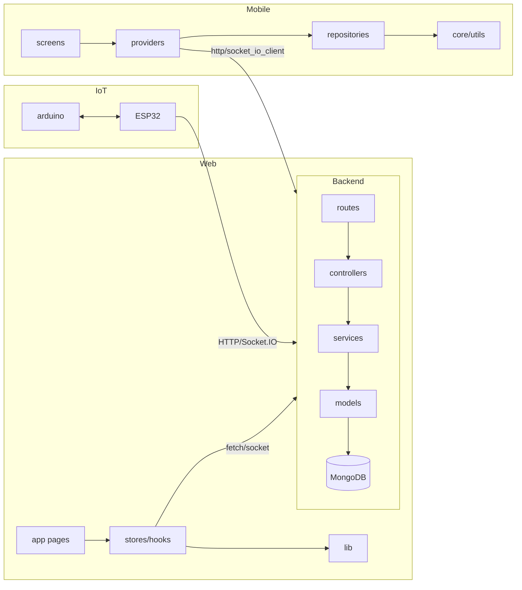

## 16.3 Authentication Flow (sequence)
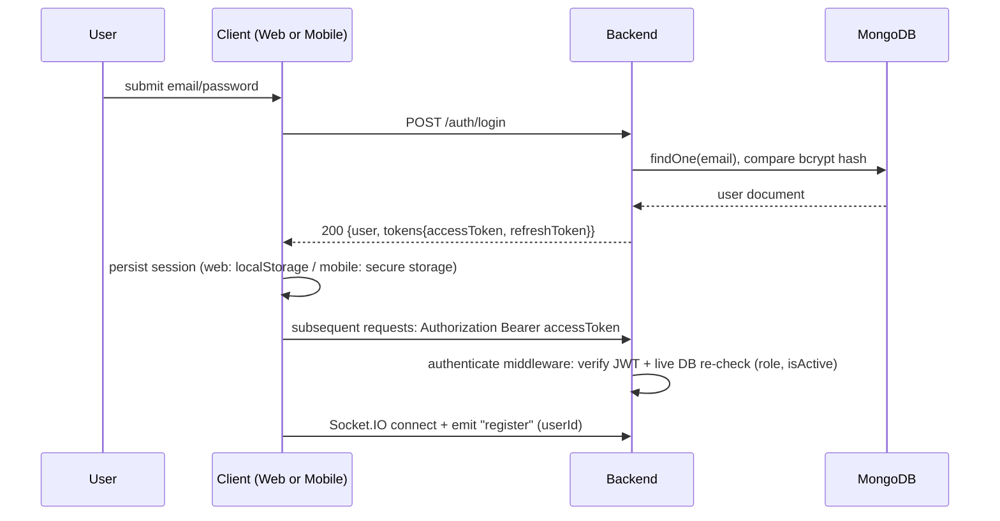

## 16.4 Order Workflow (state diagram)
```mermaid
stateDiagram-v2
    [*] --> pending: POST /orders (public)
    pending --> accepted: admin accepts
    pending --> rejected: admin rejects
    accepted --> processing: auto (~2s)
    accepted --> rejected: admin rejects
    processing --> delivered: auto (~2.5s), User created
    processing --> delivery-failed: email already exists (race)
    processing --> rejected: admin rejects
    delivered --> [*]
    rejected --> [*]
    delivery-failed --> [*]
```

## 16.5 RFID Workflow
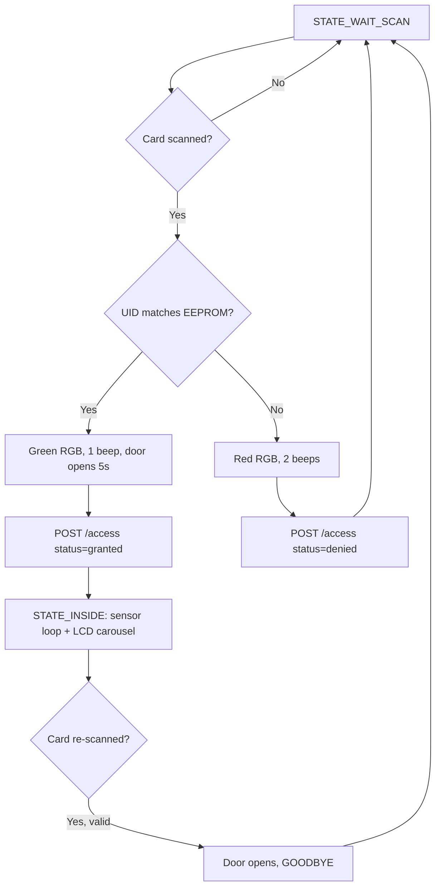

## 16.6 Sensor / Emergency Workflow (sequence)
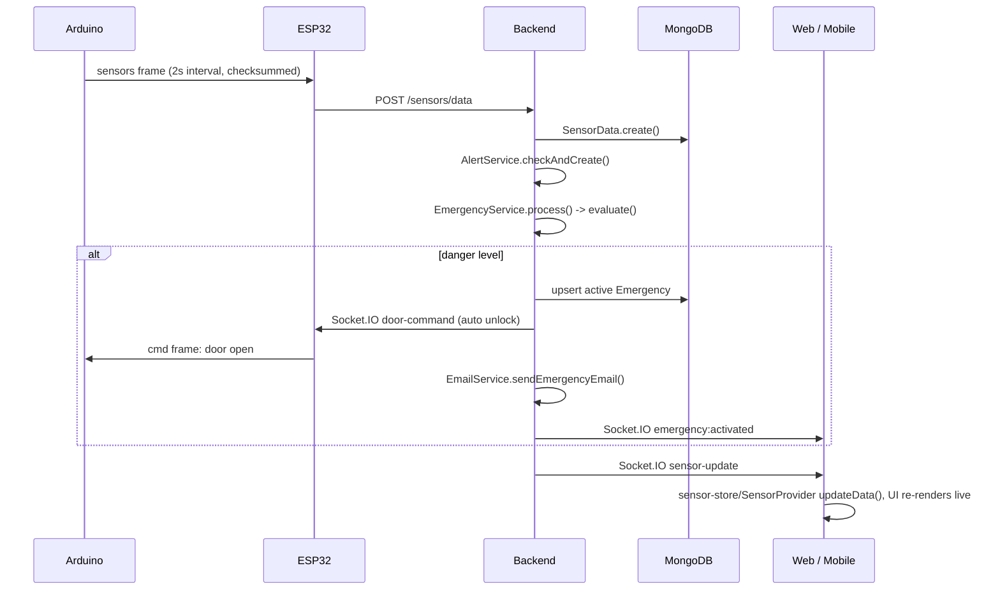

## 16.7 Bidirectional Communication Flow
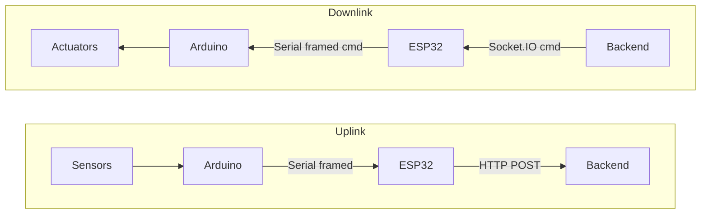

## 16.8 Database Relations (ER diagram)
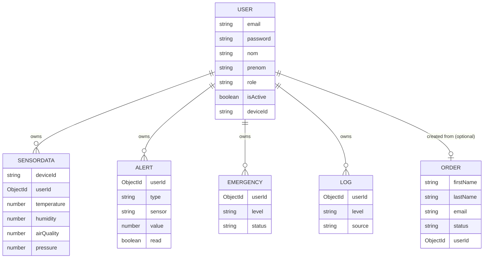

## 16.9 Backend Architecture
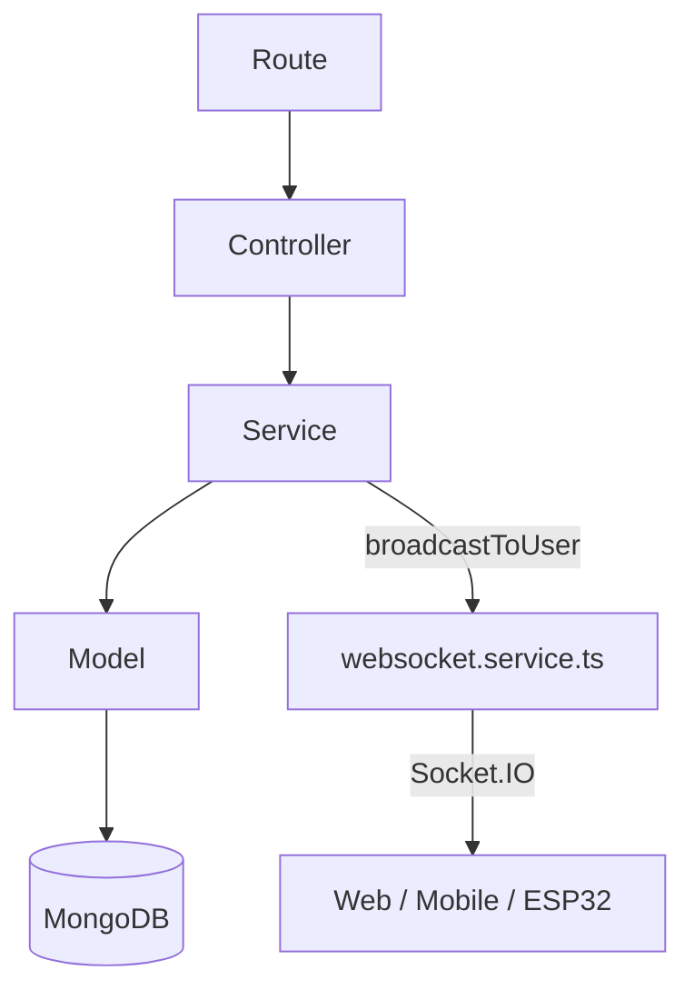

## 16.10 Web Architecture
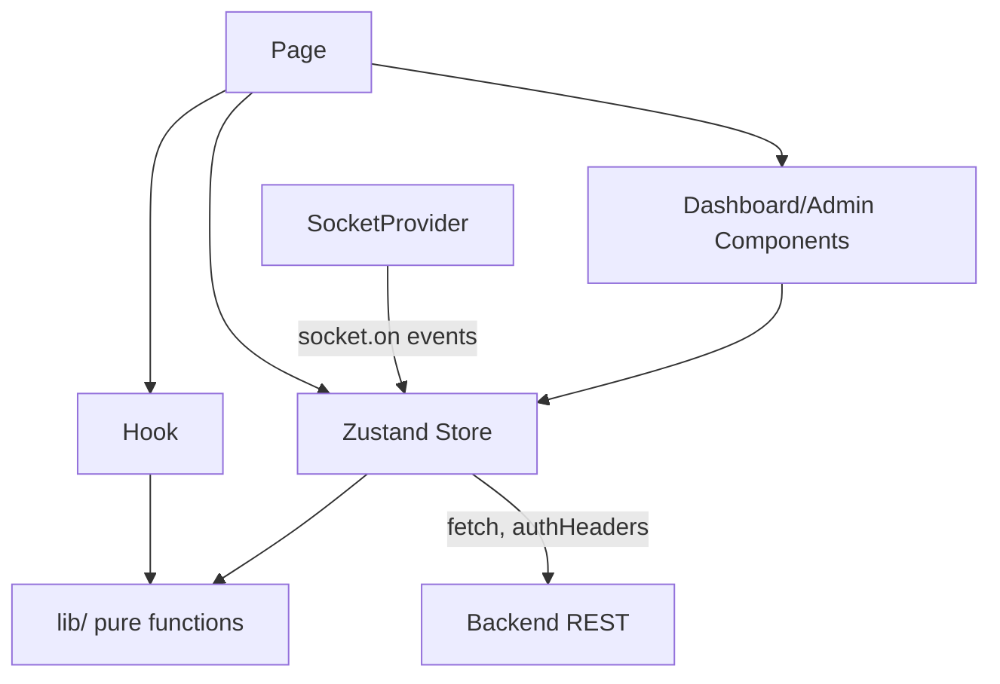

## 16.11 Mobile Architecture
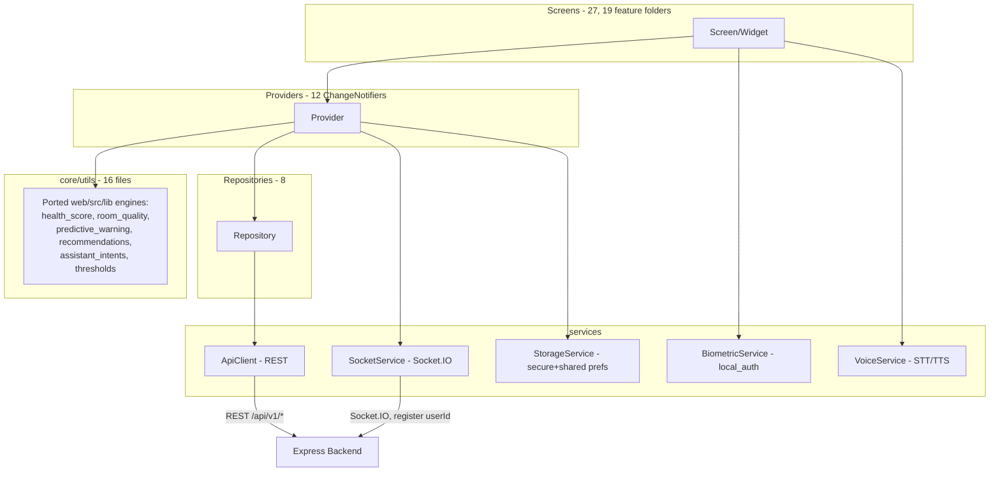

## 16.12 Mobile App Navigation / Auth Gating
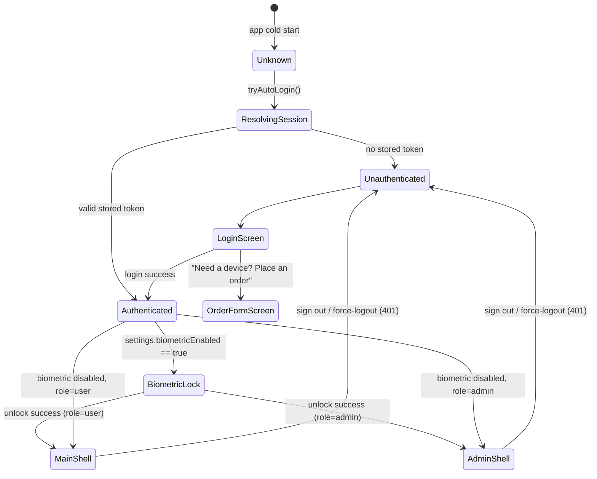

## 16.13 Arduino — Full State Machine (19 states)
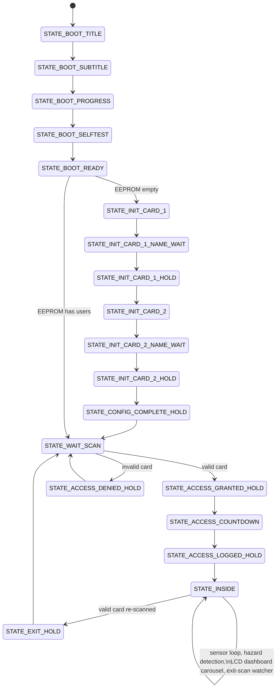

## 16.14 ESP32 Logic (simplified)
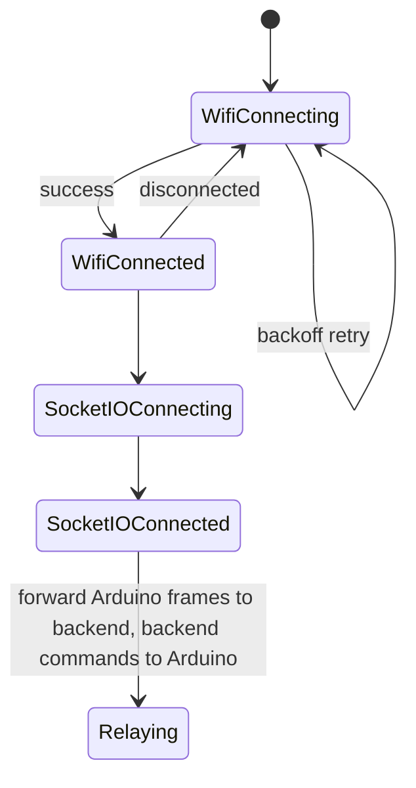

## 16.15 Socket.IO Communication (all clients)
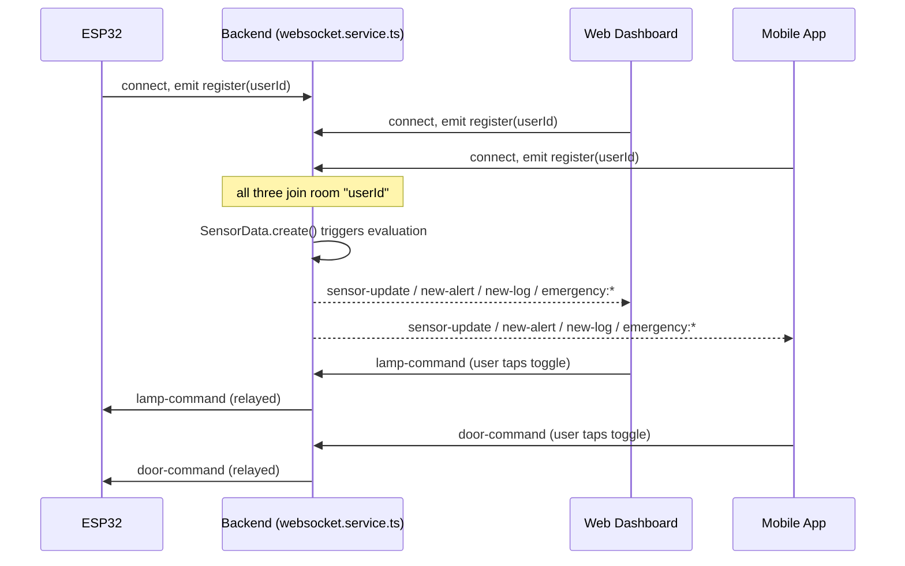

## 16.16 Emergency Workflow (standalone state diagram)
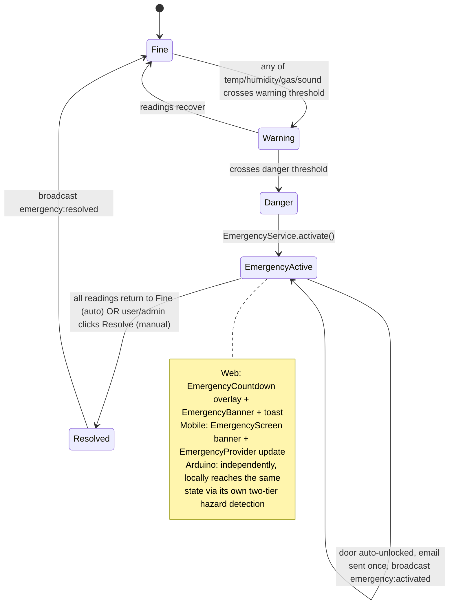

## 16.17 Deployment Architecture
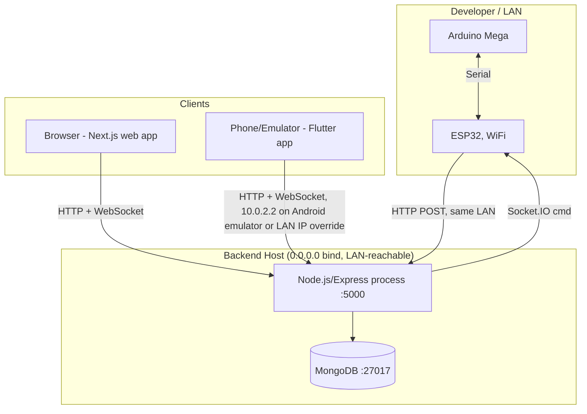

## 16.18 Network Architecture
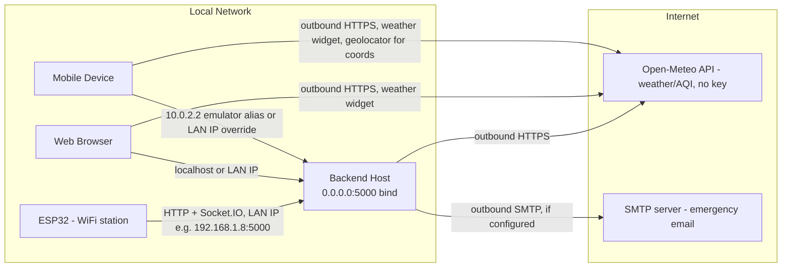

## 16.19 Sensor Data Pipeline (single ingest, full fan-out)
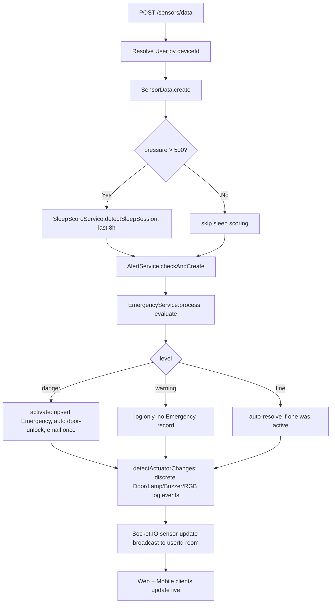

## 16.20 AI Assistant Workflow (deterministic, both clients)
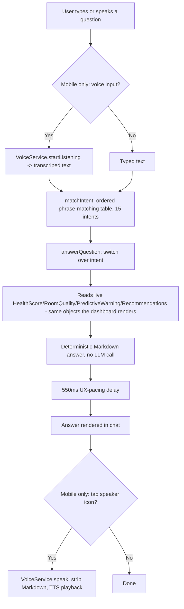

## 16.21 Sleep Analysis Flow
```mermaid
flowchart TD
    A[SensorData ingest: pressure > 500, i.e. occupied] --> B[Pull last 8h of user's SensorData]
    B --> C{>= 6 occupied samples?}
    C -->|No| D[return null - no session detected]
    C -->|Yes| E[duration = minutes first-to-last occupied sample]
    E --> F[interruptions = count of occupied samples with motion=true]
    F --> G[environmentScore = avg of temp/humidity/noise/air sub-scores]
    G --> H["score = round(durationScore*0.35 + continuityScore*0.35 + environmentScore*0.30)"]
    H --> I[Persisted onto the SensorData document]
    I --> J[Rendered on Web Dashboard sleep card and Mobile Room/Dashboard screens identically]
```

---

# 17. Required Images

Never generate images — insert real screenshots/photos at each placeholder below. **Two real screenshots already exist in the repository** at `PFE/ProjectImages/` (`HomePageImage.png`, `ProductPageImage.png`) — reuse those directly for Figures 17.1 and 17.2 rather than recapturing them.

## Figure 17.1 – Public Home Page
Insert here: `ProjectImages/HomePageImage.png` (already captured).
Purpose: Illustrates the marketing hero, feature grid, and navigation of the public landing page.

## Figure 17.2 – Product Page
Insert here: `ProjectImages/ProductPageImage.png` (already captured).
Purpose: Illustrates the product description and public order form entry point.

## Figure 17.3 – Login Page
Insert here a screenshot showing: floating-label email/password fields, password-strength indicator area, error/shake state if capturable.
Purpose: Illustrates the authentication entry point and its UX details.

## Figure 17.4 – Register Page
Insert here a screenshot of the registration form with the live password-strength meter.
Purpose: Illustrates self-service account creation.

## Figure 17.5 – Dashboard Main Page (Day Mode)
Insert here a screenshot showing: live sensor grid, Bed/Lamp cards, quick actions, greeting header, day-theme background.
Purpose: Illustrates the primary authenticated user experience under daytime ambient theming.

## Figure 17.6 – Dashboard Main Page (Night Mode)
Insert here the same page captured at night (or with the Settings theme-override forced to "Night").
Purpose: Demonstrates the day/night ambient theme system driven by the real light sensor.

## Figure 17.7 – Health Score / Room Quality / Weather Widgets
Insert here close-up screenshots of these three dashboard cards.
Purpose: Illustrates the computed intelligence layer feeding both the dashboard display and the AI assistant.

## Figure 17.8 – Emergency Banner and Fullscreen Countdown
Insert here a screenshot captured during an active emergency (real or via `/emergencies/test-trigger`).
Purpose: Illustrates the real-time safety UI response to a danger-level reading.

## Figure 17.9 – AI Assistant Chat
Insert here a screenshot of a real answered question (e.g. "Why is my health score low?").
Purpose: Demonstrates the deterministic, data-grounded assistant in use.

## Figure 17.10 – Analytics Page with Charts and PDF Export
Insert here a screenshot showing a trend chart and the PDF/PNG export controls.
Purpose: Illustrates historical analysis and reporting capability.

## Figure 17.11 – Room Map
Insert here a screenshot of the 9-node interactive floor plan with a node detail dialog open.
Purpose: Illustrates the spatial/room-state visualization feature.

## Figure 17.12 – Remote Control Page
Insert here a screenshot of the lamp/door/buzzer toggles and RGB preset picker.
Purpose: Illustrates bidirectional actuator control from the dashboard.

## Figure 17.13 – Settings Page
Insert here a screenshot covering the Preferences and App Settings sections.
Purpose: Illustrates user-configurable options (theme, units, notifications, demo/tour controls).

## Figure 17.14 – Admin Dashboard (Users + Orders sections)
Insert here a screenshot of `/admin` showing stat cards and the user/order tables.
Purpose: Illustrates the administrator back-office.

## Figure 17.15 – Admin User Modal / Order Detail Modal
Insert here a screenshot of the create/edit-user modal or the order detail modal.
Purpose: Illustrates the admin CRUD interaction pattern.

## Figure 17.16 – Arduino LCD: Boot Self-Test Sequence
Insert here a photo of the physical LCD showing the 12-item self-test in progress.
Purpose: Illustrates embedded firmware boot diagnostics.

## Figure 17.17 – Arduino LCD: Occupied Dashboard Carousel
Insert here a photo of the LCD cycling through its 13 rotating pages while the room is occupied.
Purpose: Illustrates the on-device information display independent of any network connection.

## Figure 17.18 – Physical Hardware Setup
Insert here a photo of the assembled Arduino Mega + ESP32 + sensors + actuators wired on a breadboard/enclosure.
Purpose: Grounds the software architecture in the real physical build for the jury.

## Figure 17.19 – Mobile: Login Screen
Insert here a screenshot showing the "Need a device? Place an order" link visible.
Purpose: Illustrates the mobile entry point to the same order-to-account pipeline as web.

## Figure 17.20 – Mobile: Home + Dashboard Tabs (Day/Night)
Insert here two screenshots (day and night mode) of the mobile Home/Dashboard tabs.
Purpose: Demonstrates cross-client theme parity.

## Figure 17.21 – Mobile: Room Screen with Remote Control Sheet
Insert here a screenshot of the bottom sheet open with actuator toggles visible.
Purpose: Illustrates the mobile remote-control surface.

## Figure 17.22 – Mobile: AI Assistant Screen (Voice)
Insert here a screenshot mid-conversation with the microphone button visible.
Purpose: Highlights the mobile-only voice interaction feature.

## Figure 17.23 – Mobile: Biometric Unlock Prompt
Insert here a screenshot of the fingerprint/Face ID prompt.
Purpose: Illustrates the mobile-only biometric app-lock layer.

## Figure 17.24 – Mobile: Health Report PDF Preview + Native Share Sheet
Insert here a screenshot of the in-app PDF preview and the OS share sheet.
Purpose: Contrasts mobile's native delivery mechanism against web's browser download.

## Figure 17.25 – Mobile: Admin Shell (Orders + Users Tabs)
Insert here two screenshots of the AdminShell's Orders and Users tabs.
Purpose: Demonstrates admin feature parity on mobile.

## Figure 17.26 – Mobile vs. Web Side-by-Side Comparison
Insert here a composited image of the same screen (e.g. Dashboard or Remote Control) captured on both clients simultaneously showing the same live data.
Purpose: Visually anchors the cross-client feature-parity and shared-real-time-backend claims (§8.13) for the jury.

## Figure 17.27 – Wiring Diagram
Insert here a Fritzing-style (or hand-drawn) wiring diagram redrawn from the pin table in §9.1.1.
Purpose: Gives the jury a single-glance hardware reference distinct from the pin table.

---

# 18. Tables

Consolidated technical tables not fully reproduced elsewhere (see also: Technology table in §4, Sensor/Threshold tables in §9, API table in §13, Database table in §12).

## 18.1 Complete Backend Dependencies

| Package | Version | Type |
|---|---|---|
| express | ^4.18.3 | dependency |
| mongoose | ^8.2.0 | dependency |
| socket.io | ^4.8.3 | dependency |
| jsonwebtoken | ^9.0.2 | dependency |
| bcryptjs | ^2.4.3 | dependency |
| zod | ^3.22.4 | dependency |
| winston | ^3.11.0 | dependency |
| nodemailer | ^9.0.3 | dependency |
| helmet | ^7.1.0 | dependency |
| compression | ^1.7.4 | dependency |
| cors | ^2.8.5 | dependency |
| morgan | ^1.10.0 | dependency |
| dotenv | ^16.4.5 | dependency |
| express-rate-limit | ^7.2.0 | dependency (**installed, unused**) |
| typescript | ^5.3.3 | devDependency |
| tsx | ^4.7.1 | devDependency |
| nodemon | ^3.1.0 | devDependency |
| rimraf | ^5.0.5 | devDependency |

## 18.2 Complete Web Dependencies

| Package | Version | Notes |
|---|---|---|
| next | 16.1.6 | App Router framework |
| react / react-dom | 19.2.3 | UI library |
| zustand | ^5.0.14 | State management |
| socket.io-client | ^4.8.3 | Real-time transport |
| chart.js / react-chartjs-2 / chartjs-plugin-zoom | ^4.5.1 / ^5.3.1 / ^2.2.0 | Analytics charts |
| jspdf / jspdf-autotable | ^4.2.1 / ^5.0.8 | PDF report generation |
| framer-motion | ^12.42.2 | Animation |
| gsap | ^3.15.0 | Animation (installed; usage not confirmed in the audit — see §19) |
| axios | ^1.13.5 | Installed, **unused** (all stores use raw `fetch()`) |
| next-auth | ^4.24.13 | Installed; **actual auth is a hand-rolled JWT flow, not next-auth** — verify before citing (§20) |
| shadcn | ^4.13.0 | Installed; component-generation CLI, not a runtime dependency in the traditional sense |
| lucide-react | ^0.564.0 | Icon set |
| @base-ui/react | ^1.6.0 | Headless UI primitives |
| next-themes | ^0.4.6 | Installed; project's own admin theme is a custom Zustand slice, not next-themes — see §5.3 discrepancy note in source audit |
| tailwindcss | ^4 | Utility-first styling |
| typescript | ^5 | Language |
| eslint / eslint-config-next | ^9.39.4 / ^16.2.10 | Linting |

## 18.3 Complete Mobile Dependencies

| Package | Version | Purpose |
|---|---|---|
| provider | ^6.1.2 | State management |
| http | ^1.2.2 | REST client |
| socket_io_client | ^3.0.2 | Real-time transport |
| flutter_secure_storage | ^9.2.2 | Encrypted token storage |
| shared_preferences | ^2.3.3 | Non-sensitive local persistence |
| local_auth | ^2.3.0 | Biometric app-lock |
| speech_to_text | ^7.0.0 | Voice input for AI assistant |
| flutter_tts | ^4.2.0 | Voice output for AI assistant |
| fl_chart | ^0.69.2 | Analytics charts |
| pdf | ^3.11.1 | PDF generation |
| printing | ^5.13.4 | PDF preview + native share |
| share_plus | ^10.1.4 | Native OS share sheet |
| geolocator | ^13.0.2 | Weather coordinates |
| flutter_animate | ^4.5.2 | Animation |
| shimmer | ^3.0.0 | Loading placeholders |
| package_info_plus | ^8.1.2 | App version/build info |
| path_provider | ^2.1.5 | Filesystem paths (PDF storage) |
| intl | ^0.20.2 | Date/number formatting |
| cupertino_icons | ^1.0.8 | iOS-style icons |
| flutter_lints | ^6.0.0 | devDependency — linting |

## 18.4 Hardware Component Inventory

| Component | Model/Type | Role |
|---|---|---|
| Microcontroller (main) | Arduino Mega 2560 | Owns all sensors/actuators, local safety logic |
| Microcontroller (gateway) | ESP32 | WiFi + Socket.IO + HTTP gateway |
| Temperature/Humidity sensor | DHT11 | Environmental monitoring |
| Gas sensor | MQ series (generic "MQ Gas Sensor") | Air quality / hazardous gas |
| Bed pressure sensor | FSR (Force-Sensitive Resistor) | Occupancy / sleep detection |
| Light sensor | LDR (photoresistor) | Day/night detection |
| Sound sensor | Digital sound sensor module | Noise detection (digital 0/1 only) |
| RFID reader | MFRC522 (RC522) | Access control |
| Real-time clock | DS1302 | Date/time keeping |
| Display | LCD 1602 I2C (addr `0x27`) | On-device status/dashboard display |
| Door actuator | SG90 servo motor | Physical door lock/unlock |
| Status indicator | RGB LED (common cathode) | Visual system-state indicator |
| Audible alert | Passive buzzer | Access feedback + alarm |
| Lamp control | Relay module | Remote-controlled room lamp |
| Link-status indicator | Single LED (status LED) | ESP32-link health indicator |

## 18.5 User Roles Summary

| Role | Self-registerable? | Admin API access | Device control scope |
|---|---|---|---|
| `user` | Yes (`POST /auth/register`) | No | Own paired device only |
| `admin` | No (seeded at boot or created by another admin) | Full (`/api/v1/admin/*`) | Any device (override) |

## 18.6 System Modules Summary

| Module | Web | Mobile | Backend surface |
|---|---|---|---|
| Auth | ✅ | ✅ | `/api/v1/auth/*` |
| Live Sensors/History | ✅ | ✅ | `/api/v1/sensors/*` |
| Remote Control | ✅ | ✅ | `/api/v1/sensors/{lamp,door,buzzer}/toggle`, `/rgb` |
| Alerts | ✅ | ✅ | `/api/v1/alerts/*` |
| Emergency | ✅ (+ test-trigger) | ✅ | `/api/v1/emergencies/*` |
| Analytics | ✅ | ✅ | `/api/v1/sensors/history` + client-side computation |
| Occupancy (dedicated page) | ✅ | ❌ | Same data, no dedicated mobile screen |
| AI Assistant | ✅ | ✅ (+ voice) | Client-side only, no backend endpoint |
| Admin — Users | ✅ | ✅ | `/api/v1/admin/users*` |
| Admin — Orders | ✅ | ✅ | `/api/v1/admin/orders*` |
| Admin — Devices/System sensors | ✅ | ❌ | `/api/v1/admin/devices`, `/api/v1/admin/sensors/latest` |
| Orders (public) | ✅ | ✅ | `/api/v1/orders` |
| Connection Diagnostics | ✅ | ❌ | `/api/v1/status` |
| Demo Mode / Guided Tour | ✅ | ❌ | Client-side simulation only |
| Biometric App-Lock | ❌ | ✅ | Client-side only |
| PWA | ✅ | n/a | Manifest + service worker |

---

# 19. Missing Information

The following items could not be confirmed from the repository and should not be assumed when writing the thesis:

1. **Thesis metadata**: university/institution name, department, supervisor name(s), jury members, defense date, author's full name, academic year — none of this exists in the repository (it is a code repository, not a thesis document).
2. **`next-auth` and `shadcn` actual usage**: both appear as dependencies in `web/package.json`, but the code-verified audit (`allproject.md`) describes the actual auth flow as a hand-rolled JWT system via `authStore`/`lib/api.ts`, and does not mention `next-auth` or `shadcn` usage anywhere. Whether these are genuinely wired in, partially used, or fully dead dependencies was not directly re-verified against `web/src/` source in this pass.
3. **`gsap` actual usage**: listed as an installed web dependency; the audit does not confirm where (if anywhere) it is actually used versus `framer-motion`.
4. **Exact `/dashboard/*` route slugs**: the audit confirms "11 authenticated user-facing routes" and names most of them from feature descriptions, but a literal file-by-file listing of `web/src/app/dashboard/*/page.tsx` was not exhaustively re-verified in this pass — treat the route names in §7.1 as accurate in substance but confirm exact URL slugs against the running app or source tree before citing them in a screenshots/navigation chapter.
5. **Hardware Bill of Materials (BOM) with costs**: no pricing/sourcing information for any sensor/actuator/board exists in the repository.
6. **Physical enclosure/room design**: no information about the physical room setup, enclosure, or mounting exists in the repository (software/firmware only).
7. **Deployment/hosting plan**: no Docker files, CI/CD pipeline configuration, or cloud deployment documentation exists — the project currently runs LAN-locally (backend bound to `0.0.0.0:5000`, MongoDB on `localhost:27017`).
8. **User acceptance testing / evaluation data**: no user study, survey, or usability-testing results exist in the repository.
9. **Performance benchmarks**: no load-testing results, latency measurements, or throughput figures exist for the backend/Socket.IO layer.
10. **License**: no `LICENSE` file was observed at the repository root during this pass; the backend `package.json` declares `"license": "MIT"` for that sub-package only — the project's overall licensing status is unconfirmed.
11. **`admin-improvement-plan.md` and `project-tree.txt`**: referenced by name inside `allproject.md`'s historical project-structure notes as "partially stale" project documents, but neither file exists in the current repository — they may have been removed or never committed.
12. **Automated test coverage**: confirmed to be effectively zero (`backend/scripts/simulate-esp32.ts` is a manual integration aid, not a test suite; `mobile/test/widget_test.dart` is one smoke test) — this is a confirmed fact, not a gap, but no test *plan* or QA process documentation exists beyond this.
13. **Git/version-control history**: no commit history, issue tracker, or sprint records were examined as part of this analysis (this file's source material is a point-in-time code audit, not a repository-history mining), so no real sprint/ticket timeline can be cited — §17.7-equivalent Agile framing must be presented as a suggested structure, not a historical record.
14. **Screenshots**: only 2 real screenshots exist in the repository (`ProjectImages/HomePageImage.png`, `ProjectImages/ProductPageImage.png`); all other figures listed in §17 require a live capture session against the running app/hardware.

---

# 20. Questions Remaining

1. What is the university/institution name, department, and formal thesis title to use on the cover page?
2. Who are the supervisor(s) and jury members to credit/acknowledge?
3. What is the target defense date, and is there a required page-count or chapter-count breakdown within the 80–120 page range?
4. What language is the thesis required to be written in (French is common for this style of Moroccan/francophone PFE template given the project's French-language field names like `nom`/`prenom`/`servo: "ouvert"/"fermé"`/`lightStatus: "jour"/"nuit"` — please confirm)?
5. Is a specific citation style required (IEEE, APA, or an institution-specific format)?
6. Can the ~25 screenshots listed in §17's checklist be captured from the live running app/hardware before thesis writing begins, or should placeholders remain in the delivered draft?
7. Is the physical hardware (Arduino Mega + ESP32 + sensors) currently assembled and available for photos, or has it been disassembled?
8. Should the thesis present the project as solo work or a team project, and if a team, what are the contributor names/roles to credit?
9. Is there a required institutional thesis template (LaTeX class, Word template, specific cover-page format) to follow?
10. Should `next-auth` and `shadcn` (installed but not confirmed as actively used per §19.2) be investigated further before writing the Technology Stack chapter, or should the thesis simply describe the auth system as implemented (hand-rolled JWT) and omit these as unconfirmed?
11. Is there a preferred framing for the "Agile/SCRUM" methodology chapter given no real sprint/ticket history exists — should it be presented as a retrospective feature-epic narrative (as suggested in the source audit), omitted entirely, or replaced with a different methodology (e.g., a straightforward V-model/waterfall narrative)?
12. Should the thesis include a cost/Bill-of-Materials table for the hardware, and if so, can approximate component costs be supplied?
13. Is deployment/hosting intended to remain LAN-local for the demo, or is a cloud-deployment story (and its associated architecture diagram) expected as part of the thesis's own proposed future work?
14. Should the "AI Assistant" chapter explicitly compare the deterministic rule-engine approach against an LLM-based alternative (cost/latency/safety trade-offs), or simply describe what was built?
15. Are there any non-repository artifacts (a project poster, an existing presentation deck, a prior report draft) that should be reconciled with this document?
16. Should mobile-only features (biometric lock, voice assistant) receive dedicated sub-chapters of comparable depth to web features, or be folded into a single "Mobile Application" chapter as a parity discussion?
17. Is there a target thesis structure/table of contents already mandated by the institution that this content should be mapped onto, or is chapter structuring left to the author (informed by §17's suggested structure in the source audit)?
18. Should known limitations (no rate limiting, no refresh-token endpoint, Order schema enum gap, Socket.IO CORS wildcard) be disclosed prominently in a "Limitations" chapter (recommended per the source audit's defense notes) or minimized?
19. Is a demonstration video or live demo planned for the defense, and should the thesis include a shot-by-shot demonstration script (a draft already exists in the source audit and can be adapted)?
20. Should this document's approximate database document counts (§12.1, derived from the `database/*.json` exports present in the repo) be presented in the thesis as "sample/test data collected during development," or is a fresh, larger dataset expected to be captured before submission?
