# Smart Health Room — Complete Technical Documentation

> Generated by full source-code analysis on 2026-07-20, **re-verified and extended on 2026-07-22** to incorporate the Flutter mobile application added since the first pass. Every technical claim in this document is traceable to the actual code in this repository (`backend/`, `web/`, `iot/`, `mobile/`) as it exists today — not to the project's README/architecture notes, which in places describe an earlier or aspirational state. This file is the single source another writer (human or AI) needs to produce a complete Graduation Project (PFE) report without reopening the source code.
>
> **2026-07-22 update note**: `backend/`, `web/`, and `iot/` were spot-verified against this document's existing claims (controller/service/model/route counts, firmware line counts, page/store/hook counts) and found unchanged. The entire `mobile/` Flutter application — previously an empty placeholder directory — now exists (128 Dart files) and is documented throughout this revision from a full re-read of its source.

---

# 1. GENERAL INFORMATION

## 1.1 Project Name
**Smart Health Room**

## 1.2 Project Description
Smart Health Room is a full-stack IoT healthcare-monitoring platform for a single connected room. An Arduino Mega 2560 reads all physical sensors and drives all local actuators (RFID door lock, LCD, RGB status light, buzzer, lamp); an ESP32 acts as a pure WiFi/network gateway between the Arduino and a Node.js/Express/MongoDB backend; the backend applies all business logic (alerting, emergency detection, sleep scoring, logging, user/order management) and exposes both a REST API and a Socket.IO real-time channel; a Next.js 16 web application and a Flutter mobile application both consume the same backend to provide a live dashboard, an admin back-office, and a deterministic rule-based "AI" health assistant. The Flutter app (`mobile/`, 128 Dart files) is a full native client — not a stripped-down companion app — reimplementing nearly every web feature (live sensors, remote control, analytics, PDF health report, admin back-office, AI assistant) against the exact same `/api/v1/*` REST and Socket.IO surface, with no new backend endpoints introduced for it. It adds a small number of genuinely mobile-native capabilities the web app has no equivalent for: biometric app-lock, voice input/output for the AI assistant, and native PDF sharing.

## 1.3 Project Objectives
- Continuously monitor a room's environmental conditions: temperature, humidity, air quality (gas), light level, sound.
- Detect and log room-occupancy/bed-presence and compute a sleep quality score.
- Secure physical access with RFID authentication and an automatically-actuated door.
- Detect dangerous conditions automatically and raise a two-tier (warning/danger) alert and emergency response, including autonomous physical response (open the door, alarm) at the hardware level, independent of network connectivity.
- Present all of the above in real time on a modern, responsive web dashboard, with historical trends, analytics, and PDF reporting.
- Provide a self-service account/order/administration system for provisioning new rooms/users.
- Give the end user natural-language access to their own data through a fully deterministic (non-LLM) "AI Assistant" grounded only in real sensor data.

## 1.4 Problem Addressed
Manually monitoring a room occupant's environment and safety (temperature/gas/humidity extremes, unauthorized access, prolonged inactivity) is unreliable and non-continuous. Smart Health Room automates this monitoring end-to-end — from raw sensor voltage to a real-time, explainable dashboard alert — while keeping a physical safety response (door unlock, alarm) working even if the network or backend is unreachable, because the Arduino evaluates its own two-tier hazard thresholds locally.

## 1.5 Target Users
- **Room occupant / patient / end user** — views their own room's live status, history, alerts, and can remote-control actuators from the dashboard (`role: "user"`).
- **Administrator** — manages user accounts, device pairing, order fulfillment, and system-wide monitoring across every registered room (`role: "admin"`). Exactly these two roles exist in the system; no other role (e.g. "doctor", "caregiver") is implemented despite being mentioned as a future idea in project notes.

## 1.6 Main Features
See the dedicated **FEATURES** section (§12) for the exhaustive, module-grouped list. In summary: live IoT monitoring (5 sensors + occupancy), RFID security with an autonomous door/alarm response, a Smart Health Score and Room Quality Index, predictive (trend-based) early warnings, a rule-based AI health assistant with chat, an emergency subsystem (auto door-unlock, email notification, audit trail), self-service registration and a public order-to-account pipeline, an admin back-office with full user/order management, analytics with PDF/PNG export, a day/night-reactive animated dashboard background, a guided onboarding tour, a scripted demo mode, and PWA installability on web — and, on the native Flutter mobile app, the same live monitoring/remote-control/analytics/AI-assistant/admin feature set plus biometric app-lock and voice-driven assistant interaction.

## 1.7 Innovation
- **Two independent, redundant safety layers**: the Arduino Mega evaluates its own hazard thresholds and reacts physically (opens the door, alarms) without waiting for any network round-trip; the backend independently re-evaluates the same raw readings for its own emergency/alert/email pipeline. Either layer alone is sufficient to protect the occupant.
- **A genuinely explainable "AI" assistant**: every answer the chat assistant gives is generated by a deterministic rule engine reading the exact same Health Score / Room Quality / Predictive Warning / Recommendation computations the rest of the dashboard already displays — there is no LLM call, no hallucination risk, and every number quoted in an answer is traceable to a live sensor reading and a named threshold.
- **A single merged real-time event model** (`useUnifiedEvents`) that feeds three different UI surfaces (Live Event Center, Timeline, and — filtered — the Logs page) from one source of truth, so no event categorization logic is duplicated across the frontend.
- **A fully non-blocking, watchdog-safe embedded firmware** (both boards) with EEPROM-persisted RFID enrollment, a 12-item self-test at boot, sensor-fault-streak detection, checksummed framed serial protocol with sequence-based duplicate detection between the two boards, and exponential-backoff reconnection on both WiFi and Socket.IO.

## 1.8 Technologies

| Layer | Technologies |
|---|---|
| Backend | Node.js, Express 4, TypeScript (ESM), Mongoose 8 / MongoDB, Socket.IO 4, JWT (`jsonwebtoken`), `bcryptjs`, Zod, Winston, Nodemailer, `helmet`, `compression`, `cors`, `morgan` |
| Web Frontend | Next.js 16 (App Router), React 19, TypeScript, Tailwind CSS v4, Zustand 5, Framer Motion, Chart.js + `react-chartjs-2` + `chartjs-plugin-zoom`, `jspdf` + `jspdf-autotable`, `socket.io-client`, `lucide-react`, `@base-ui/react`, `next-themes`, `axios` (installed, effectively unused — see §5.11), GSAP (installed) |
| Mobile | Flutter (Dart, SDK `^3.11.0`), `provider` (state management), `http` (REST client), `socket_io_client`, `flutter_secure_storage` + `shared_preferences` (persistence), `local_auth` (biometrics), `speech_to_text` + `flutter_tts` (voice AI assistant), `fl_chart` (analytics charts), `pdf` + `printing` (Health Report generation/share), `geolocator` (weather coordinates), `flutter_animate`, `shimmer`, `share_plus`, `package_info_plus` |
| IoT — Arduino Mega 2560 | C++ (Arduino core), libraries: `MFRC522` (RFID), `LiquidCrystal_I2C`, `DHT`, `RtcDS1302`/`ThreeWire`, `Servo`, `ArduinoJson`, `EEPROM`, AVR watchdog (`avr/wdt.h`) |
| IoT — ESP32 | C++ (Arduino core for ESP32), libraries: `WiFi`, `HTTPClient`, `ArduinoJson`, `WebSocketsClient`, `SocketIOclient`, `esp_task_wdt` |
| Database | MongoDB (via Mongoose ODM) |
| Auth | JWT (access + refresh tokens minted; no refresh endpoint currently exposed — see Discrepancies), bcrypt password hashing (12 rounds) |

## 1.9 Project Structure (top level)
```
projet-IOT-main/
├── backend/     — Express + MongoDB REST/Socket.IO API
├── web/         — Next.js 16 web application
├── iot/
│   ├── arduino/ — Arduino Mega 2560 firmware (canonical)
│   └── esp32/   — ESP32 gateway firmware (canonical)
├── mobile/      — Flutter mobile application (Provider state mgmt, 128 Dart files, full feature parity with web)
├── README.md, architecture.md, admin-improvement-plan.md, project-tree.txt — project notes (partially stale; not authoritative over source code)
```

## 1.10 Architecture Overview
Layered, single-direction data flow with a real-time side channel:

```
Sensors → Arduino Mega (local logic + actuation) → Serial (framed/checksummed) → ESP32 (WiFi gateway, no business logic)
        → HTTP POST (REST) → Express Backend (Route → Controller → Service → Model) → MongoDB
        → Socket.IO broadcast → Web Dashboard (Zustand stores) → React UI
                              → Flutter Mobile App (Provider ChangeNotifiers) → Widget UI
```
The backend also pushes Socket.IO commands back down to the ESP32 → Arduino for remote actuator control and emergency activation, closing the loop in the opposite direction. The Flutter app is a peer real-time client to the web dashboard, not a downstream consumer of it — both connect independently to the same Socket.IO server and register the same `userId` room (§9.4), so either client can trigger `lamp-command`/`door-command`/`buzzer-command`/`rgb-command` and both see the result live.

## 1.11 Development Methodology
The codebase enforces (and largely follows) a strict layered convention documented in the repository's own `README.md`: **Route → Controller → Service → Model**, "never put business logic in a controller or route," "reuse existing services," one collection = one model. The frontend mirrors this with **Page → Store (or Hook) → REST/Socket.IO → Backend**, and a "never duplicate business logic" rule that is followed closely (e.g. `RecommendationsPanel` and `SmartSuggestionsPanel` both read the *same* `generateInsights()` call rather than each re-deriving insights). The mobile app applies the identical discipline under different names — **Screen → Provider → Repository → `ApiClient`/`SocketService` → Backend** — and, tellingly, its own pure-logic layer (`lib/core/utils/*.dart`: `health_score.dart`, `room_quality.dart`, `predictive_warning.dart`, `recommendations.dart`, `assistant_intents.dart`, `thresholds.dart`) is a line-for-line Dart port of the web app's `lib/*.ts` scoring/rule engines, not an independent reimplementation — the project's own code comments say so explicitly (e.g. `thresholds.dart`: "Ported verbatim from `web/src/lib/thresholds.ts`"). See §16 (REPORT_RESOURCES) for a suggested Agile/SCRUM framing of this build for the report itself — the actual repository contains no issue tracker or sprint artifacts, so that section is a *suggested* structure, not a record of real ceremonies.

---

# 2. FULL DIRECTORY STRUCTURE

```
backend/
├── .env                          # local secrets (JWT keys, Mongo URI, SMTP, admin seed) — not committed content, present locally
├── package.json                  # dependencies/scripts (dev: tsx watch, build: tsc)
├── scripts/simulate-esp32.ts     # standalone script that POSTs synthetic sensor payloads for local testing
├── src/
│   ├── app.ts                    # Express app entry point: middleware stack, /health, startServer()
│   ├── config/
│   │   ├── database.ts           # Mongoose connect/disconnect
│   │   ├── env.ts                # Zod-validated environment variables (single source of truth)
│   │   └── thresholds.ts         # THRESHOLDS map + levelFor() — single source of truth for alert/emergency levels
│   ├── controllers/               # 10 files — thin HTTP handlers, one per resource (access, admin, alert, auth, bed, emergency, log, order, profile[EMPTY], sensor, status)
│   ├── middleware/                # auth.middleware.ts (JWT), rbac.middleware.ts (role gate)
│   ├── models/                    # 6 Mongoose schemas: User, SensorData, Alert, Emergency, Log, Order
│   ├── routes/                    # 10 router files + index.ts (mounts everything under /api/v1)
│   ├── services/                  # 12 files — all business logic (see §4)
│   └── utils/                     # http.ts (shared helpers), jwt.ts, logger.ts (Winston)
└── tsconfig.json

web/
├── package.json, next.config.ts, tailwind.config.ts, eslint.config.mjs, components.json
├── public/
│   └── sw.js                     # hand-written service worker (PWA)
└── src/
    ├── app/                       # Next.js App Router
    │   ├── (marketing)/           # public Home + Product pages, shared Navbar/Footer layout
    │   ├── (auth)/                # Login + Register pages, shared centered layout
    │   ├── dashboard/             # 11 authenticated user-facing routes, shared DashboardLayout shell
    │   ├── admin/                 # 3 admin-only routes (+ role-gated layout)
    │   ├── 403/, offline/         # error/fallback pages
    │   ├── layout.tsx             # root layout: SessionGuard, ServiceWorkerRegister, SocketProvider
    │   ├── manifest.ts, icon.tsx, apple-icon.tsx  # PWA metadata/icon generation
    │   └── globals.css            # Tailwind v4 theme, day:/admin-dark: custom variants, keyframes
    ├── components/
    │   ├── admin/                 # 14 admin-panel components (tables, modals, stats, toasts)
    │   ├── dashboard/              # ~24 dashboard widgets + assistant/ (4) + background/ (5) subfolders
    │   ├── providers/              # PageTransition, ServiceWorkerRegister, SessionGuard, SocketProvider, ThemeProvider(unused)
    │   ├── ui/                     # 14 shared design-system primitives
    │   ├── navbar.tsx, footer.tsx, testimonials.tsx  # public marketing components
    ├── hooks/                      # 10 custom hooks (see §5)
    ├── lib/                        # 22 pure-logic modules — the core "business logic" of the frontend
    └── store/                      # 14 Zustand stores

iot/
├── arduino/
│   ├── arduino.ino                # 1632-line firmware: state machine, sensors, actuators, RFID, EEPROM, protocol
│   └── config.h                   # every pin/threshold/timing constant
└── esp32/
    ├── esp32.ino                  # WiFi/Socket.IO/HTTP gateway firmware
    └── config.h                   # WiFi credentials, backend host/port, endpoints, timing constants

mobile/
├── pubspec.yaml                   # dependencies (provider, socket_io_client, local_auth, speech_to_text, flutter_tts, pdf/printing, geolocator...)
├── android/, ios/, web/, test/    # standard Flutter platform folders + widget_test.dart (one smoke test)
└── lib/
    ├── main.dart                  # MultiProvider root + `_AuthGate` (session resolve → Login / MainShell / AdminShell, optional biometric gate)
    ├── core/
    │   ├── config/api_config.dart # per-platform backend host resolution (10.0.2.2 for Android emulator, LAN-IP override from Settings)
    │   ├── theme/                 # app_colors.dart, app_theme.dart, sky_theme.dart — palette ported verbatim from web's Tailwind config
    │   └── utils/                 # 16 files — Dart port of web's `lib/` scoring/rule engines (health score, room quality, predictive warning, recommendations, AI intents, thresholds, trend, timeline events...)
    ├── models/                     # 12 plain Dart data classes (User, SensorData, Alert, Emergency, Order, LogEntry, ChatMessage, Weather, NotificationItem, SearchResult, AdminUser, AdminEmergency)
    ├── providers/                  # 12 `ChangeNotifier` classes — the Provider-pattern equivalent of the web's 14 Zustand stores
    ├── repositories/               # 8 files — thin REST wrappers, one per backend resource, calling only endpoints already documented in §10
    ├── services/                   # api_client.dart, socket_service.dart, storage_service.dart, biometric_service.dart, voice_service.dart
    ├── screens/                    # 27 top-level screens across 19 feature folders (admin/, alerts/, analytics/, assistant/, auth/, dashboard/, emergency/, health_report/, home/, logs/, notifications/, orders/, profile/, room/, search/, sensors/, settings/, shell/, timeline/); 11 of the 19 also have their own widgets/ subfolder
    └── widgets/                    # 8 shared design-system primitives (glass_card, circular_gauge, shimmer_placeholder, sky_background, markdown_lite...)
```

### Responsibility of each top-level module
- **`backend/src/controllers`**: parse/validate HTTP requests, call one or more services, shape the JSON response. No direct MongoDB access, no business logic (with one historical exception already removed — see backend Discrepancies in §3).
- **`backend/src/services`**: 100% of business logic — threshold evaluation, emergency state machine, sleep scoring, order lifecycle automation, logging, email, device-liveness detection, admin operations, Socket.IO broadcasting.
- **`backend/src/models`**: Mongoose schemas only; two schemas (`User`, `Order`) carry a bcrypt pre-save hook, nothing else does.
- **`web/src/app`**: routes and layouts only — every page delegates data/logic to a store, hook, or `lib/` function.
- **`web/src/store`**: all server-state and cross-component client state (Zustand), including the sole app-wide Socket.IO event consumer wiring (`SocketProvider` dispatches into these stores).
- **`web/src/lib`**: pure, framework-agnostic functions — scoring engines, the assistant's rule engine, formatting, PDF/PNG export, weather API client, global search index builder.
- **`web/src/hooks`**: React-specific composition over stores/lib (memoized derived state, DOM listeners, browser APIs).
- **`mobile/lib/screens`**: Flutter widgets/routes only — every screen delegates data/logic to a provider or repository, mirroring `web/src/app`'s "no business logic in pages" rule.
- **`mobile/lib/providers`**: all server-state and cross-screen client state (`ChangeNotifier`), including the app's sole Socket.IO event consumer wiring — the direct Provider-pattern analogue of `web/src/store`.
- **`mobile/lib/core/utils`**: pure, framework-agnostic Dart functions — a verbatim port of `web/src/lib`'s scoring engines and assistant rule engine, not an independent implementation.
- **`mobile/lib/repositories`** / **`mobile/lib/services`**: the Flutter analogue of `web/src/lib/api.ts` + `SocketProvider` — REST/Socket.IO plumbing only, no new backend surface.
- **`iot/arduino`**: owns every sensor and actuator; the only board with physical I/O.
- **`iot/esp32`**: WiFi/Socket.IO/HTTP gateway only — explicitly carries no business logic, per project convention.

---

# 3. BACKEND

## 3.1 Architecture Overview
Node.js + Express 4 (TypeScript, ESM `type: module`), MongoDB via Mongoose 8, Socket.IO 4 for realtime, Winston for logging, Zod for env validation, JWT (`jsonwebtoken`) for auth, `bcryptjs` for hashing.

**Layering**: `routes/*.ts` → `controllers/*.ts` → `services/*.ts` → `models/*.ts`. `config/` holds env parsing, Mongo connection, and the single source of truth for alert/emergency thresholds. `utils/` holds `jwt.ts`, `logger.ts`, `http.ts` (shared `EMAIL_REGEX` + `handleError`).

**`app.ts`**: creates the Express app wrapped in a raw `http.createServer` (so Socket.IO can attach to the same server). Middleware stack, in exact order: `helmet()` → `compression()` → `cors({origin: two hardcoded localhost/LAN origins, credentials:true})` → `morgan("dev")` → `express.json()` → `express.urlencoded()`. Mounts the whole API at `/api/v1`. `GET /health` (outside `/api/v1`, no auth) returns `{status, timestamp, environment, websocket:"enabled"}`. `startServer()`: `connectDB()` → `seedAdmin()` → `initSocketIO(httpServer)` → `startDeviceWatcher()` → `httpServer.listen(PORT, "0.0.0.0", ...)` — binds all interfaces deliberately so LAN-connected ESP32 devices can reach it; logs every non-internal IPv4 interface at boot for easy device configuration.

**Known gaps** (see §3.10 Discrepancies): `express-rate-limit` is installed but never wired in — no endpoint is rate-limited. No `SIGTERM`/`SIGINT` graceful shutdown handling.

## 3.2 Environment Variables

| Var | Required | Default | Purpose |
|---|---|---|---|
| `NODE_ENV` | No | `development` | gates console log transport, echoed in `/health` |
| `PORT` | No | `5000` | HTTP server port |
| `MONGODB_URI` | No | `mongodb://localhost:27017/smart-room` | Mongoose connection string |
| `JWT_SECRET` | **Yes** | — | min 32 chars; signs/verifies access tokens |
| `JWT_REFRESH_SECRET` | **Yes** | — | min 32 chars; signs/verifies refresh tokens |
| `JWT_EXPIRES_IN` | No | `15m` | intended access-token lifetime (see §3.7 — actually unused) |
| `JWT_REFRESH_EXPIRES_IN` | No | `7d` | intended refresh-token lifetime (actually unused) |
| `SMTP_HOST`/`SMTP_PORT`/`SMTP_USER`/`SMTP_PASS` | No | port `587` | if host/user/pass unset, email is silently disabled |
| `ALERT_EMAIL_FROM` | No | falls back to `SMTP_USER` | emergency-email "From" address |
| `ADMIN_NAME`/`ADMIN_EMAIL`/`ADMIN_PASSWORD` | No (password min 8 if set) | `ADMIN_NAME` defaults `"Administrator"` | one-time admin seed at boot; skipped with a warning if unset |

## 3.3 Database Models (exhaustive) — see also §4 Database

### User
`email` (unique), `password` (select:false, bcrypt-12 pre-save hashed, `$locals.skipHash` escape hatch), `nom` (display/last name, required, default `"Nom"`), `prenom` (first name, default `"Prénom"`), `dateNaissance` (DOB, default now), `role` (`user`|`admin`, default `user`), `isActive` (default true), `lastLogin?`, `deviceId?` (sparse, links to one IoT device), `profileImage?` (base64), `phone?`, `address?`, `createdAt`/`updatedAt` (manually managed). Instance methods: `comparePassword`, `assignDevice`. Indexes: unique `email`, sparse `deviceId`.

### SensorData (`{timestamps:true}` + explicit `timestamp`)
`deviceId` (indexed), `userId` (ref User, indexed), `timestamp` (indexed, default now), `temperature`, `humidity`, `airQuality`, `pressure` (bed load value; >500 ⇒ occupied), `motion`, `soundLevel`, `co2?`, `light?` (default 500), `lamp?`, `sleepScore?` (0–100), `rfid` (default ""), `gas` (default 0), `buzzer` (default false), `lightStatus` (`jour`|`nuit`, default `jour`), `servo` (`ouvert`|`fermé`, default `fermé`), `rgb: {r,g,b}` (defaults 0/255/0), `rtc` (default now). Compound indexes: `{userId,timestamp:-1}`, `{deviceId,timestamp:-1}`.

### Alert
`userId` (ref, indexed), `type` (`danger`|`warning`|`info` — `info` never actually produced), `message`, `sensor`, `value`, `threshold`, `timestamp` (default now), `read` (default false). Compound index `{userId,read,timestamp:-1}`.

### Emergency
`userId` (ref, indexed), `deviceId`, `level` (`warning`|`danger` — in practice always created `danger`), `status` (`active`|`resolved`, default `active`, indexed — one-active-per-user enforced at app level, not DB level), `triggeredSensors: [{sensor,value,threshold}]` (`_id:false`), `message`, `buzzerActive` (default false), `emailSent` (default false), `createdAt` (default now), `resolvedAt?`. Indexes: `{userId,status}`, `{userId,createdAt:-1}`.

### Log
`userId` (ref, indexed), `level` (`info`|`warning`|`error`|`success`), `source` (free-form string tag, not a schema enum — conventionally `auth`, `sensor`, `actuator`, `emergency`, `admin`, `order`, `rfid`, `esp32`, `websocket`, `threshold`, `email`), `message`, `metadata?` (Mixed), `createdAt` (default now). Indexes: `{userId,createdAt:-1}`, `{userId,level}`.

### Order
`firstName`, `lastName` (min 2, max 50), `dateOfBirth`, `email` (not DB-unique — uniqueness enforced only in `OrderService.createOrder`'s app-level check), `phone?`, `password` (select:false, bcrypt-12 pre-save hashed), `status` (enum `pending|accepted|processing|delivered|rejected`, default `pending` — **schema enum omits `"delivery-failed"`** even though the TS type and the `timeline[]` subdocument enum both include it, and the code does set it at runtime — a real schema/type inconsistency), `userId?` (set once auto-delivered), `timeline: [{status, at, note?}]` (`_id:false`), `createdAt`/`updatedAt` (manually managed). Instance method: `comparePassword`.

## 3.4 Middleware

- **`authenticate`** (`auth.middleware.ts`): requires `Authorization: Bearer <token>`; `verifyAccessToken` against `JWT_SECRET`; **re-reads the user from MongoDB on every request** (`select('email role isActive')`) rather than trusting the JWT payload — so a suspension/role change takes effect on the very next request, not only at token expiry. 401 on missing/invalid/expired token or deleted user; 403 `"Account suspended"` if `isActive` is false. Attaches `req.user = {userId, email, role, isActive}`.
- **`requireRole(...roles)`** (`rbac.middleware.ts`): 401 if unauthenticated, 403 if role not in the allowed list. Only two roles exist. Gates the entire `/api/v1/admin/*` tree and `POST /sensors/assign-device`.

## 3.5 Services (business logic — the most important layer)

- **`admin.service.ts` (`AdminService`)**: `listUsers` (search/role/status filter, pagination, sort), `getStats` (total/admins/active/suspended counts), `createUser` (shared by both admin-creation and self-registration, configurable log source/message; forces `role` unless explicitly `"admin"`), `updateUser`, `deleteUser` (hard delete, blocks self-delete), `setSuspended` (blocks self-suspend), `resetPassword`, `listAllLatestSensorData` (aggregation: latest reading per user system-wide), `listAllEmergencies`, `listDevices`.
- **`alert.service.ts` (`AlertService`)**: `checkAndCreate(userId, readings)` — persists a `warning`/`danger` Alert per sensor crossing a threshold in `config/thresholds.ts` and broadcasts `new-alert`; readings below warning are simply skipped (no `info` alert ever persists). `getUnreadCount`, `markAsRead`, `markAllAsRead`, `deleteOldAlerts` (declared, unused).
- **`deviceStatus.service.ts`**: pure classifier — `online` if last-seen <30s, `connecting` if <2min, else `offline`. Single source of truth used by both on-demand `/status` requests and the background watcher.
- **`deviceWatcher.service.ts`**: `setInterval` every 15s; tracks per-user online/offline transitions in memory and logs+broadcasts `"ESP32 Connected"`/`"ESP32 Disconnected"` on genuine transitions only (first observation after boot never fires, avoiding a spurious startup log).
- **`email.service.ts` (`EmailService`)**: lazily builds a Nodemailer transporter; if SMTP env vars are incomplete, email is silently disabled (one warning log, no crash). `sendEmergencyEmail` never throws; French-language subject/body.
- **`emergency.service.ts` (`EmergencyService`)** — the core alarm state machine: `evaluate(readings)` computes the worst of `fine`/`warning`/`danger` across temperature/humidity/airQuality/soundLevel. `process(userId, deviceId, readings)` is the ingest-time entry point: logs warnings per-sensor (no Emergency record at warning level), `activate()` on `danger`, auto-`resolve()` once all readings drop back to `fine`. `activate()` upserts a single active Emergency per user (updates in place if one exists), **automatically unlocks the door** (`door-command` broadcast + log) and, only on first creation, emails once and records the result. `resolve()` marks resolved and broadcasts. `getActive`/`getHistory`/`resolveManually` round out the read/manual-ack paths.
- **`eventDetection.service.ts`**: in-memory per-device edge detector (`detectActuatorChanges`) that turns continuous telemetry into discrete Door/Lamp/Buzzer/RGB change-events for the log stream, since raw telemetry pushes every few seconds regardless of change.
- **`log.service.ts` (`LogService`)**: `record(userId, level, source, message, metadata?)` — the single write path for **every** system event across the whole backend; persists then broadcasts `new-log`. `list()` — paginated/filterable read, scoped to caller. Explicitly the backbone of the Live Event Center, Logs page, and Timeline.
- **`order.service.ts` (`OrderService`)**: full order lifecycle automation — see §14.1 Order Workflow.
- **`seedAdmin.service.ts`**: one-time boot-time admin creation from env vars; no-ops if any admin exists or env vars are missing.
- **`sleepScore.service.ts` (`SleepScoreService`)**: the sleep-scoring algorithm, computed exclusively here — neither the web app nor the mobile app recomputes it; both clients only display the resulting `sleepScore` field. Formula reproduced in full below (§3.6).
- **`websocket.service.ts`**: Socket.IO server init, `userSockets: Map<userId,socketId>` (one socket per user — a second connection for the same user overwrites the mapping), room-per-user model, `broadcastToUser(userId,event,data)` used by every other service/controller.

## 3.6 Sleep Score Algorithm (exact formula)

Triggered from `sensor.controller.ts#ingestData` only when the just-received `pressure > 500`. Pulls the last 8 hours of that user's data.

`detectSleepSession`: filters to occupied samples (`pressure > 500`), requires **≥6 samples**, else returns `null`. `duration` = minutes between first/last occupied sample. `interruptions` = count of occupied samples with `motion===true`. `environment` = `calculateEnvironmentScore(occupied)`.

```
score = round(durationScore × 0.35 + continuityScore × 0.35 + environmentScore × 0.30)
```

- **durationScore(hours)**: 7–9h → 100; <4h → 40; >10h → 80; 4–7h → linear ramp `40 + ((h-4)/3)×60`; 9–10h → linear decay `100 - ((h-9)×20)`.
- **continuityScore(interruptions)**: 0 → 100; 1–2 → 85; 3–5 → 70; else `max(40, 100 - interruptions×10)`.
- **environmentScore**: unweighted average of 4 sub-scores over the occupied window — temperature (18–22°C ideal→100, else 70), humidity (40–60%→100, else 75), noise (<30dB→100, <50dB→80, else 60), air (<300ppm→100, <500→80, else 60). These ideal ranges are **independent of** `config/thresholds.ts`'s warning/danger levels — sleep "environment quality" and alert "danger" are two separate scales.

## 3.7 Authentication & Authorization

- **Password hashing**: bcrypt, 12 salt rounds, identical pattern in `User` and `Order` pre-save hooks; `$locals.skipHash` lets `OrderService.autoDeliver` carry over an already-hashed `Order.password` into a new `User`.
- **JWT**: `JWT_SECRET` (access) + `JWT_REFRESH_SECRET` (refresh), both required, min 32 chars. Payload is `{userId, email}` only — role/isActive are always re-fetched live by `authenticate`.
- **Known inconsistency**: `auth.controller.ts` defines its **own local** `generateTokens` that hardcodes `"15m"`/`"7d"` rather than reading `env.JWT_EXPIRES_IN`/`JWT_REFRESH_EXPIRES_IN` (the env-reading version in `utils/jwt.ts` is effectively dead code). **No refresh-token endpoint exists anywhere** — refresh tokens are minted and returned on login/register but the backend exposes no route to redeem one; they are currently inert.
- **Roles**: exactly `user` and `admin`. `requireRole("admin")` gates all of `/api/v1/admin/*` plus `POST /sensors/assign-device`. Every other authenticated route layers in per-request ownership checks (device-owner or admin-override patterns).
- **Device-facing ingestion endpoints** (`/sensors/data`, `/bed`, `/access`) carry **no JWT** — trust is established purely by presenting a `deviceId` already paired to a `User` (404 otherwise).

## 3.8 Thresholds (single source of truth: `backend/src/config/thresholds.ts`)

| Sensor | Warning | Danger | Unit |
|---|---|---|---|
| Temperature | 30 | 35 | °C |
| Humidity | 70 | 85 | % |
| Air Quality (Gas) | 400 | 600 | ppm |
| Sound Level | 40 | 50 | dB |

Only these four keys are monitored for alerting/emergency; `pressure`, `motion`, `light` have no threshold and are never alerted on directly.

## 3.9 Logging System

Model `Log` + `LogService.record()` is the single write path for auth events, admin CRUD, sensor ingest, threshold warnings, actuator commands and edge-detected state changes, emergency lifecycle, email outcome, device connectivity, websocket connect/disconnect, RFID access, bed occupancy, and orders — the shared backbone of the Live Event Center, Logs page, and dashboard Timeline (all consuming the same events via the frontend's `useUnifiedEvents` hook). Separately, `utils/logger.ts` (Winston) writes server-operator diagnostics to `logs/error.log`/`logs/combined.log` — a distinct system from the user-visible `Log` collection.

## 3.10 Notes on Discrepancies (for accuracy — do not silently "fix" these when describing the system)

- `express-rate-limit` installed, never used — no rate limiting exists today.
- No graceful shutdown (`disconnectDB()` exists, unused).
- `profile.controller.ts` is a completely empty file, not imported anywhere — all profile endpoints actually live in `auth.controller.ts` under `/api/v1/auth/*`.
- `JWT_EXPIRES_IN`/`JWT_REFRESH_EXPIRES_IN` env vars are validated but not actually consulted for token issuance.
- No refresh-token redemption endpoint exists.
- `Order` schema enum omits `"delivery-failed"` at the top level despite it being set at runtime.
- `Alert.type` supports `'info'` but it is never produced.
- Socket.IO CORS is wide open (`origin:'*'`) while the Express HTTP CORS is a hardcoded two-origin allow-list — an intentional-looking asymmetry flagged in-code as needing production hardening.

---

# 4. DATABASE

MongoDB via Mongoose. **Six collections**: `users`, `sensordatas`, `alerts`, `emergencies`, `logs`, `orders` (Mongoose default pluralized/lowercased collection names for `User`, `SensorData`, `Alert`, `Emergency`, `Log`, `Order`).

## 4.1 Relationships
- `SensorData.userId` → `User._id` (many-to-one; also carries a denormalized `deviceId` for device-facing lookups that don't have a JWT/userId).
- `Alert.userId` → `User._id`.
- `Emergency.userId` → `User._id`.
- `Log.userId` → `User._id`.
- `Order.userId` → `User._id` (nullable; only populated once the order auto-delivers and creates the account).

## 4.2 Fields, indexes, enums, and statuses
See §3.3 for the complete per-model field list. Enum/status summary:
- `User.role`: `user | admin`.
- `Alert.type`: `danger | warning | info` (`info` unused in practice).
- `Emergency.level`: `warning | danger` (only `danger` ever created). `Emergency.status`: `active | resolved`.
- `Log.level`: `info | warning | error | success`.
- `SensorData.lightStatus`: `jour | nuit`. `SensorData.servo`: `ouvert | fermé`.
- `Order.status` (TS type / timeline enum): `pending | accepted | processing | delivered | rejected | delivery-failed` (top-level schema enum is missing `delivery-failed` — see Discrepancies).

## 4.3 Data Flow
`ESP32 → POST /api/v1/sensors/data → SensorData.create() → [AlertService.checkAndCreate, EmergencyService.process, SleepScoreService (if occupied), eventDetection] → Socket.IO 'sensor-update' broadcast → frontend sensor-store`. Historical reads always go through REST (`GET /sensors/history`); live values always arrive over Socket.IO — the project's own documented convention, followed consistently.

---

# 5. WEB APPLICATION

## 5.1 Pages — Route Map

| Route | Layout | Access |
|---|---|---|
| `/` , `/product` | `(marketing)` | Public |
| `/login` , `/register` | `(auth)` | Public |
| `/dashboard/*` (11 routes) | `dashboard` | Authenticated, role `user` |
| `/admin` , `/admin/alerts` , `/admin/orders` | `admin` | Authenticated, role `admin` |
| `/403` , `/offline` | none | Public fallback pages |

## 5.2 Root Layout & Providers
`app/layout.tsx` mounts, around all pages: `SessionGuard` (global `fetch` patch — force-logout on any 401 from an authenticated request, redirect to `/login?expired=1`), `ServiceWorkerRegister` (registers `/sw.js`), `SocketProvider` (the single app-wide Socket.IO connection and its full event → store wiring).

## 5.3 Theme System
Two independent systems: (1) the **dashboard's Day/Night ambient theme**, driven by the room's real LDR light sensor via `useDayNightTheme`/`data-theme` + Tailwind's custom `day:` variant, overridable in Settings; (2) the **admin panel's conventional Light/Dark toggle** (`admin-store.theme`, session-only) via `data-admin-theme`/`admin-dark:`. A third `ThemeProvider`/`useTheme` context exists in the codebase but is not mounted anywhere — dead code.

## 5.4 Navigation
Public `Navbar` (marketing) with a protected "Dashboard" link (redirects unauthenticated users to `/login?redirect=/dashboard` with a login-required toast); `DashboardSidebar` (11 items, collapsible, active-pill indicator); `AdminSidebar` (7 items incl. anchor links and modal-opening actions).

## 5.5 Dashboard
See the exhaustive per-page and per-widget breakdown in §12 (Features) and the Web App research notes folded in below. Key structural facts:
- `DashboardLayout` is the single client-side auth/role gate for the whole `/dashboard` tree and the single mount point for every headless/global dashboard system: `ToastProvider`, `DemoSimulator`, `DemoSequencer`, `BaselineSensorSimulator`, `GuidedTour`, `EmergencyCountdown`, `DashboardBackground`, `DashboardNavbar`, `DemoModeBanner`.
- `DashboardNavbar` hosts global search (`Ctrl/Cmd+K`), day/night + connection-status pills, a live clock, the Live Event Center, the notification bell, and the profile menu.
- `DashboardBackground` is a fully decorative, weather/time-reactive animated scene (sun/moon/stars, drifting clouds, birds/planes, rain/snow/lightning/rainbow, ambient particles), respecting `prefers-reduced-motion`.

## 5.6 Admin
Each admin page independently composes `AdminSidebar` + `AdminNavbar` (no shared `admin/layout.tsx` beyond the `useAdminAuth` role gate). Full user CRUD (`UserTable`/`UserModal`/`DeleteModal`/`PasswordResetModal`), full order queue (`OrderTable`/`OrderDetailModal`/`OrderActionModal`/`OrderProgressToast`), system-wide emergency log (`/admin/alerts`), stat cards, and a client-derived `ActivityTimeline` built from orders' own `timeline[]` arrays (not a separate fetch).

## 5.7 Orders (public → account pipeline)
Public, unauthenticated order form (`/product`) → `POST /api/v1/orders` → admin Accept/Reject → automatic Processing → Delivered cascade → real `User` account creation (bcrypt-hashed order password carried over without re-hashing) — the entire flow visualized live via `OrderTimeline` (user + admin views) and `OrderProgressToast` (admin-only live progress toasts, Socket.IO-driven).

## 5.8 Analytics
5-range trend charts (24h/7d/15d/30d/1y) with zoom/pan (`chartjs-plugin-zoom`), 10-metric stat row (`computeAnalytics` — warnings/emergencies/door-openings/RFID accepted+denied/bed-occupancy%/avg Health Score/avg Room Quality/sensor+ESP32 "reliability" — a reporting-consistency metric, not wall-clock uptime, since the Arduino only transmits while the room is occupied), PNG chart export, a scoped Analytics PDF export, and a full multi-page Health & Environment PDF report (patient info, score breakdowns, current readings, outdoor weather, predictive warnings, recommendations table, emergency history, and a hand-drawn 15-day trend chart using jsPDF's own vector primitives — deliberately not a scraped canvas, keeping the report a pure function of its data).

## 5.9 Timeline / History / Logs
One merged, severity-tagged event feed (`useUnifiedEvents`, combining alerts + emergencies + filtered logs + recommendation-history + weather-refresh events) backs three UI surfaces: the compact **Live Event Center** dropdown, the full **Activity Timeline** tab, and — independently filtered server-side — the **System Logs** tab, so event categorization logic exists in exactly one place.

## 5.10 AI Assistant
See §13 (dedicated AI section) for the full deterministic pipeline.

## 5.11 PDF Generation, Charts, and API Client
- PDF: `jsPDF` + `jspdf-autotable`, two generators sharing one header/footer/brand-color module (`healthReport.ts`) — the full Health Report and the smaller Analytics export.
- Charts: Chart.js via `react-chartjs-2`, wrapped once in a shared `ChartCard` component (loading/empty states, optional zoom/pan, PNG export via `toBase64Image()`).
- API client: **no axios instance and no interceptor/refresh logic** despite `axios` being an installed dependency — every store performs raw `fetch()` calls with a single shared `authHeaders()` helper (`lib/api.ts`) attaching the Bearer token from `authStore`.

## 5.12 Theme/Dark Mode, PWA, Demo Mode, Search, Settings, Room Map, Remote Control, Emergency, History, Occupancy, Weather
All covered in full detail as part of §12 (Features) — each of these is a first-class, already-implemented feature (not a future item as some project notes imply): PWA (`manifest.ts`, dynamic icon routes, `offline` fallback, hand-written service worker), Demo Mode (random-noise simulator **and** a scripted, pausable 11-stage guided walkthrough sharing the exact same store-mutation pathways as real hardware), global search (`Ctrl/Cmd+K`, 5 categories), Settings (profile, password, temperature unit, theme override, reduced motion, granular notification toggles, demo/tour controls), Room Map (9-node interactive floor plan), Remote Control (live lamp/door/buzzer/RGB actuation + a real emergency test-trigger), Emergency (banner, fullscreen countdown, resolve dialog, history), Occupancy (daily/weekly/monthly bed-presence analytics), Weather (real Open-Meteo integration, indoor/outdoor comfort comparison).

---

# 6. MOBILE APPLICATION

**Status: fully implemented.** `mobile/` is a complete Flutter application (128 Dart files under `lib/`) that talks to the *same* backend as the web app over the *same* `/api/v1` REST surface and the *same* Socket.IO server — zero new backend endpoints or events were added to support it. It is not a cut-down companion app: 27 screens across 19 feature areas reimplement essentially the full web feature set (live sensors, remote control, analytics, RFID-driven room state, emergency handling, AI assistant, admin back-office, orders) natively, following the same layered discipline as the rest of the codebase — the small number of exceptions are listed in the parity table (§6.13).

## 6.1 Architecture Overview
**Screen → Provider (`ChangeNotifier`) → Repository → `ApiClient`/`SocketService` → Backend.** This is a structural match to the web app's **Page → Store → `lib/api.ts`/`SocketProvider` → Backend**, just renamed for Flutter's idioms: `provider` package `ChangeNotifier`s stand in for Zustand stores, and a thin `Repository` class per backend resource stands in for each store's inline `fetch()` calls. State management is `provider` (`^6.1.2`) exclusively — no Riverpod, BLoC, or Redux.

`main.dart` wraps the whole app in a single `MultiProvider` exposing 12 `ChangeNotifier`s (`AuthProvider`, `SensorProvider`, `AlertProvider`, `EmergencyProvider`, `WeatherProvider`, `ThemeProvider`, `ChatProvider`, `AnalyticsProvider`, `LogProvider`, `OrderProvider`, `SettingsProvider`, `AdminProvider`) at the `MaterialApp` root, so every provider stays alive regardless of which screen is visible — the same "global store, not per-page state" philosophy as the web app's Zustand stores.

## 6.2 Navigation & Auth Gating
A private `_AuthGate` widget (in `main.dart`) is the mobile equivalent of the web app's `SessionGuard` + `DashboardLayout` role-gate combined: on cold start it calls `AuthProvider.tryAutoLogin()` (resolves a persisted session from secure storage) and `SettingsProvider.load()`, then renders one of three states — a loading spinner (`AuthStatus.unknown`), `LoginScreen` (`unauthenticated`), or the role-appropriate shell (`authenticated`). Exactly like the web dashboard's `role === "admin" → router.push("/admin")` behavior, an authenticated admin is routed to a completely separate `AdminShell` instead of the regular-user `MainShell` — there is no single shell with conditional admin tabs.

Both shells use a 5-tab `IndexedStack`-based bottom `NavigationBar` (tab state/scroll position preserved across switches):
- **`MainShell`** (role `user`): Home, Dashboard, Room, Alerts (badge = unread count), Profile.
- **`AdminShell`** (role `admin`): Dashboard, Orders (badge = pending count), Users, Alerts, Profile — covering the same ground as the web admin sidebar's Dashboard/Orders/Users/Alerts + Profile/Logout, just as bottom-nav tabs instead of a side rail.

If Settings' "Biometric Login" toggle is on, `_AuthGate` additionally inserts a one-per-cold-start `BiometricLockScreen` between a resolved authenticated session and the shell — a local unlock gate in front of the already-valid JWT session, never a replacement for it (§6.5).

## 6.3 Screens (27, grouped by area)

| Area | Screen(s) | Mirrors (web) |
|---|---|---|
| Auth | `login_screen`, `register_screen`, `biometric_lock_screen` | `/login`, `/register` |
| Home | `home_screen` | Dashboard greeting/quick-actions/summary section |
| Dashboard | `dashboard_screen` | `/dashboard` main page |
| Room | `room_screen` (+ `remote_control_sheet`, `room_status_tile` widgets) | `/dashboard/room-map` + `/dashboard/remote-control` combined |
| Sensors | `sensors_screen` | Live sensor grid / `/dashboard` sensor cards |
| Alerts | `alerts_screen` | Alert bell dropdown / alert history |
| Emergency | `emergency_screen` (+ stats row, timeline widgets) | `/dashboard/emergency` |
| Analytics | `analytics_screen` | `/dashboard/analytics` |
| Health Report | `health_report_screen` | Analytics page's PDF Health Report export |
| Assistant | `assistant_screen` | `/dashboard/assistant` |
| Notifications | `notification_center_screen` | Live Event Center dropdown |
| Timeline | `timeline_screen` | `/dashboard/history` Activity Timeline |
| Logs | `logs_screen` | `/dashboard` System Logs tab |
| Search | `search_screen` | Global `Ctrl/Cmd+K` search |
| Orders | `order_form_screen`, `order_history_screen`, `order_detail_screen` | `/product` order form + user's own order tracking |
| Settings | `settings_screen` | `/dashboard/settings` |
| Profile | `profile_screen` | Profile section of Settings |
| Admin | `admin_dashboard_screen`, `admin_orders_screen`, `admin_order_detail_screen`, `admin_users_screen`, `admin_alerts_screen`, `admin_shell` | `/admin`, `/admin/orders`, `/admin/alerts` |

## 6.4 State Management — Providers (12)

| Provider | Responsibility | Web equivalent |
|---|---|---|
| `AuthProvider` | session lifecycle, auto-login, force-logout on 401 | `authStore` + `SessionGuard` |
| `SensorProvider` | latest reading + history, Socket.IO `sensor-update` subscription, lamp/door/buzzer/RGB commands, offline-cache fallback | `sensor-store` |
| `AlertProvider` | alert list, unread count, read/delete | `alert-store` |
| `EmergencyProvider` | active emergency + history, resolve action, `emergency:*` subscription | `emergencyStore` |
| `WeatherProvider` | Open-Meteo fetch, 20-min auto-refresh, 60s min-refetch guard | `weatherStore` |
| `ThemeProvider` | dashboard day/night override (Auto/Day/Night) | `useSettingsStore.themeOverride` |
| `ChatProvider` | AI Assistant conversation state, persisted history | `chatStore` |
| `AnalyticsProvider` | range-scoped (24h–1y) sensor+alert history for charts | Analytics page's own fetch logic |
| `LogProvider` | paginated/filterable system log stream | Logs page state |
| `OrderProvider` | caller's own order submission/history | `order-store` |
| `SettingsProvider` | app theme mode, notifications/sound toggles, °C/°F, reduce-motion, biometric, offline-cache — all `shared_preferences`-persisted, client-only (no backend settings endpoint exists to sync against, on either client) | `useSettingsStore` |
| `AdminProvider` | **combines** user management + order management + system emergencies in one provider (the web app splits the same responsibilities across `admin-store` + `order-admin-store`) since a single `AdminShell` screen set is its only consumer | `admin-store` + `order-admin-store` |

## 6.5 Services & Local Persistence

- **`ApiClient`** (`services/api_client.dart`): a thin REST wrapper (`get`/`post`/`patch`/`delete`) over `package:http`, attaching a Bearer token from `StorageService` to every authorized call and invoking an `onUnauthorized` callback on any 401 — the direct analogue of the web app's `authHeaders()` + raw `fetch()` pattern (`lib/api.ts`), including the same force-logout-on-401 behavior as `SessionGuard`. No new REST paths are introduced anywhere in the app; every repository call target is already documented in §10.
- **`SocketService`** (`services/socket_service.dart`): wraps `socket_io_client`, connecting to the same Socket.IO server and registering the same `userId` room model (§9.4) as the web `SocketProvider` and the ESP32 client — same events in both directions (`sensor-update`, `new-alert`, `emergency:*`, `new-log`, `*-command`), same exponential-backoff reconnection parameters (2s base / 60s cap) as the ESP32 firmware and `socket.io-client`'s own defaults.
- **`StorageService`** (`services/storage_service.dart`): splits persistence by sensitivity — `flutter_secure_storage` (OS-level encrypted keystore/keychain) for the JWT access/refresh tokens and cached user JSON; `shared_preferences` (plain, unencrypted) for non-sensitive UI state — theme override, chat history, last sensor snapshot, backend host override. This is a **stronger** security posture than the web app, which persists its entire auth state (including tokens) to plain `localStorage`.
- **`BiometricService`** (`services/biometric_service.dart`): wraps `local_auth` (Fingerprint/Face ID) as a local unlock gate in front of an already-valid session — never a replacement for backend JWT authentication. No mobile-web equivalent exists (browsers have no biometric API the web app uses).
- **`VoiceService`** (`services/voice_service.dart`): wraps `speech_to_text` (voice question input) and `flutter_tts` (spoken answers, with a hand-rolled Markdown-stripper so the assistant's bold/bullet/header syntax isn't read aloud literally) for the AI Assistant screen. **No web equivalent** — this is a genuine mobile-native addition beyond feature parity.
- **`ApiConfig`** (`core/config/api_config.dart`): resolves the backend host per platform, since a mobile device/emulator cannot reach `localhost` the way a browser on the same machine as the backend can — defaults to `10.0.2.2` on the Android emulator (the standard host-loopback alias) and `localhost` elsewhere (web/iOS simulator), with a Settings-configurable LAN-IP override (persisted) for testing against real hardware, matching the ESP32's own configured `SERVER_HOST`.

## 6.6 AI Assistant Parity + Voice
The assistant screen reuses the identical deterministic pipeline documented in §12 for web (`assistant_intents.dart`, ported verbatim from `assistantIntents.ts`) — same intent-matching table, same grounding in live `HealthScore`/`RoomQuality`/`PredictiveWarning`/`Recommendations` data, same 550ms UX-pacing delay before an answer appears (`ChatProvider.ask`), same "no LLM anywhere" guarantee. The mobile-only addition is voice: a microphone button starts live speech-to-text transcription into the question field, and a per-answer speaker icon plays the response back via TTS after stripping Markdown formatting.

## 6.7 Remote Control & Room State
`RoomScreen` + its `remote_control_sheet` bottom sheet reproduce the web Remote Control page's full actuator surface against the exact same four endpoints (`POST /sensors/{lamp,door,buzzer}/toggle`, `POST /sensors/rgb`) — door/lamp/buzzer toggles (door and buzzer gated behind a confirm dialog, since they trigger real physical actuation) and a 6-swatch RGB preset picker (Red/Green/Blue/White/Amber/Purple — identical preset count and colors to the web app's Remote Control page). Actuator state (`servo`, `lamp`, `buzzer`, `rgb`) arrives embedded in the same `sensor-update` payload `SensorProvider` already subscribes to, so no separate "room state" event or endpoint was needed. **Gap vs. web**: the web Remote Control page's `POST /emergencies/test-trigger` QA/demo button (fires a synthetic danger reading through the real evaluation pipeline) has **no mobile equivalent** — `EmergencyScreen` only exposes viewing the active/historical emergency and manually resolving one.

## 6.8 Notifications, Search, Settings
- **Notifications**: `NotificationItem`/`NotificationCategory` (`success`/`warning`/`emergency`/`information`) unify `AlertProvider` + `EmergencyProvider` data into one categorized feed for `NotificationCenterScreen` — the mobile analogue of the web's `useUnifiedEvents`, scoped to the two realtime sources the app already fetches (alerts + emergencies; it does not additionally fold in logs/recommendation-history the way the web's broader unified feed does). **No push notifications**: there is no Firebase Cloud Messaging (or any) package in `pubspec.yaml` — "Notifications" here means an in-app feed plus local toggles (`SettingsProvider.notificationsEnabled`/`soundEnabled`), not OS-level push, matching the web app's own browser-Notification-API-only approach (neither client has a true server-push channel).
- **Search**: `search_screen.dart` implements the same category-grouped global search as the web app's `Ctrl/Cmd+K`, triggered from a search icon instead of a keyboard shortcut (mobile has no persistent keyboard focus to bind one to). Mobile actually groups results into **9** categories (Pages, Profile, Sensors, Settings, Alerts, Emergency, Orders, Logs, Recommendations) versus the web's **5** (Pages, Sensors, Alerts, Recommendations, Logs) — a genuine mobile enhancement, not a like-for-like port.
- **Settings**: theme mode, notification/sound toggles, °C/°F unit, reduce-motion, biometric lock, offline-cache toggle, and the mobile-specific "Backend Host Override" field (persisted via `StorageService`, feeding `ApiConfig`) — the mobile analogue of `useSettingsStore`, entirely client-persisted since the backend has no settings-sync endpoint for either client.

## 6.9 Orders, Admin, Health Report
- **Orders**: `OrderFormScreen` is reachable from `LoginScreen` via a "Need a device? Place an order" link — reproducing the web app's public, pre-account `/product` order flow — through to `POST /orders`; `OrderHistoryScreen`/`OrderDetailScreen` cover the authenticated user's own `GET /orders/me` view.
- **Admin**: `AdminProvider` + the five admin screens reproduce full user CRUD (create/update/suspend/delete/reset-password), the order queue (accept/reject), and the system-wide emergency log against the identical `/api/v1/admin/*` endpoints documented in §10 — no new admin surface. Two admin endpoints go unused by the mobile app: `GET /admin/devices` (paired-device list) and `GET /admin/sensors/latest` (system-wide latest-reading grid) have no mobile screen calling them, so an admin needs the web app for device-pairing visibility and the cross-user sensor overview.
- **Health Report**: `HealthReportScreen` calls the exact same `computeDashboardInsights` → `buildHealthReportPdf` pipeline (ported to `core/utils/health_report.dart` + `dashboard_insights.dart`) as the web app's PDF export, rendering the identical multi-section report (patient info, score breakdowns, current readings, weather, predictive warning, recommendations, emergency history, trend chart). Delivery differs by platform necessity: the `printing` package's `PdfPreview` gives an in-app preview plus `Printing.sharePdf()` for the native OS share sheet, in place of the web app's direct browser download.

## 6.10 Theming
`AppColors` (`core/theme/app_colors.dart`) is the sky/slate brand palette ported **verbatim, value-for-value**, from `web/tailwind.config.ts`/`globals.css`, so the two clients are visually on-brand with each other. `ThemeProvider` reimplements the web dashboard's day/night ambient theme logic (ground truth = the room's real light sensor via `SensorData.lightStatus`, overridable Auto/Day/Night from Settings) — distinct from `SettingsProvider.appThemeMode`, which is a conventional Material light/dark mode toggle, mirroring the web app's own two-separate-theme-systems split (§5.3).

## 6.11 Permissions (Android manifest)
`INTERNET`, `ACCESS_NETWORK_STATE` (backend/socket connectivity), `ACCESS_FINE_LOCATION` + `ACCESS_COARSE_LOCATION` (weather geocoding via `geolocator`, same default-coordinate fallback as the web app's `navigator.geolocation` path), `RECORD_AUDIO` (assistant voice input), `USE_BIOMETRIC` (app-lock).

## 6.12 Testing
One smoke test exists (`test/widget_test.dart`): boots `SmartHealthRoomApp` and asserts the pre-auth-resolution loading state renders without throwing. This is marginally ahead of the backend/web (§17.12: zero automated tests) but still far short of real coverage — the same "pure `lib/`-equivalent functions are ideal unit-test candidates" recommendation in §17.12 applies equally to `mobile/lib/core/utils/*.dart`.

## 6.13 Feature Parity Summary

| Capability | Web | Mobile | Note |
|---|---|---|---|
| Live sensors, history, day/night theme | ✅ | ✅ | identical thresholds/formulas (ported) |
| Remote control (lamp/door/buzzer/RGB) | ✅ | ✅ | same 4 endpoints, same 6 RGB presets |
| Emergency test-trigger (QA button) | ✅ | ❌ | web-only; §6.7 |
| AI Assistant (deterministic, rule-based) | ✅ | ✅ | identical rule engine (ported) |
| AI Assistant voice input/output | ❌ | ✅ | mobile-only; §6.6 |
| Health Report PDF | ✅ (download) | ✅ (native share) | identical content, §6.9 |
| Admin back-office (users/orders/emergencies) | ✅ | ✅ | identical endpoints |
| Public order → account pipeline | ✅ | ✅ | identical endpoint, reachable pre-login |
| Global search | ✅ (⌘K, 5 categories) | ✅ (icon, 9 categories) | mobile groups more finely — §6.8 |
| Biometric app-lock | ❌ | ✅ | mobile-only; §6.5 |
| Demo Mode / Guided Tour | ✅ | ❌ | web-only; no `mobile/` equivalent exists |
| PWA installability | ✅ | n/a | mobile is already an installable native app |
| Push notifications (OS-level) | ❌ | ❌ | neither client has one — §6.8 |
| Token storage | `localStorage` (plain) | OS-encrypted secure storage | mobile is stricter — §6.5 |
| Connection diagnostics (`GET /status`: backend/mongodb/websocket/esp32/arduino/email tiles) | ✅ (`ConnectionStatusPanel`, Settings) | ❌ (basic socket-connected indicator on Dashboard only) | web-only; mobile never calls `GET /status` |
| Dedicated Occupancy page (daily/weekly/monthly bed-presence breakdown) | ✅ (`/dashboard/occupancy`) | ❌ (occupancy folded into one Analytics stat row entry only) | web-only; no mobile screen reproduces the day/week/month breakdown |

---

# 7. ARDUINO MEGA 2560

Full firmware v2.0.0, 1632 lines (`iot/arduino/arduino.ino`) + `config.h`. The legacy duplicate directory referenced in an old `project-tree.txt` snapshot (`iot/iot/`) **no longer exists** — this is the sole, canonical firmware.

## 7.1 Responsibilities
Owns every sensor and actuator. Reads DHT11 (temp/humidity), MQ gas sensor, FSR (bed pressure), LDR (light/day-night), sound sensor, and RFID (MFRC522); drives LCD 1602 I2C, RGB LED, passive buzzer, lamp relay, SG90 door servo; persists RFID enrollment in EEPROM; talks to the ESP32 over a framed/checksummed Serial1 protocol in both directions. Fully non-blocking (`millis()`-driven state machine, no `delay()` except one deliberate, user-triggered EEPROM-reset reboot); AVR watchdog fed every loop.

## 7.2 Pin Mapping

| Component | Pin(s) |
|---|---|
| RFID RC522 SS / RST | 53 / 49 |
| LCD 1602 I2C | I2C bus, addr `0x27` |
| DHT11 | A1 |
| MQ gas sensor | A0 |
| FSR (bed pressure) | A2 |
| LDR (light) | A3 |
| Sound sensor | D8 |
| Buzzer | D2 |
| RGB LED R/G/B | D3 / D5 / D6 (common cathode) |
| Lamp (relay) | D9 |
| Door servo (SG90) | D7 (closed=0°, open=90°) |
| RTC DS1302 CLK/DAT/RST | 22 / 23 / 24 |
| Status LED (ESP32-link indicator) | D4 |
| Debug/USB Serial | `Serial`, 9600 baud |
| ESP32 link | pins 18/19 (`Serial1`), 9600 baud |

## 7.3 Boot Sequence
`setup()`: Serial/Serial1 init → SPI+RFID init → I2C+LCD init (+4 custom trend/progress glyphs) → DHT init → actuator pin modes (lamp/status-LED forced LOW, servo forced closed) → RTC init (auto-reseeded from compile timestamp if invalid, fault remembered for self-test) → RGB off → `loadUsersFromEeprom()` → watchdog armed (`WDTO_4S`).

Runtime boot flow (state machine): typewriter title reveal → subtitle → 16-column progress bar → **12-item hardware self-test** (LCD, RFID, RTC, DHT, gas, FSR, LDR, sound, RGB, buzzer, servo, ESP32-link — best-effort; sound/RGB/buzzer always report OK since they have no electrical feedback path; the board never halts on a failed test) → "SYSTEM READY"/"CHECK WARNINGS" → first-run RFID registration (only if EEPROM empty) or straight to "PLEASE SCAN YOUR CARD".

## 7.4 State Machine
19-state explicit `enum SystemState`: boot (5 states) → optional first-run card registration (7 states) → access cycle (`STATE_WAIT_SCAN` → granted/denied hold states → `STATE_ACCESS_COUNTDOWN` → `STATE_ACCESS_LOGGED_HOLD` → `STATE_INSIDE`) → occupied monitoring (`STATE_INSIDE`, continuous sensor loop + LCD carousel + exit-scan watcher) → `STATE_EXIT_HOLD` back to `STATE_WAIT_SCAN`.

## 7.5 RFID Flow
**EEPROM-backed, max 2 users** (not a hardcoded UID list). First-run: scan card → type a name over USB Serial within 3s (falls back to `"User N"`) → saved + persisted to EEPROM → repeat for card 2 → done. Normal operation: match found → green RGB, 1 beep, door opens, `access` frame sent to ESP32 (`status:"granted"`), 5-second visual closing countdown; no match → red RGB, 2 beeps, `access` frame (`status:"denied"`), door stays locked. While inside, any registered card re-scan opens the door and exits back to idle.

## 7.6 EEPROM
Fixed layout at address 0: magic byte `0xA5` + count + up to 2 `{uidLen, uid[10], name[21]}` structs. A `"RESET"` command typed over USB serial corrupts the magic byte and reboots via a 15ms watchdog timeout, making the board re-run first-time registration on next boot.

## 7.7 Sensors

| Sensor | Pin | Validation |
|---|---|---|
| DHT11 (temp/humidity) | A1 | rejects NaN/out-of-[-20,60]°C or [0,100]%, falls back to last-known-good |
| MQ gas | A0 | rejects out-of-[0,1023] |
| FSR (bed) | A2 | rejects out-of-[0,1023]; occupied if >300 raw |
| LDR (light) | A3 | rejects out-of-[0,1023] **and** a >600 single-sample spike vs. last accepted value; dark if <500 raw, debounced 2s |
| Sound | D8 | digital comparator (0/1), used for "noise while lying down" detection only |

A consecutive-failure-streak fault detector (5 in a row) flags temp/gas/LDR as offline/faulted on the LCD's dedicated Sensor Health page, self-clearing once good readings resume.

## 7.8 Actuators
- **Servo**: 0°/90°, auto-closes 5s after opening — **except held open for the entire duration of any active emergency** (local or remote).
- **RGB LED**: green (grant/registration), red (deny/emergency), orange (warning), otherwise mirrors the last remote-commanded color.
- **Buzzer**: non-blocking beep sequencer for RFID feedback (1×150ms grant, 2×120ms deny); continuous alarm pulses for warning (1200Hz/600ms) and emergency (1000Hz/150ms, faster); a manual remote command plays a steady 2000Hz tone.
- **Lamp**: simple relay, only ever remote-commanded (no local automatic control).
- **Status LED**: blinks while the ESP32 serial link is down.

## 7.9 Two-Tier Hazard Detection (autonomous, on-device)

| Sensor | Warning | Emergency |
|---|---|---|
| Gas (raw) | 300 | 400 |
| Temperature | 30.0°C | 35.0°C |
| Humidity | 60.0% | 70.0% |

Priority: gas-emergency > temp-emergency > humidity-emergency > gas-warning > temp-warning > humidity-warning > none. **Emergency tier**: door auto-opens and stays open for the duration, red RGB, fast buzzer, LCD force-overridden. **Warning tier**: orange RGB, slower buzzer pulse, does not open the door. On every genuine tier/kind change, an `alert` frame is sent to the ESP32 independently of the periodic sensor push. Separately, a **remotely-commanded emergency** (relayed from the backend's `emergency:activated` event) triggers the identical physical response — either source alone is sufficient.

## 7.10 Day/Night Logic
`isDark = ldrRaw < 500`, debounced 2s before a transition is accepted/logged/banner-shown. Drives the LCD's light page, the outbound `lightStatus` field, and (indirectly, via the backend/frontend) the whole dashboard's day/night ambient theme.

## 7.11 On-Device Recommendation Engine
Deterministic ordered rule cascade (`computeRecommendation()`, re-evaluated every 6s): remote override (60s priority window, unused today) → "Reduce Noise" (occupied+noise) → "Sleep Earlier" (dark, 22:00–06:00) → "Open Window" (gas EMA >70% of warning) → "Drink Water" (avg temp >26°C) → "Excellent Weather" (comfortable, unoccupied, daylight) → "Good Day For Walking" (fallback daylight) → "Stay Hydrated" (default). Uses EMA-smoothed running averages (α=0.1), not instantaneous readings.

## 7.12 LCD Dashboard Carousel (occupied state)
13 rotating pages (Greeting, Date, Time, Temp, Humidity, Gas, Light, Bed, Recommendation, RGB, Door, Stats, Sensor Health), one every 3s, with trend-arrow glyphs on temp/humidity/gas. Priority overrides pre-empt the carousel: Emergency > RTC fault > Warning > lying-down+noise > normal carousel.

## 7.13 Constants & Timing (exhaustive, `config.h`)
Sensor bounds: `TEMP[-20,60]°C warn30/danger35`, `HUM[0,100]% warn60/danger70`, `GAS[0,1023] warn300/danger400`, `FSR[0,1023] bed>300`, `LDR[0,1023] dark<500, spike>600`. Timing: sensor send 2000ms, LDR debounce 2000ms, beep 150ms/gap 80ms, warn buzzer 600ms, emergency buzzer 150ms, door open 5000ms, door countdown step 1000ms. Boot: title char 60ms/hold 1200ms, subtitle 1400ms, progress 1600ms/16 cols, self-test step 350ms/ESP32-wait 3500ms, ready hold 1200ms, error hold 900ms. Dashboard/stats: page 3000ms, recommendation rotate 6000ms, stats sample 5000ms, EMA α=0.1, trend deltas (temp 0.3°C, hum 1.0%, gas 8 raw), ESP32 link timeout 8000ms. EEPROM: magic `0xA5`, max 2 users, name max 20 chars. Watchdog: 4s.

---

# 8. ESP32

Pure WiFi/backend gateway firmware, `iot/esp32/esp32.ino` + `config.h`. Carries **no business logic** by design.

## 8.1 WiFi Connection
Credentials hardcoded in `config.h` (live network credentials — intentionally not reproduced in this document). Non-blocking state machine (`DISCONNECTED/CONNECTING/CONNECTED`), 15s connect timeout, exponential backoff reconnect (base 2s, capped 60s), resets on success.

## 8.2 Serial Communication with Arduino
`Serial2`, 9600 baud, RX=16/TX=17 (matches the Arduino's TX1(18)/RX1(19) wiring). Identical framed-checksum line protocol as the Arduino side (shared XOR-checksum implementation). Per-message-type duplicate suppression via sequence numbers.

## 8.3 HTTP Client / Backend Communication
Base: `http://<SERVER_HOST>:<SERVER_PORT>` (`SERVER_HOST=192.168.1.8`, `SERVER_PORT=5000` — LAN IP, matches the backend's `0.0.0.0` bind). Endpoints POSTed: `/api/v1/sensors/data`, `/api/v1/access`, `/api/v1/alerts`, `/api/v1/bed`. 5s HTTP timeout; `deviceId` auto-injected into every outbound body if absent. On failure, logs and marks `backendReachable=false`; no retry queue — the next periodic cycle simply tries again.

## 8.4 Socket.IO (Real-Time Commands from Backend)
Connects to the backend's existing Socket.IO server (`/socket.io/?EIO=4`), emits `register` with a hardcoded `BACKEND_USER_ID` (the target user's Mongo `_id` — must be manually provisioned per device since the firmware only knows its own `deviceId`, not the Mongo id). Same exponential-backoff reconnection pattern as WiFi. Listens for and relays to the Arduino: `lamp-command`, `door-command`, `buzzer-command`, `rgb-command`, `emergency:activated`, `emergency:resolved`.

## 8.5 Heartbeat / Connectivity Recovery
Sends a `ping` frame to the Arduino every 3s so the Mega can distinguish "ESP32 idle" from "ESP32 disconnected." Tracks its own `esp32FullyOnline = WiFi connected && Socket.IO connected`, logged once per transition. Reports a structured health line to USB Serial every 30s (firmware version, WiFi/RSSI/IP/MAC, uptime, free heap, backend/socket reachability, last sensor update, UART byte counters) — documented as forward-compatible (not yet forwarded to the backend).

## 8.6 Constants & Timing
`WIFI_CONNECT_TIMEOUT_MS=15000`, `WIFI_RECONNECT_BASE/MAX_MS=2000/60000`, `HTTP_TIMEOUT_MS=5000`, `SOCKETIO_RECONNECT_BASE/MAX_MS=2000/60000`, `SERIAL_LINE_MAX_LEN=500`, `SERIAL_LINE_TIMEOUT_MS=500`, `WIFI_CHECK_INTERVAL_MS=2000`, `HEALTH_REPORT_INTERVAL_MS=30000`, `HEARTBEAT_INTERVAL_MS=3000`, `WATCHDOG_TIMEOUT_S=25`.

## 8.7 Full JSON Payload (ESP32 → Backend, `POST /sensors/data`)
```json
{
  "deviceId": "ESP32-MOHAMED-001",
  "readings": {
    "temperature": 24.5, "humidity": 48.0,
    "airQuality": 210, "gas": 210,
    "pressure": 180, "motion": false, "soundLevel": 0,
    "light": 640, "lamp": false, "servo": "fermé",
    "buzzer": false, "lightStatus": "jour",
    "rgb": { "r": 0, "g": 255, "b": 0 }
  }
}
```
`pressure` is the raw FSR value (no dedicated pressure sensor); `motion` is hardcoded `false` (no PIR on this hardware); `airQuality`/`gas` carry the same raw MQ value (redundant for backend field-name flexibility); `soundLevel` is a raw 0/1 digital state, not a calibrated dB figure.

---

# 9. COMMUNICATION

## 9.1 Physical/Protocol Chain
`Sensors → Arduino Mega (Serial1, 9600 baud, framed+checksummed JSON, sequence-numbered) → ESP32 (Serial2 mirror) → WiFi → HTTP POST (REST, /api/v1/*) → Express Backend → MongoDB (Mongoose)`. Return path: `Backend → Socket.IO 'lamp-command'/'door-command'/'buzzer-command'/'rgb-command'/'emergency:*' → ESP32 (Socket.IO client) → Serial2 framed cmd → Arduino → physical actuator`.

## 9.2 Backend ↔ Web / Mobile
`Backend → REST (JSON) for all historical/CRUD reads+writes; Socket.IO for everything live (sensor-update, new-alert, new-log, emergency:*, order:*, *-command)`. Neither client ever polls for live sensor values — only for `GET /status` (web, 15s interval) and paginated historical/log queries. The Flutter mobile app is a second, independent Socket.IO client of the identical server: it connects and `emit`s `register` with the same Mongo `userId` the web app would, joins the same per-user room (§9.4), and receives the same event set — the backend makes no distinction between a browser dashboard socket and a mobile-app socket, exactly as it already makes none between a browser and an ESP32 socket.

## 9.3 Frame Format (Arduino ↔ ESP32, both directions)
`<json>*<XX>\n` — JSON payload, literal `*`, 2-digit uppercase-hex XOR checksum of the JSON text, newline. Receivers recompute and silently drop on mismatch. Max line 500 chars, stale-partial-line timeout 500ms. Every frame carries an incrementing `seq`; receivers drop exact repeats per message type.

## 9.4 Socket.IO Room Model
One Socket.IO room per user, named after the MongoDB `_id`. A client (browser, Flutter app, or ESP32) `emit`s `register` with that id after connecting; the backend's `broadcastToUser` is simply `io.to(userId).emit(...)`. The backend does not distinguish an ESP32-side socket client from a browser dashboard client or a mobile-app client — all three just register under the same `userId`, so up to three sockets (web tab + phone + ESP32) can share one room and each receives every broadcast.

---

# 10. API DOCUMENTATION

All endpoints are mounted under `/api/v1` (plus `GET /health`, outside `/api/v1`, no auth). "JWT" = `authenticate` only; "JWT+admin" = `authenticate` + `requireRole("admin")`; "no auth" = public or device-facing. **This entire surface is shared, unmodified, between the web app and the Flutter mobile app** — every endpoint below is called from `web/src/store`/`web/src/lib/api.ts` on one side and `mobile/lib/repositories/*.dart` on the other with identical paths/payloads; no mobile-specific route was added anywhere in `backend/src/routes`.

### Auth (`/api/v1/auth`)
| Method | Route | Auth | Description |
|---|---|---|---|
| POST | `/auth/login` | no auth | verify credentials, issue access+refresh JWT |
| POST | `/auth/register` | no auth | self-service signup, always `role:"user"` |
| GET | `/auth/me` | JWT | caller's profile |
| PATCH | `/auth/profile` | JWT | update name/email/DOB/phone/address |
| PATCH | `/auth/password` | JWT | change password (requires current) |
| PATCH | `/auth/profile-image` | JWT | set base64 avatar (~2MB cap) |
| DELETE | `/auth/profile-image` | JWT | clear avatar |

### Sensors (`/api/v1/sensors`)
| Method | Route | Auth | Description |
|---|---|---|---|
| POST | `/sensors/data` | no auth (device) | ESP32 telemetry ingest; runs alert/emergency/sleep-score/actuator-event pipelines, broadcasts `sensor-update` |
| POST | `/sensors/lamp/toggle` | JWT (owner/admin) | broadcast `lamp-command` |
| POST | `/sensors/door/toggle` | JWT (owner/admin) | broadcast `door-command` |
| POST | `/sensors/buzzer/toggle` | JWT (owner/admin) | broadcast `buzzer-command` |
| POST | `/sensors/rgb` | JWT (owner/admin) | broadcast `rgb-command` |
| GET | `/sensors/latest` | JWT | most recent reading (own, or `?userId=` if admin) |
| GET | `/sensors/history` | JWT | readings in last `?hours=` (default 24) |
| POST | `/sensors/assign-device` | JWT+admin | pair a `deviceId` to a `User` |

### Alerts (`/api/v1/alerts`, all JWT)
| Method | Route | Description |
|---|---|---|
| GET | `/alerts` | paginated per-sensor alert list |
| GET | `/alerts/unread-count` | unread count |
| PATCH | `/alerts/:id/read` | mark one read |
| PATCH | `/alerts/read-all` | mark all read |
| DELETE | `/alerts/:id` | delete one (own, or any if admin) |

### Emergencies (`/api/v1/emergencies`, all JWT)
| Method | Route | Description |
|---|---|---|
| GET | `/emergencies` | history (own, or `?userId=` if admin) |
| GET | `/emergencies/active` | current active emergency, if any |
| PATCH | `/emergencies/:id/resolve` | manual acknowledge/resolve |
| POST | `/emergencies/test-trigger` | fire a synthetic danger reading through the real pipeline (QA/demo) |

### Admin — Users/Sensors/Emergencies/Devices (`/api/v1/admin`, all JWT+admin)
| Method | Route | Description |
|---|---|---|
| GET | `/admin/stats` | user counts (total/admin/active/suspended) |
| GET | `/admin/users` | paginated/filterable/sortable user list |
| POST | `/admin/users` | create user (can set role/deviceId) |
| PATCH | `/admin/users/:id` | update user |
| DELETE | `/admin/users/:id` | hard delete (blocks self-delete) |
| PATCH | `/admin/users/:id/suspend` | toggle `isActive` |
| PATCH | `/admin/users/:id/reset-password` | admin password reset |
| GET | `/admin/sensors/latest` | latest reading per user, system-wide |
| GET | `/admin/emergencies` | all emergencies, filterable by status |
| GET | `/admin/devices` | every user with a paired device |

### Admin — Orders (`/api/v1/admin`, JWT+admin)
| Method | Route | Description |
|---|---|---|
| GET | `/admin/orders` | paginated/filterable order list |
| GET | `/admin/orders/stats` | counts per status |
| GET | `/admin/orders/:id` | one order |
| PATCH | `/admin/orders/:id/accept` | pending → accepted, starts auto-progress |
| PATCH | `/admin/orders/:id/reject` | → rejected |

### Logs (`/api/v1/logs`, JWT)
| Method | Route | Description |
|---|---|---|
| GET | `/logs` | paginated/filterable technical log stream, scoped to caller |

### Status (`/api/v1/status`, JWT)
| Method | Route | Description |
|---|---|---|
| GET | `/status` | backend/mongodb/websocket/esp32/arduino/emailService/api connectivity tiles |

### Orders (`/api/v1/orders`)
| Method | Route | Auth | Description |
|---|---|---|---|
| POST | `/orders` | no auth | public order intake |
| GET | `/orders/me` | JWT | caller's own orders |

### Bed (`/api/v1/bed`) / Access (`/api/v1/access`) — device-facing
| Method | Route | Auth | Description |
|---|---|---|---|
| POST | `/bed` | no auth | occupied/free transition event |
| POST | `/access` | no auth | RFID grant/deny event |

### Outside `/api/v1`
| Method | Route | Description |
|---|---|---|
| GET | `/health` | `{status, timestamp, environment, websocket}` |

## 10.1 Socket.IO Events (server ↔ client)

**Client → server**: `register` (`userId`), `disconnect`.

**Server → client's room** (event — trigger): `sensor-update` (every sensor ingest), `new-alert` (per-sensor threshold breach), `emergency:activated` / `emergency:resolved` (emergency lifecycle), `door-command` / `lamp-command` / `buzzer-command` / `rgb-command` (user or automatic actuation), `new-log` (every `LogService.record` call, system-wide), `order:created` / `order:status-changed` (to admin rooms only).

---

# 11. FEATURES (exhaustive, grouped by module)

## Marketing
Animated hero with word-reveal typography; 8-sensor feature grid; testimonial marquee (static content); public product order form with full inline validation, password-strength meter, and success animation; scroll-aware translucent navbar; protected Dashboard link with login-required toast + post-login redirect; social-linked footer with animated back-to-top.

## Auth
Floating-label inputs with browser-autofill detection; password-strength meter; shake-on-error; success-check animation; post-login redirect-back (`?redirect=`); session-expired banner (`?expired=1`, triggered globally by `SessionGuard`); self-service registration (always role `user`, no device).

## Dashboard
Live greeting/clock header; 4 quick-action shortcuts; AI-generated summary card; real-time sensor grid with live lamp control; interactive Bed/Lamp cards; 3 rotating 24h trend charts; day/night ambient theming driven by the real light sensor; a fully animated, weather-reactive background (sun/moon/stars/clouds/rain/snow/lightning/rainbow/birds/planes/fireflies); global `Ctrl/Cmd+K` search across pages/sensors/alerts/recommendations/logs.

## Safety
Real-time emergency banner + fullscreen countdown overlay + resolve dialog; predictive (trend-extrapolation) early warning distinct from real threshold alerts; per-sensor alert history with read/unread state and bulk mark-read; interactive Room Map with 9 live-status nodes.

## AI Assistant
Full chat interface, 8 suggested questions, deterministic Markdown-formatted answers sourced exclusively from live sensor data (no external AI call); persistent recommendation history; expandable "why" reasoning with a computed confidence percentage per recommendation.

## Analytics & Reporting
5-range trend charts with zoom/pan; PNG chart export; scoped Analytics PDF export; comprehensive multi-page Health & Environment PDF report including a hand-drawn 15-day trend chart.

## Occupancy
Daily/Weekly/Monthly bed-presence analytics derived purely from the pressure sensor, with gap-capped, session-aware aggregation.

## Remote Control
Live lamp/door/buzzer toggle and RGB color picker (with 6 presets), real device-status indicator, and a real emergency test-trigger that exercises the actual backend evaluation pipeline behind a confirmation dialog.

## Notifications
In-app toast system (sound + browser-notification opt-outs, always-visible critical alerts); Live Event Center dropdown; standard alert-bell dropdown — three consistent views of one merged event feed.

## Demo Mode
A one-click random-noise simulator and a fully scripted, pausable/restartable 11-stage guided walkthrough (Welcome → Normal → Sensor Updates → Warning → Emergency → Notifications → Recommendation → Analytics → Health Report → Recovery → Finished), both mutating the exact same stores real hardware would.

## Onboarding
An automatic first-visit 7-step guided tour across the dashboard's key sections, replayable anytime from Settings.

## Settings
Profile photo/info management; password change; temperature unit (°C/°F); dashboard theme override (Auto/Day/Night); reduced-motion toggle; granular notification preferences (toast/sound/browser); Demo Mode and Guided Tour controls; a live Connection Status panel (also usable standalone).

## Admin
Full user CRUD with suspend/reactivate and forced password reset; device-ID pairing; system-wide order queue with automated status-progression visualization; system-wide emergency alert log; client-derived activity timeline; independent light/dark admin theme; live system-health header stats; global user autocomplete search.

## PWA
Installable web manifest; dynamically generated app icons (`next/og`); offline fallback page; hand-written service worker registration.

## IoT / Hardware
12-item boot self-test; EEPROM-persisted RFID enrollment (2 users); non-blocking, watchdog-fed firmware on both boards; two-tier local hazard detection with autonomous door/alarm response; day/night detection with debouncing and spike-filtered LDR; a 13-page LCD dashboard carousel; on-device deterministic recommendation engine; sensor-fault-streak health monitoring; checksummed, sequence-numbered, duplicate-safe serial protocol between the two boards; exponential-backoff WiFi and Socket.IO reconnection on the ESP32; periodic structured health reporting.

## Mobile (Flutter)
Full native re-implementation of the live dashboard, remote control (lamp/door/buzzer/RGB, same 6 presets), analytics, occupancy-aware room state, AI Assistant (identical deterministic rule engine, plus mobile-only voice input/output via speech-to-text/TTS), Health Report PDF generation with native share-sheet delivery, notification center, global search, admin back-office (users/orders/emergencies), and the public order-to-account pipeline — all against the existing backend REST/Socket.IO surface with zero new endpoints. Adds capabilities the web app has none of: biometric (fingerprint/Face ID) app-lock layered in front of the JWT session, OS-encrypted secure token storage (vs. the web app's plain `localStorage`), and a more finely-categorized global search (9 categories vs. web's 5). See §6.13 for the full parity table, including the web-only features that did **not** get ported (the emergency test-trigger QA button, Demo Mode/Guided Tour, the `GET /status` connection-diagnostics panel, and the dedicated daily/weekly/monthly Occupancy page).

---

# 12. AI (Assistant / Recommendation Engine)

**There is no LLM/external AI API anywhere in this codebase.** "AI" here means a deterministic, fully explainable rule engine reading the app's own already-computed live state.

## 12.1 Recommendation Engine (`generateSmartRecommendations`)
Six independent rule modules, concatenated and sorted critical→warning→info:
1. **Environment** — wraps the lower-level `generateInsights()` (gas/temperature/humidity/light/sound/prolonged-bed-time rules), adding a data-quoting reason string.
2. **Outdoor** — compares indoor vs. real outdoor (Open-Meteo) conditions: storm/rain warnings, "great weather for a walk," "ventilate" suggestions, "outdoor air is better/worse" comparisons, "indoor is healthier than outside."
3. **Sun Exposure** — only during real daylight hours (actual sunrise/sunset): high-UV warning, or a morning-sunlight suggestion within 3 hours of sunrise.
4. **Hydration** — only when presence is detected: baseline reminder, escalating to a "hot weather" warning.
5. **Sleep** — only during night hours (22:00–06:00): screen-exposure reminder, lighting-suitability note, noise warning, low-sleep-score warning.
6. **Weekend** — Sat/Sun only: activity suggestion, "spend time outdoors" if weather is favorable.

Each recommendation carries a **confidence score**: base 90/78/65 (critical/warning/info) + 4 per extra supporting reason (max 3 bonuses), capped at 98%.

## 12.2 Intent Detection & Chat (`assistantIntents.ts`)
`matchIntent(question)` — an ordered, deterministic phrase-matching table over 15 named intents (room-status, health-score-why, room-quality-why, warning-why, what-to-do, how-improve, explain-gas/humidity/temperature/air-quality/every-sensor, explain-health-score, explain-room-quality, explain-recommendations, greeting), checked as lowercased substring matches, most-specific phrases first, falling back to single-keyword matching, else `"unknown"`.

`answerQuestion()` — a switch over the matched intent; every branch reads live data directly (e.g. `explain-gas` quotes the current ppm value plus the exact warning/danger thresholds; `health-score-why` lists the 3 lowest-scoring breakdown items; `room-quality-why` names the single worst of the four sub-scores). Answers are constrained-Markdown strings rendered by a hand-rolled `MarkdownLite` component (bold/bullets/`##` headers only).

## 12.3 Chat UX
`chatStore.ask(question, answerFn)` pushes the user message, sets a typing flag, and after a fixed 550ms delay pushes the computed answer — purely a UX pacing device, not a real inference latency.

## 12.4 Grounding Data Sources
Every fact an answer can quote comes from one of: `calculateHealthScore().breakdown`, `calculateRoomQuality().explanations`, `detectTrendWarning()`, `generateSmartRecommendations()`, or the named numeric thresholds in `lib/thresholds.ts` — the same objects the rest of the dashboard already renders, so the assistant can never disagree with what the user sees elsewhere on screen.

---

# 13. SECURITY

## 13.1 Authentication
JWT (access + refresh, `HS256` via `jsonwebtoken`), payload limited to `{userId, email}`. Passwords hashed with bcrypt at 12 salt rounds (both `User` and `Order`). `authenticate` middleware re-verifies the user's live DB state (role, `isActive`) on every request rather than trusting the token payload, so a suspension takes effect immediately.

## 13.2 Authorization
Two roles only (`user`, `admin`); `requireRole("admin")` gates the entire admin API surface plus device-assignment. Per-resource ownership checks layer on top (e.g. a user can only remote-control their own paired device unless they are an admin).

## 13.3 Password Handling
Never returned by default queries (`select:false` on both `User.password` and `Order.password`); admin-triggered resets and self-service changes both funnel through the same bcrypt pre-save hook.

## 13.4 Known Security Gaps (accurate, not hypothetical — cite these honestly in a report)
- No rate limiting on any endpoint (dependency installed, never wired in).
- Socket.IO CORS is fully open (`origin:'*'`), while the Express HTTP CORS is a hardcoded two-origin allow-list — an asymmetry flagged in-code but not yet fixed.
- No refresh-token redemption endpoint — refresh tokens are issued but currently unusable, meaning a user must fully re-login once their 15-minute access token expires.
- Device-facing ingestion endpoints (`/sensors/data`, `/bed`, `/access`) have no authentication beyond knowledge of a pre-assigned `deviceId` string.
- WiFi credentials for the ESP32 are hardcoded in firmware source (`config.h`), not provisioned via a secrets mechanism — standard practice for hobbyist/prototype IoT firmware, but worth naming as a limitation.

## 13.5 Input Validation
Zod validates all environment configuration at boot. Request-body validation is done by hand in each controller (regex email checks, length minimums, enum checks) rather than a shared schema-validation middleware — functional but not DRY; every controller repeats similar validation patterns.

## 13.6 Mobile-Specific Security Notes
- **Token storage**: the Flutter app persists its JWT access/refresh tokens via `flutter_secure_storage` (Android Keystore / iOS Keychain-backed, OS-encrypted at rest) — a stricter posture than the web app's plain-`localStorage` persistence, though both remain equally exposed to the backend-level gaps in §13.4 (no refresh-token redemption endpoint, so a mobile session also fully re-logs-in once its 15-minute access token expires).
- **Biometric app-lock**: `local_auth` gates the already-authenticated UI behind a device fingerprint/Face ID check (once per cold start, if enabled in Settings). This is a **local UX/privacy layer only** — it never talks to the backend and provides no additional protection against a stolen, already-unlocked JWT; the actual authorization boundary remains the backend's `authenticate`/`requireRole` middleware, unchanged.
- **Backend host override**: Settings exposes a free-text LAN-IP override (`ApiConfig.setHostOverride`, persisted in plain `shared_preferences`) so the app can be pointed at a real device on the local network during development/testing. It only ever talks to `http://<host>:5000` (no TLS) — acceptable for a LAN-local IoT prototype but worth naming explicitly as a limitation alongside the backend's own missing CORS/rate-limiting hardening (§13.4).
- **Permissions**: `RECORD_AUDIO` (voice assistant) and precise/coarse location (weather) are requested at runtime, not silently — consistent with standard Android/iOS permission-prompt behavior; no permission is requested that the corresponding feature doesn't actually need.

---

# 14. IOT (Hardware Summary)

See §7 and §8 for full detail. Consolidated inventory:

**Sensors**: DHT11 (temperature+humidity, A1), MQ gas sensor (A0), FSR bed-pressure sensor (A2), LDR photoresistor (A3), digital sound sensor (D8), MFRC522 RFID reader (SPI), DS1302 RTC (pins 22–24).

**Actuators**: SG90 door servo (D7), RGB LED (D3/D5/D6), passive buzzer (D2), lamp relay (D9), LCD 1602 I2C (I2C bus), status LED (D4, ESP32-link indicator only).

**Thresholds** (on-device, `config.h` — numerically close to but *independently defined from* the backend's own `config/thresholds.ts`): temperature 30/35°C, humidity 60/70%, gas 300/400 raw (warn/emergency). Sound has an on-device digital detection path but no numeric dB threshold on either side — the Arduino only ever sends a raw 0/1 state for sound, so the backend's own 40/50 dB sound threshold cannot be meaningfully triggered by this hardware as currently wired.

**Alerts / Emergency**: two-tier (warning/emergency) on-device, autonomous of network state; a fully independent, threshold-driven emergency state machine again on the backend (`EmergencyService`), re-evaluating the same raw readings.

**Synchronization**: checksummed, sequence-numbered, duplicate-safe framed serial protocol between the two boards; heartbeat-based link-health detection on both sides; exponential-backoff WiFi/Socket.IO reconnection on the ESP32.

---

# 15. PROJECT WORKFLOW

## 15.1 Order → Account → Login → Dashboard
1. **Pending** — public `POST /orders`; rejects duplicate in-flight orders or an already-existing account for that email.
2. **Accepted** — admin action; broadcasts to admin rooms, logs, schedules auto-progress.
3. **Processing** — automatic ~2000ms after acceptance (only if still `accepted`).
4. **Delivered** — automatic ~2500ms after entering `processing` (only if still `processing`); creates the real `User` account (bcrypt-hashed password carried over, no re-hash), links `order.userId`.
   - **Delivery-Failed** — automatic alternate outcome if an account with that email was created in the meantime (race edge case).
5. **Rejected** — admin action, valid from `pending`/`accepted`/`processing` (can still halt mid-auto-progress; the next scheduled step re-checks status and no-ops if no longer expected).

No emails are sent as part of this workflow — only Socket.IO broadcasts to admin rooms and `LogService` entries. Once delivered, the new user logs in with the email/password they originally submitted with the order. This entire pipeline is entry-point-agnostic: the public order form is reachable both from the web's `/product` page and from the Flutter app's `LoginScreen` ("Need a device? Place an order" → `OrderFormScreen`), both POSTing to the identical `/api/v1/orders` endpoint, and the resulting account can then log in from either client.

## 15.2 RFID → Access → Door → Sensors → Alerts → Notifications → Logs
1. Card scanned at `STATE_WAIT_SCAN`.
2. Matched against up-to-2 EEPROM-stored UIDs.
3. **Grant**: green RGB, beep, door opens 5s (visual countdown), LCD welcome, `access` frame sent to ESP32 → `POST /api/v1/access` → `LogService.record` (`success`, source `rfid`, `"RFID Accepted: <name>"`).
4. **Deny**: red RGB, double-beep, `access` frame (`status:"denied"`) → same endpoint → `LogService.record` (`warning`).
5. While inside, the Arduino streams `sensors` frames every 2s → ESP32 repackages → `POST /sensors/data` → backend runs `AlertService.checkAndCreate` + `EmergencyService.process` + (if occupied) `SleepScoreService` + `eventDetection` → `Socket.IO 'sensor-update'`/`'new-alert'`/`'emergency:*'`/`'new-log'` → dashboard updates live, toasts fire, Live Event Center/Timeline/Logs page all reflect the new entries via the shared `useUnifiedEvents` feed. The same broadcast reaches the Flutter app's `SensorProvider`/`AlertProvider`/`EmergencyProvider` in parallel (§9.2) — a phone in the user's pocket sees the same RFID/sensor events in real time as the web dashboard, with no separate mobile-facing pipeline.

## 15.3 Sensor Ingest Pipeline (single POST, full fan-out)
`POST /sensors/data` → resolve owning `User` by `deviceId` → `SensorData.create()` → (if `pressure>500`) `SleepScoreService.detectSleepSession` over the last 8h, persisted back onto the doc → `AlertService.checkAndCreate` (per-sensor persisted alerts + `new-alert` broadcast) → `EmergencyService.process` (evaluate → activate/resolve, possibly auto door-unlock + email) → `detectActuatorChanges` (discrete Door/Lamp/Buzzer/RGB log events) → `sensor-update` broadcast with an embedded alert summary and (if active) a trimmed emergency object → `LogService.record` (`"Sensor Data Received"`).

## 15.4 Emergency Lifecycle
Danger-level reading → `EmergencyService.activate` → upsert one active Emergency per user → auto door-unlock broadcast + log → (first activation only) email attempt + result log → `emergency:activated` broadcast → frontend: `EmergencyCountdown` fullscreen overlay + `EmergencyBanner` + critical toast + `emergencyStore` update → all readings return to `fine` → `EmergencyService.resolve` (auto) or a user clicks "Resolve" (manual, `PATCH /emergencies/:id/resolve`) → `emergency:resolved` broadcast → banner/countdown clear, success toast.

---

# 16. MERMAID DIAGRAMS

## 16.1 Overall System Architecture
```mermaid
graph TD
    S[Sensors] --> AM[Arduino Mega 2560]
    AM -->|Serial1 framed+checksum 9600bd| ESP[ESP32 Gateway]
    ESP -->|HTTP POST /api/v1/*| BE[Express Backend]
    BE -->|Mongoose| DB[(MongoDB)]
    BE -->|Socket.IO broadcast| WEB[Next.js Web Dashboard]
    BE -->|Socket.IO broadcast + REST| MOB[Flutter Mobile App]
    WEB -->|Socket.IO commands| BE
    MOB -->|Socket.IO commands| BE
    BE -->|Socket.IO commands| ESP
    ESP -->|Serial2 framed cmd| AM
    AM --> ACT[Actuators: Door/RGB/Buzzer/Lamp/LCD]
    ADMIN[Admin Panel] -.same Next.js app.-> WEB
    ADMINM[Admin Shell] -.same Flutter app.-> MOB
```

## 16.2 Folder Architecture
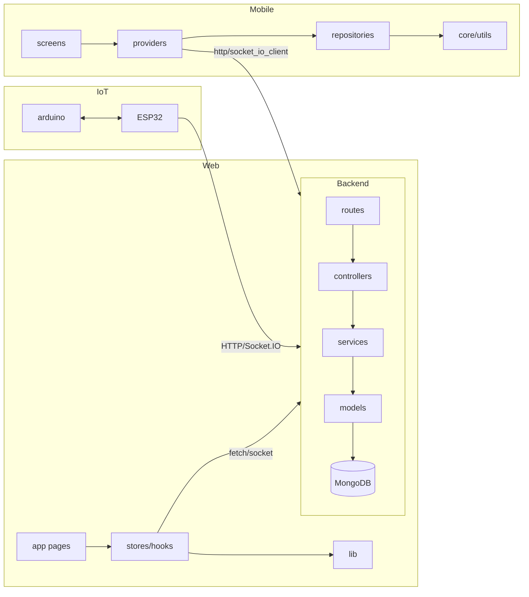

## 16.3 Authentication Flow
Identical on both clients except the persistence mechanism in the last step (web: `localStorage`; mobile: OS-encrypted `flutter_secure_storage`, §6.5).
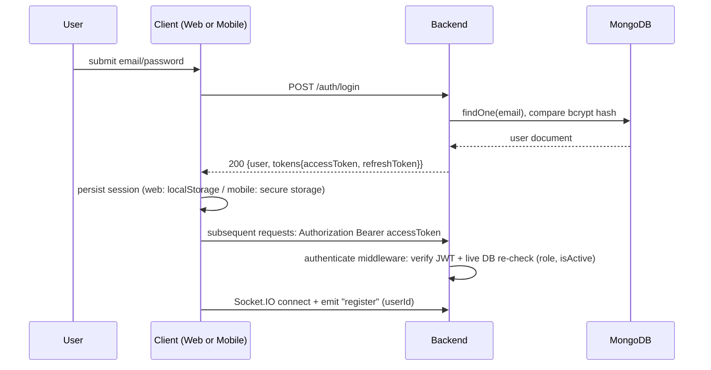

## 16.3.1 Login Flow (detailed)
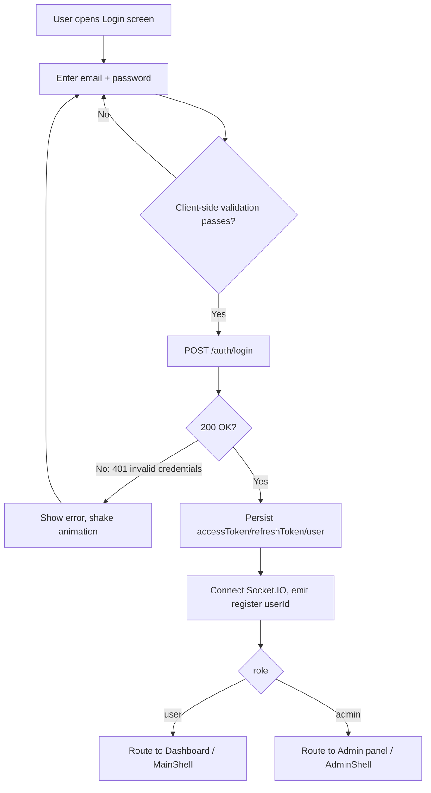

## 16.3.2 Registration Flow (detailed)
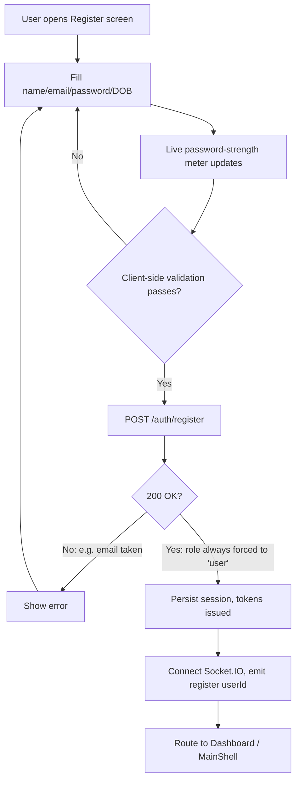

## 16.4 Order Workflow
```mermaid
stateDiagram-v2
    [*] --> pending: POST /orders (public)
    pending --> accepted: admin accepts
    pending --> rejected: admin rejects
    accepted --> processing: auto (~2s)
    accepted --> rejected: admin rejects
    processing --> delivered: auto (~2.5s), User created
    processing --> delivery-failed: email already exists (race)
    processing --> rejected: admin rejects
    delivered --> [*]
    rejected --> [*]
    delivery-failed --> [*]
```

## 16.5 RFID Workflow
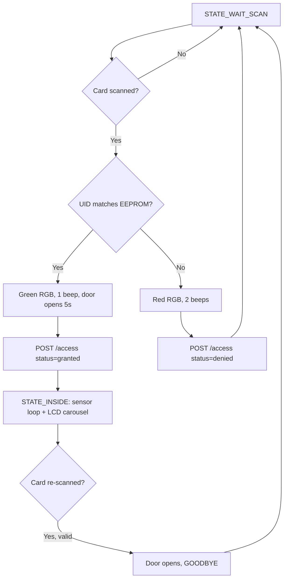

## 16.6 Sensor / Emergency Workflow
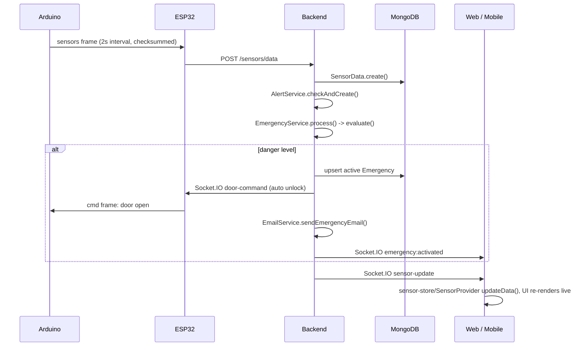

## 16.7 Communication Flow (bidirectional)
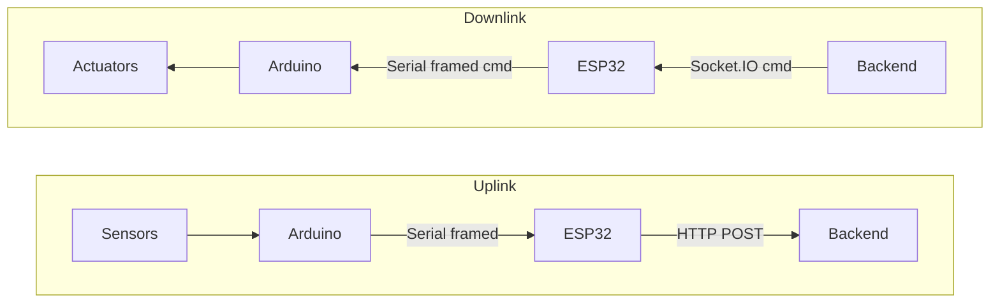

## 16.8 Database Relations
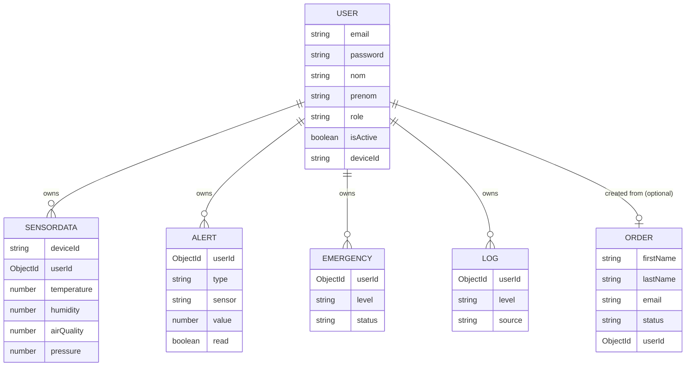

## 16.9 Backend Architecture
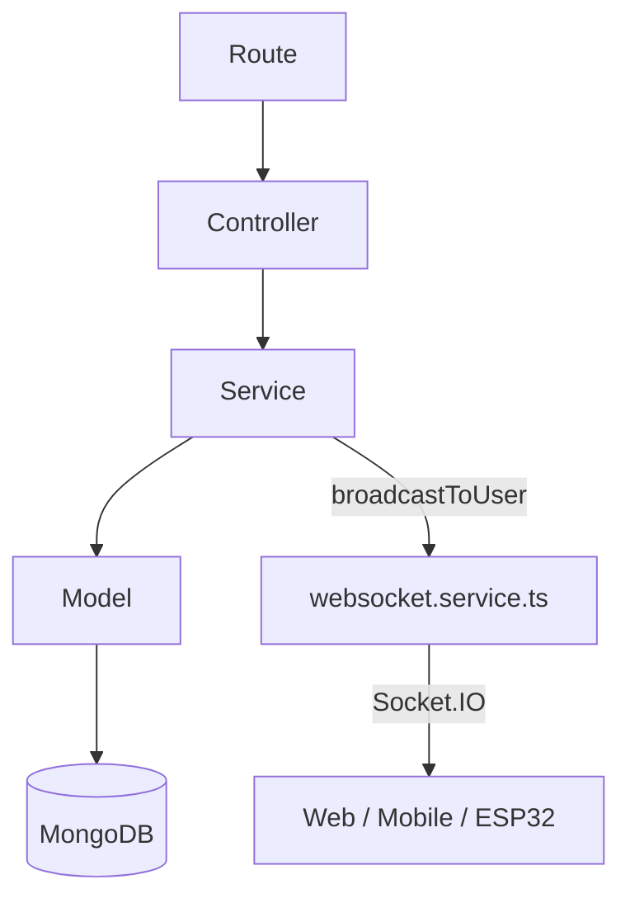

## 16.10 Web Architecture
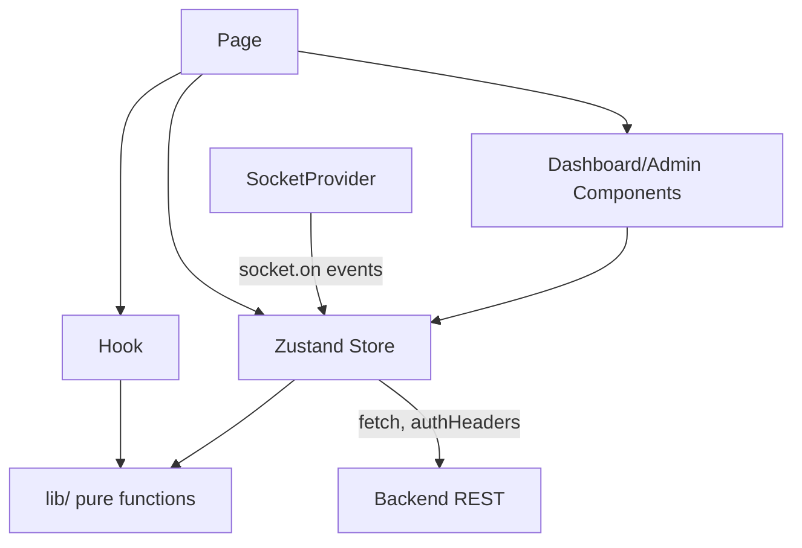

## 16.11 Mobile Architecture
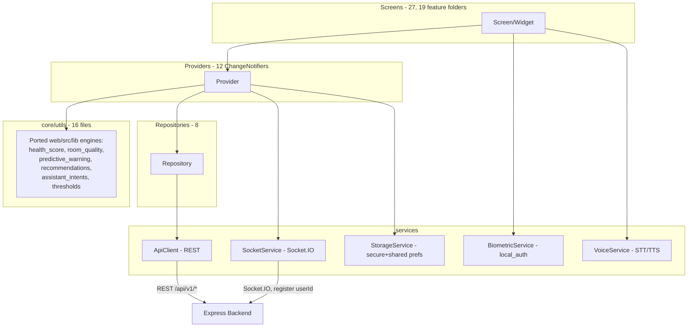

## 16.11.1 Mobile App Navigation / Auth Gating
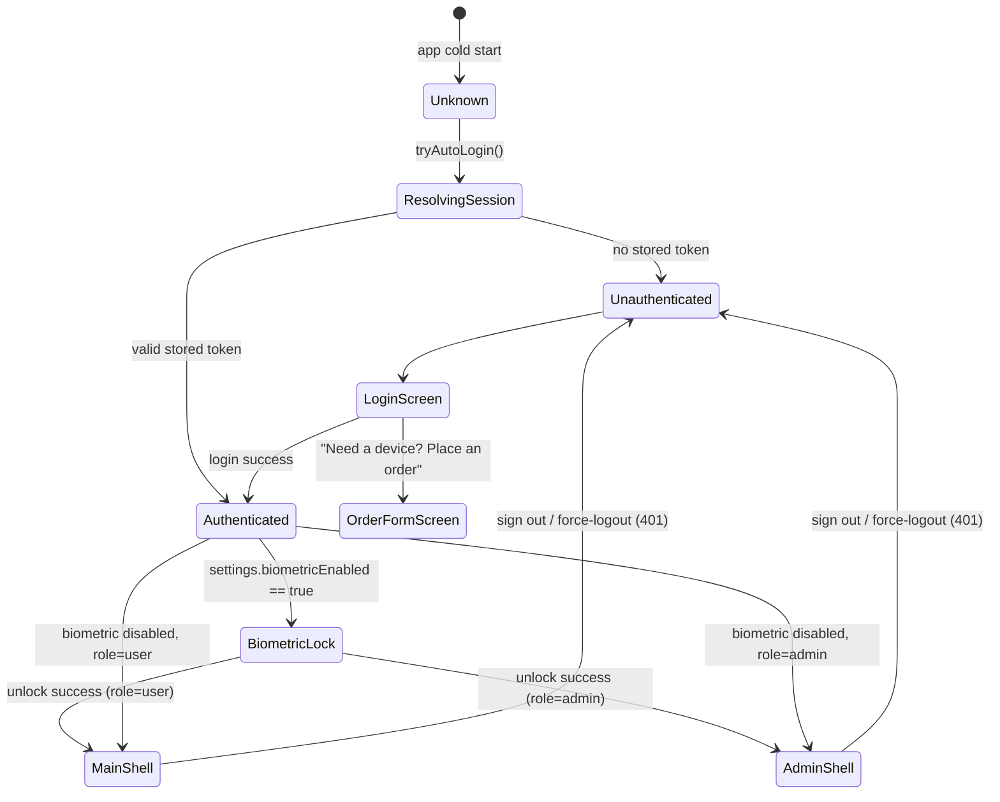

## 16.12 Arduino Logic (state machine, simplified)
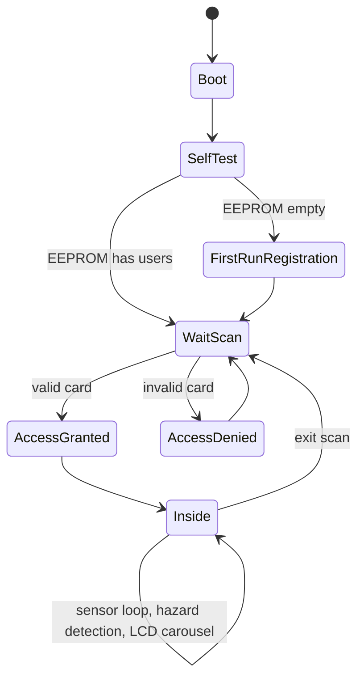

## 16.13 ESP32 Logic (simplified)
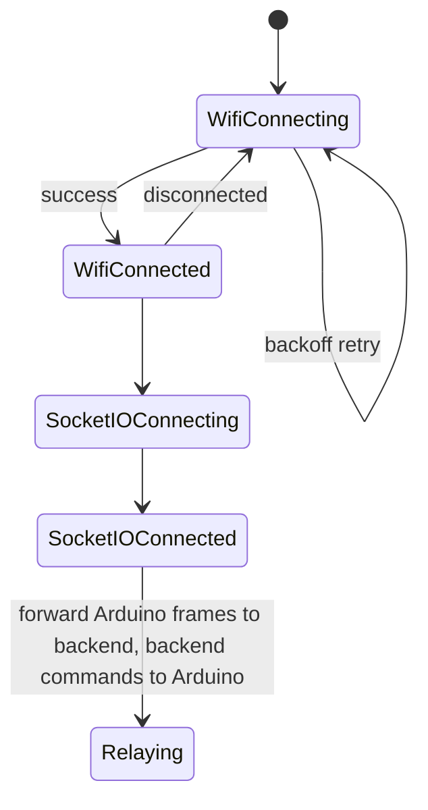

## 16.14 Arduino Mega — Hardware/Component Architecture
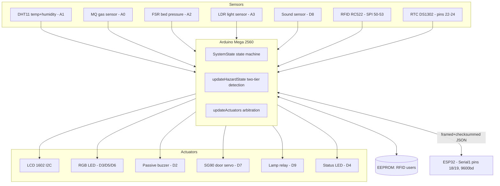

## 16.15 ESP32 — Hardware/Component Architecture
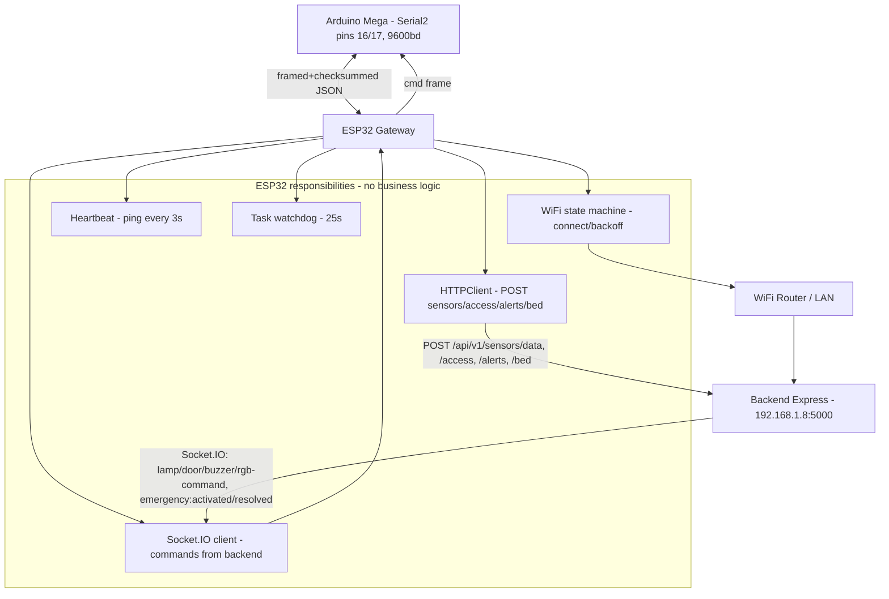

## 16.16 Arduino — Full State Machine (19 states)
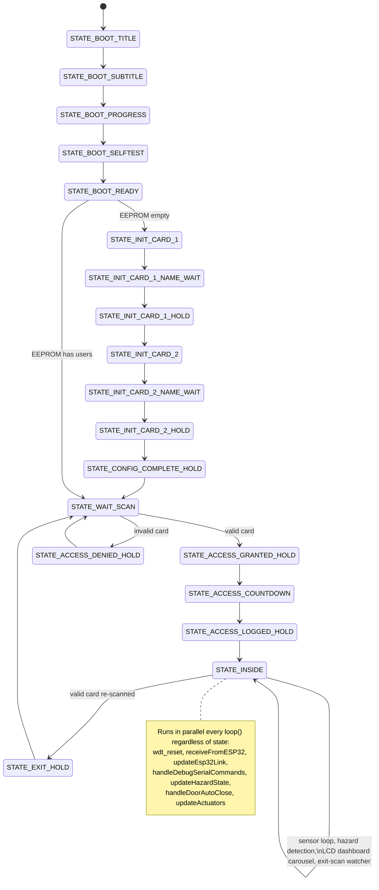

## 16.17 IoT Architecture (consolidated Arduino + ESP32)
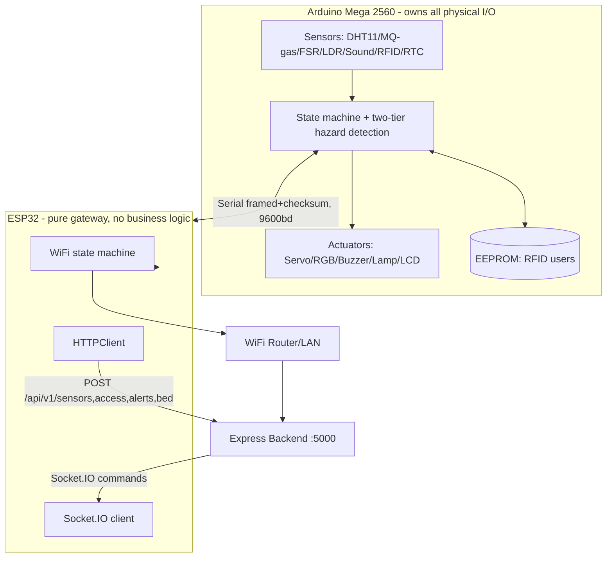

## 16.18 Socket.IO Communication (all clients)
```mermaid
sequenceDiagram
    participant ESP32
    participant BE as Backend (websocket.service.ts)
    participant WEB as Web Dashboard
    participant MOB as Mobile App

    ESP32->>BE: connect, emit register(userId)
    WEB->>BE: connect, emit register(userId)
    MOB->>BE: connect, emit register(userId)
    Note over BE: all three join room "userId"
    BE->>BE: SensorData.create() triggers evaluation
    BE-->>ESP32: (n/a - ESP32 only sends, rarely listens except *-command)
    BE-->>WEB: sensor-update / new-alert / new-log / emergency:*
    BE-->>MOB: sensor-update / new-alert / new-log / emergency:*
    WEB->>BE: lamp-command (user taps toggle)
    BE->>ESP32: lamp-command (relayed)
    MOB->>BE: door-command (user taps toggle)
    BE->>ESP32: door-command (relayed)
```

## 16.19 API Request Flow (REST, either client)
```mermaid
sequenceDiagram
    participant C as Client (Web fetch() or Mobile ApiClient)
    participant MW as authenticate + requireRole middleware
    participant Ctrl as Controller
    participant Svc as Service
    participant DB as MongoDB

    C->>MW: HTTP request + Authorization: Bearer accessToken
    MW->>DB: re-fetch user (role, isActive) live
    alt token invalid/expired or user missing/suspended
        MW-->>C: 401 / 403
        C->>C: onUnauthorized -> force logout
    else authorized
        MW->>Ctrl: req.user attached
        Ctrl->>Svc: delegate business logic
        Svc->>DB: read/write
        Svc-->>Ctrl: result
        Ctrl-->>C: 200 + JSON
    end
```

## 16.20 Sensor Data Pipeline (single ingest, full fan-out)
```mermaid
flowchart TD
    A[POST /sensors/data] --> B[Resolve User by deviceId]
    B --> C[SensorData.create]
    C --> D{pressure > 500?}
    D -->|Yes| E[SleepScoreService.detectSleepSession, last 8h]
    D -->|No| F[skip sleep scoring]
    E --> G
    F --> G[AlertService.checkAndCreate]
    G --> H[EmergencyService.process: evaluate]
    H --> I{level}
    I -->|danger| J[activate: upsert Emergency, auto door-unlock, email once]
    I -->|warning| K[log only, no Emergency record]
    I -->|fine| L[auto-resolve if one was active]
    J --> M[detectActuatorChanges: discrete Door/Lamp/Buzzer/RGB log events]
    K --> M
    L --> M
    M --> N[Socket.IO sensor-update broadcast to userId room]
    N --> O[Web + Mobile clients update live]
```

## 16.21 Emergency Workflow (standalone)
```mermaid
stateDiagram-v2
    [*] --> Fine
    Fine --> Warning: any of temp/humidity/gas/sound crosses warning threshold
    Warning --> Danger: crosses danger threshold
    Warning --> Fine: readings recover
    Danger --> EmergencyActive: EmergencyService.activate()
    EmergencyActive --> EmergencyActive: door auto-unlocked, email sent once, broadcast emergency:activated
    EmergencyActive --> Resolved: all readings return to Fine (auto) OR user/admin clicks Resolve (manual, PATCH /emergencies/:id/resolve)
    Resolved --> Fine: broadcast emergency:resolved
    note right of EmergencyActive
        Web: EmergencyCountdown overlay + EmergencyBanner + toast
        Mobile: EmergencyScreen banner + EmergencyProvider update
        Arduino: independently, locally reaches the same
        state via its own two-tier hazard detection (§7.9)
    end note
```

## 16.22 Notification Workflow
```mermaid
flowchart TD
    A[LogService.record / AlertService.checkAndCreate / EmergencyService.activate-resolve] --> B[Persist to Log/Alert/Emergency collection]
    B --> C[Socket.IO broadcast: new-log / new-alert / emergency:*]
    C --> D{Client}
    D -->|Web| E[useUnifiedEvents merges into: Live Event Center, Timeline, Logs page, toast]
    D -->|Mobile| F[NotificationItem unifies Alert+Emergency into: Notification Center, Alerts tab badge]
    E --> G[User sees categorized, real-time notification]
    F --> G
```

## 16.23 AI Assistant Workflow (deterministic, both clients)
```mermaid
flowchart TD
    A[User types or speaks a question] --> B{Mobile only: voice input?}
    B -->|Yes| C[VoiceService.startListening -> transcribed text]
    B -->|No| D[Typed text]
    C --> E[matchIntent: ordered phrase-matching table, 15 intents]
    D --> E
    E --> F[answerQuestion: switch over intent]
    F --> G[Reads live HealthScore/RoomQuality/PredictiveWarning/Recommendations - same objects the dashboard renders]
    G --> H[Deterministic Markdown answer, no LLM call]
    H --> I[550ms UX-pacing delay]
    I --> J[Answer rendered in chat]
    J --> K{Mobile only: tap speaker icon?}
    K -->|Yes| L[VoiceService.speak: strip Markdown, TTS playback]
    K -->|No| M[Done]
```

## 16.24 Remote Control Flow
```mermaid
sequenceDiagram
    participant U as User
    participant C as Client (Web Remote Control page or Mobile RoomScreen sheet)
    participant BE as Backend
    participant ESP as ESP32
    participant ARD as Arduino

    U->>C: tap Door/Lamp/Buzzer toggle or RGB preset
    C->>C: confirm dialog (door/buzzer only)
    C->>BE: POST /sensors/{lamp,door,buzzer}/toggle or /sensors/rgb
    BE->>BE: broadcastToUser: *-command
    BE-->>ESP: Socket.IO *-command
    ESP->>ARD: Serial2 framed cmd
    ARD->>ARD: updateActuators(): physically actuate
    ARD->>ESP: next sensors frame reflects new actuator state
    ESP->>BE: POST /sensors/data
    BE-->>C: Socket.IO sensor-update (both Web and Mobile see the change)
```

## 16.25 Sleep Analysis Flow
```mermaid
flowchart TD
    A[SensorData ingest: pressure > 500, i.e. occupied] --> B[Pull last 8h of user's SensorData]
    B --> C{>= 6 occupied samples?}
    C -->|No| D[return null - no session detected]
    C -->|Yes| E[duration = minutes first-to-last occupied sample]
    E --> F[interruptions = count of occupied samples with motion=true]
    F --> G[environmentScore = avg of temp/humidity/noise/air sub-scores]
    G --> H["score = round(durationScore*0.35 + continuityScore*0.35 + environmentScore*0.30)"]
    H --> I[Persisted onto the SensorData document]
    I --> J[Rendered on Web Dashboard sleep card and Mobile Room/Dashboard screens identically]
```

## 16.26 Dashboard Navigation (Web)
```mermaid
graph TD
    DL[DashboardLayout - auth/role gate] --> DN[DashboardNavbar: search, day/night, clock, events, notifications, profile]
    DL --> DS[DashboardSidebar - 11 items]
    DS --> P1[Dashboard] & P2[Sensors] & P3[Analytics] & P4[Assistant] & P5[Emergency]
    DS --> P6[Occupancy] & P7[Remote Control] & P8[Room Map] & P9[History] & P10[Settings] & P11[Orders]
```

## 16.27 Admin Navigation (Web)
```mermaid
graph TD
    AS[AdminSidebar - 7 items] --> A1[Dashboard/Stats]
    AS --> A2[Users - CRUD/suspend/reset-password]
    AS --> A3[Orders - queue + accept/reject]
    AS --> A4[Alerts - system-wide emergency log]
    AS --> A5[Devices]
    AS --> A6[Activity Timeline - client-derived from orders]
    AS --> A7[Profile/Logout]
```

## 16.28 Deployment Architecture
```mermaid
graph TD
    subgraph Dev["Developer / LAN"]
      ARD2[Arduino Mega] <-->|Serial| ESP2[ESP32, WiFi]
    end
    subgraph Server["Backend Host (0.0.0.0 bind, LAN-reachable)"]
      NODE[Node.js/Express process :5000]
      MONGO[(MongoDB :27017)]
      NODE --> MONGO
    end
    subgraph Clients
      BROWSER[Browser - Next.js web app]
      PHONE[Phone/Emulator - Flutter app]
    end
    ESP2 -->|HTTP POST, same LAN| NODE
    NODE -->|Socket.IO cmd| ESP2
    BROWSER -->|HTTP + WebSocket| NODE
    PHONE -->|HTTP + WebSocket, 10.0.2.2 on Android emulator or LAN IP override| NODE
```

## 16.29 Network Architecture
```mermaid
graph LR
    subgraph LAN[Local Network]
      ESP3[ESP32 - WiFi station]
      SERVERHOST["Backend Host\n0.0.0.0:5000 bind"]
      PC[Web Browser]
      PHONE2[Mobile Device]
    end
    subgraph Internet
      OM[Open-Meteo API - weather/AQI, no key]
      SMTP[SMTP server - emergency email]
    end
    ESP3 -->|HTTP + Socket.IO, LAN IP e.g. 192.168.1.8:5000| SERVERHOST
    PC -->|localhost or LAN IP| SERVERHOST
    PHONE2 -->|10.0.2.2 emulator alias or LAN IP override| SERVERHOST
    SERVERHOST -->|outbound HTTPS| OM
    SERVERHOST -->|outbound SMTP, if configured| SMTP
    PC -->|outbound HTTPS, weather widget| OM
    PHONE2 -->|outbound HTTPS, weather widget, geolocator for coords| OM
```

---

# 17. REPORT_RESOURCES

Everything below is scaffolding to help write the PFE report itself — some of it (methodology, sprints) is a *suggested* framing since this repository contains no issue tracker or sprint history; do not present it as a factual record of ceremonies that occurred.

## 17.1 Suggested Introduction
"Modern connected-room and smart-healthcare systems require continuous, automated environmental and safety monitoring that does not depend on constant human supervision. This project, Smart Health Room, implements such a system end-to-end: from physical sensors on an Arduino Mega 2560, through an ESP32 WiFi gateway, to a Node.js/Express/MongoDB backend and a Next.js real-time dashboard, culminating in a fully explainable, rule-based health assistant. The system's defining design choice is redundant safety — the embedded firmware can protect the occupant (unlock the door, sound an alarm) entirely on its own, independent of network or backend availability, while the backend independently re-evaluates the same data for logging, alerting, and notification."

## 17.2 Project Context
Built as a full-stack IoT/web engineering project spanning embedded C++ firmware (two boards), a TypeScript/Node.js backend, and a TypeScript/React frontend — a realistic three-tier IoT product architecture suitable for a graduation project demonstrating competence across embedded systems, backend API/service design, real-time communication, and modern frontend engineering.

## 17.3 Problem Statement
Manual or purely-scheduled environmental monitoring cannot react in real time to dangerous conditions (gas, heat, humidity) or unauthorized access, and typically has no unified, explainable interface for the occupant or an administrator to understand *why* a given alert fired. Smart Health Room addresses both gaps: autonomous hardware-level safety response, and a transparent, data-grounded assistant layer on top of a real-time dashboard.

## 17.4 Objectives (restated for report use)
Functional monitoring of 5 environmental parameters + occupancy; RFID-secured access with autonomous actuation; two-tier local + server-side hazard detection; real-time web dashboard with historical analytics and PDF export; self-service account provisioning via a public order pipeline; full admin back-office; a deterministic, explainable AI assistant.

## 17.5 Functional Requirements
- FR1: The system shall read temperature, humidity, gas, light, and sound continuously while the room is occupied.
- FR2: The system shall authenticate room entry via RFID against a locally-enrolled card list.
- FR3: The system shall autonomously unlock the door and sound an alarm when any monitored sensor crosses its emergency threshold, without requiring network connectivity.
- FR4: The backend shall independently re-evaluate every ingested reading against its own threshold configuration and raise/persist alerts and emergencies accordingly.
- FR5: The web application shall display live sensor values, historical trends, and system connectivity status in real time via Socket.IO.
- FR6: Users shall be able to remotely control the lamp, door, buzzer, and RGB status light from the dashboard.
- FR7: The system shall compute a Sleep Score whenever bed occupancy is detected.
- FR8: The system shall provide a chat-based assistant that answers questions using only live sensor-derived data.
- FR9: The system shall support public order submission, admin review, and automatic account creation upon delivery.
- FR10: Administrators shall be able to manage user accounts (create/update/suspend/delete/reset password) and pair devices to accounts.
- FR11: The system shall generate downloadable PDF health and analytics reports.
- FR12: The system shall provide a native mobile client (Flutter, Android/iOS) offering live monitoring, remote control, analytics, the AI assistant, and admin back-office functions against the same backend API, with no reduction in monitored data compared to the web client.

## 17.6 Non-Functional Requirements
- NFR1 (Availability/Resilience): local hazard response must function without any backend/network dependency.
- NFR2 (Real-time): sensor updates must reach the dashboard within the Socket.IO round-trip of ingestion (no polling for live values).
- NFR3 (Security): passwords hashed (bcrypt, 12 rounds); JWT-based session; role-based access control.
- NFR4 (Usability): responsive, accessible (`aria-*` attributes throughout), reduced-motion-aware UI.
- NFR5 (Maintainability): strict layered architecture (Route→Controller→Service→Model backend; Page→Store→Lib frontend) with no duplicated business logic (verified during code audit — e.g. `RecommendationsPanel`/`SmartSuggestionsPanel` split one engine's output rather than re-implementing it).
- NFR6 (Portability/Installability): the web app is an installable PWA with an offline fallback; the mobile app is natively installable on Android/iOS by construction, with its own offline affordance (cached last-known sensor snapshot, §6.5).

*(Honest caveat for the report: rate limiting, refresh-token redemption, and full CORS hardening are NOT yet implemented on the backend — and therefore affect both clients equally — list these under "Known Limitations," not under met NFRs. Similarly, the mobile app's single smoke test does not constitute real automated coverage — §6.12/§17.12.)*

## 17.7 Agile / SCRUM Framing (suggested structure — not a historical record)
Since no ticket/sprint history exists in the repository, a defensible report structure is to present the build as **feature-epics** rather than literal sprints:
- Epic 1 — Hardware & Firmware (sensor reading, actuator control, RFID/EEPROM, communication protocol).
- Epic 2 — Backend Core (auth, models, sensor ingestion pipeline, Socket.IO).
- Epic 3 — Safety Systems (thresholds, AlertService, EmergencyService, email).
- Epic 4 — Web Dashboard (live sensors, charts, history).
- Epic 5 — Intelligence Layer (Health Score, Room Quality, Predictive Warning, Recommendation Engine, AI Assistant).
- Epic 6 — Admin & Orders (user management, order lifecycle automation).
- Epic 7 — Polish (PWA, Demo Mode, Guided Tour, Analytics/PDF export, theming).
- Epic 8 — Mobile Client (Flutter app: provider-based state management, REST/Socket.IO integration against the existing backend, porting the web `lib/` scoring engines to Dart, native additions — biometric lock, voice assistant, secure token storage).

## 17.8 Technologies Justification
- **Next.js 16 / React 19**: App Router for file-based routing across three distinct access levels (public/user/admin); React Server/Client Component split keeps auth-gated pages client-rendered while marketing pages stay simple.
- **Zustand**: minimal-boilerplate global state, chosen over Redux for a project with ~14 independent state slices that mostly don't need cross-slice reducers — each store owns its own fetch/mutate logic.
- **Socket.IO** (both backend and ESP32 client): a mature, reconnect-aware real-time layer already battle-tested on constrained hardware (an `esp32` Socket.IO client library exists and was used, avoiding a hand-rolled WebSocket protocol).
- **MongoDB/Mongoose**: schema flexibility suits evolving sensor payloads (new optional fields like `co2`, `rgb`, `lightStatus` were added over time without migrations).
- **Arduino Mega 2560 over Uno**: enough digital/analog pins and multiple hardware serial ports (`Serial`, `Serial1`) to run the LCD, RFID, DHT, RTC, and a dedicated ESP32 link simultaneously without SoftwareSerial contention.
- **jsPDF (vector-drawn charts)**: avoids a canvas-scraping dependency, keeping PDF generation a pure function of already-fetched data — easier to test and reason about.
- **Flutter + `provider`**: a single codebase targeting Android/iOS (and, incidentally, web/desktop via Flutter's own web target) without a JS-bridge cost; `provider`'s `ChangeNotifier` pattern was chosen over Riverpod/BLoC as the lightest-boilerplate option that still maps cleanly onto the web app's existing store-per-concern architecture — each of the 12 providers corresponds 1:1 to a Zustand store, minimizing the conceptual gap between the two codebases and making the web `lib/` scoring engines straightforward to port verbatim into `mobile/lib/core/utils` rather than redesigned.
- **`flutter_secure_storage` for tokens**: chosen specifically because a stolen or backed-up mobile device exposes app storage more readily than a desktop browser profile — OS Keystore/Keychain encryption is a deliberately stricter choice than the web app's `localStorage`, not an oversight in one direction or the other.
- **`local_auth` (biometric app-lock)**: a low-cost, native-platform-provided UX layer that reduces how often a user must retype a password on a personal device, explicitly scoped as a *local unlock gate*, not a second authentication factor recognized by the backend.

## 17.9 UML Preparation Notes
- **Use-case actors**: User (occupant), Administrator, ESP32 Device (system actor). The same actors apply identically whether the actor's client is the web app or the Flutter mobile app — there is no separate "Mobile User" actor, since both clients reach the same use cases against the same backend.
- **Key use cases**: Login/Register, View Live Dashboard, Control Actuators Remotely, View Alerts/Emergency History, Ask Assistant, Export Report, Place Order (public), Manage Users (admin), Manage Orders (admin). Two use cases exist on the web app only (Trigger Test Emergency, Run Demo Mode/Guided Tour — §6.7/§6.13) and two exist on the mobile app only (Biometric App Unlock, Voice-Driven Assistant Interaction — §6.5/§6.6); note these as client-specific extensions on the use-case diagram rather than omitting them.
- **Class-diagram candidates** (backend): `User`, `SensorData`, `Alert`, `Emergency`, `Log`, `Order` (from §3.3/§4) map directly to UML classes with the field lists already given — no further reverse-engineering needed. The mobile app's `models/*.dart` classes (§6, `AppUser`, `SensorData`, `AppAlert`, `Emergency`, `Order`, `LogEntry`...) are client-side DTOs mirroring these same shapes field-for-field (with French→English key translation, e.g. `nom`→`name`), not additional domain classes.
- **Sequence-diagram candidates**: reuse §16.3/§16.3.1/§16.3.2 (auth/login/registration), §16.4 (order), §16.5 (RFID), §16.20 (sensor pipeline), §16.21 (emergency), §16.24 (remote control) directly — already accurate to the code and already annotated with both-client behavior where it differs.
- **Component diagram**: Arduino / ESP32 / Backend / MongoDB / Web (dashboard+admin) / Mobile (user+admin shells) as six components, edges per §9 (Communication) and §16.1/§16.28 (Global/Deployment Architecture).

## 17.10 Architecture Explanations (for the report's architecture chapter)
Explain the layered backend (§3.1) and the frontend's Page→Store→Lib split (§5, §5.11) as *the same architectural pattern applied twice* — a useful framing device: both halves separate "what triggered this" (route/page) from "what should happen" (controller/hook) from "the actual rule" (service/lib function) from "where it's stored" (model/store).

## 17.11 Implementation Notes (noteworthy engineering decisions to highlight)
- Redundant local+server hazard evaluation (§7.9, §3.5 EmergencyService) as the headline safety design decision.
- The unified event feed (`useUnifiedEvents`) as a DRY solution to three UI surfaces needing the same categorized event stream.
- The deterministic AI assistant as a defensible, explainable alternative to an LLM integration for a safety-relevant domain.
- Non-blocking embedded firmware design (both boards) with watchdog safety and checksummed, sequence-numbered serial framing — worth a dedicated firmware-reliability subsection.
- EEPROM-persisted RFID enrollment removing the need to re-register cards on every reboot.

## 17.12 Testing Notes
No automated test suite (unit/integration) exists in `backend/` or `web/` as of this analysis — `backend/scripts/simulate-esp32.ts` is the closest thing to an integration aid, a standalone script that POSTs synthetic sensor payloads for manual/local verification. `mobile/` has exactly one test (`test/widget_test.dart`, a smoke test asserting the app boots to its auth-gate loading state without throwing) — marginally ahead of zero, but not real coverage. For the report's testing chapter, describe testing as **manual + the built-in QA affordances**: the `/emergencies/test-trigger` endpoint (exercises the real evaluation pipeline with synthetic danger-level values, web-only — §6.7), Demo Mode's scripted 11-stage walkthrough (web-only, exercises nearly every dashboard surface deterministically), and the Arduino's 12-item boot self-test. Recommend, as future work, adding Jest/Vitest unit tests for the pure `lib/` scoring functions (`healthScore.ts`, `roomQuality.ts`, `sleepScore.service.ts`, `predictiveWarning.ts`) and `flutter_test` unit tests for their Dart ports (`mobile/lib/core/utils/*.dart`) — both sides are already pure, side-effect-free functions, and being verbatim ports of each other, a shared test-fixture/expected-output set could validate both implementations stay in sync.

## 17.13 Difficulties Encountered & Solutions Implemented (patterns visible in the code, safe to generalize in the report)
- **Browser autofill breaking floating labels** → solved with the `:-webkit-autofill` CSS animation-detection trick (no dependency, no behavior change for the non-autofill path).
- **Real-time transport reliability** (a WebSocket link can silently disconnect) → solved with exponential-backoff reconnection on both the ESP32 (WiFi + Socket.IO) and the web client (`socket.io-client`'s built-in reconnection), plus heartbeat-based link-health detection between the two boards.
- **Duplicate/garbled serial data** between Arduino and ESP32 → solved with a checksummed, sequence-numbered framed protocol that silently drops corrupted or repeated packets rather than crashing the parser.
- **Sensor telemetry not correlating with wall-clock "uptime"** (Arduino only transmits while occupied) → solved by defining "reliability" as a reporting-consistency metric during active sessions only, rather than a naive uptime percentage that would be misleadingly low.
- **Multiple UI surfaces needing the same event history** → solved with one shared hook (`useUnifiedEvents`) instead of three parallel implementations.
- **Two clients (web + mobile) needing the same scoring/rule logic** → solved by treating the web app's `lib/` engines as the canonical source and porting them into `mobile/lib/core/utils` verbatim (in-code comments in the Dart files explicitly say "ported from `web/src/lib/X.ts`"), rather than having a second team/session independently reimplement the health-score/room-quality/assistant rules and risk the two clients silently disagreeing.
- **A mobile device can't reach a backend at `localhost` the way a browser on the same machine can** → solved with `ApiConfig`'s per-platform default host resolution (`10.0.2.2` on the Android emulator, `localhost` elsewhere) plus a persisted Settings override for testing against a real phone on the same LAN as the backend and the ESP32.
- **JWTs deserve stronger at-rest protection on a personal mobile device than a browser tab** → solved by persisting tokens through `flutter_secure_storage` (OS Keystore/Keychain) instead of the web app's plain `localStorage` pattern, without changing the token format or the backend's expectations at all.

## 17.14 Future Improvements
- Wire up rate limiting (dependency already installed).
- Implement the missing refresh-token redemption endpoint (would benefit both web and mobile sessions equally, since neither client can currently redeem one).
- Restrict Socket.IO CORS to the same allow-list as the Express HTTP CORS.
- Add automated unit tests for the pure scoring/engine functions (both `web/src/lib/*.ts` and their `mobile/lib/core/utils/*.dart` ports).
- Add heart-rate/SpO2/body-temperature sensors (mentioned as a long-term hardware roadmap item in project notes).
- Forward the ESP32's periodic health-report line to the backend for dashboard-visible firmware diagnostics (already structured, just not transmitted).
- Add OS-level push notifications (Firebase Cloud Messaging) to the mobile app — today's "Notifications" toggle only governs an in-app feed, since the app has no background-push channel to the backend.
- Port the remaining web-only features to the mobile app for feature-complete parity: Emergency test-trigger (QA button), Demo Mode/Guided Tour, the `GET /status` connection-diagnostics panel, and a dedicated Occupancy page (§6.13).
- Publish the mobile app's `pubspec.yaml` dependency set to a CI pipeline (`flutter analyze` / `flutter test`) alongside the backend/web build, none of which currently run in any automated pipeline in this repository.

## 17.15 Personal Skills Acquired (template — tailor to the actual author)
Full-stack TypeScript development across a real-time system; embedded C++ firmware design under hard memory/timing constraints (non-blocking state machines, watchdog-safe loops); designing a checksummed serial protocol from scratch; MongoDB schema design for time-series-like sensor data; real-time architecture with Socket.IO; building an explainable rule-based "AI" system as a safer alternative to LLM integration in a safety-relevant domain; PDF/report generation; PWA packaging; cross-platform mobile development with Flutter/Dart and the `provider` state-management pattern; porting a TypeScript business-logic layer to Dart while keeping both implementations behaviorally identical; native-platform integration (biometric authentication, secure OS keystore storage, geolocation, speech-to-text/text-to-speech).

## 17.16 Keywords
IoT, Smart Home, Embedded Systems, Arduino, ESP32, RFID, MQTT-alternative (Socket.IO), Real-Time Systems, MERN-adjacent stack (MongoDB/Express/React-Next/Node), JWT Authentication, Role-Based Access Control, Rule-Based Recommendation Engine, Explainable AI, Predictive Warning, Sleep Score, Progressive Web App, Watchdog Timer, Non-Blocking Firmware, Checksummed Serial Protocol, Flutter, Dart, Cross-Platform Mobile Development, Provider State Management, Biometric Authentication, Secure Storage, Voice Assistant (STT/TTS), Cross-Client Feature Parity.

## 17.17 Figure Suggestions
Overall architecture diagram (§16.1, now including the mobile client); wiring diagram for the Arduino (pin table in §7.2, redrawable as a Fritzing-style figure); RFID and Order sequence diagrams (§16.5, §16.3); dashboard screenshots (live sensors, Health Score card, Room Quality card, Emergency banner, AI Assistant chat, Room Map, Analytics charts, Admin user table, Admin order table); Arduino LCD carousel photos (boot self-test, dashboard pages, emergency override screen); mobile app screenshots side-by-side with their web equivalents to visually demonstrate the cross-client feature-parity claim in §6.13 (Home/Room/Dashboard/Assistant/Remote Control/Admin screens).

## 17.18 Table Suggestions
Sensor pin/threshold table (§7.2 + §7.9); full API endpoint table (§10, note it is shared verbatim by both clients); database schema/field table per model (§3.3); comparison table of the two independent hazard-detection layers (Arduino local vs. backend `EmergencyService`) — thresholds, response time, and what each one controls; mobile screens table (§6.3); mobile providers table (§6.4); the cross-client feature-parity table (§6.13) as a standalone report figure — it doubles as evidence of scope for a jury.

## 17.19 Screenshot Checklist
- [ ] Public Home page hero
- [ ] Product page + order modal
- [ ] Login page (floating labels, error state)
- [ ] Register page
- [ ] Dashboard main page (day mode and night mode)
- [ ] Health Score card, Room Quality card, Weather widget close-ups
- [ ] Emergency banner + fullscreen countdown overlay
- [ ] AI Assistant chat with a real answered question
- [ ] Analytics page with charts + PDF export button
- [ ] Room Map with a node detail dialog open
- [ ] Remote Control page
- [ ] Settings page (Preferences + App Settings sections)
- [ ] Admin dashboard (orders + users sections)
- [ ] Admin User modal / Order detail modal
- [ ] Arduino LCD showing the boot self-test sequence
- [ ] Arduino LCD showing the dashboard carousel while occupied
- [ ] Physical hardware photo (Arduino Mega + ESP32 + sensors wired)
- [ ] Mobile: Login screen (with "Need a device? Place an order" link visible)
- [ ] Mobile: Home + Dashboard tabs (day mode and night mode)
- [ ] Mobile: Room screen with Remote Control bottom sheet open
- [ ] Mobile: AI Assistant screen mid-conversation, mic button visible
- [ ] Mobile: Biometric unlock prompt
- [ ] Mobile: Health Report PDF preview + native share sheet
- [ ] Mobile: Admin shell (Orders + Users tabs)
- [ ] Mobile vs Web side-by-side comparison of the same screen (e.g. Dashboard or Remote Control) to visually anchor the feature-parity claim

## 17.20 Demonstration Scenario (suggested live-demo script)
1. Power on the Arduino/ESP32; show the LCD boot self-test completing and "PLEASE SCAN YOUR CARD."
2. Scan an unregistered card → show LCD "WRONG CARD," red RGB, double beep, and the event appearing in the dashboard's Live Event Center in real time.
3. Scan a registered card → door opens (servo), green RGB, LCD welcome, dashboard shows "RFID Accepted" and the Bed/room widgets go live.
4. On the dashboard, toggle the Lamp from Remote Control and show the physical/simulated response.
5. Trigger `POST /emergencies/test-trigger` (or physically create a hazard condition, e.g. breathe near the gas sensor) → show the fullscreen Emergency Countdown, the automatic door unlock, the red RGB/fast buzzer on the Arduino LCD, and the emergency email (if SMTP is configured) — then resolve it manually from the dashboard.
6. Open the AI Assistant and ask "Why is my health score low?" and "Explain gas" — show the answers quoting the exact live sensor numbers.
7. Switch to the Admin panel, show the live order queue auto-progressing (Accepted→Processing→Delivered) after accepting a demo order, and show the new user account it creates.
8. Enable Demo Mode's Guided Sequence from Settings as a fallback if live hardware isn't available, and let it walk through the full story end-to-end.
9. Open the Flutter mobile app side-by-side with the web dashboard on the same account — toggle the Lamp from the phone's Remote Control sheet and show it reflected live on the web dashboard (and vice versa), demonstrating both clients share one real-time backend. Ask the AI Assistant a question by voice (tap the mic, speak, get a spoken answer back) to showcase the mobile-only voice feature.
10. Lock the mobile app and unlock it with a fingerprint/Face ID to show the biometric app-lock layer.

## 17.21 Defense Presentation Notes
Lead with the **redundant safety design** (§1.7/§17.11) as the single most defensible engineering decision — it directly answers the "what happens if WiFi drops during an emergency" question a jury is likely to ask. Have the exact threshold tables (§3.8, §7.9) memorized/printed, since "what number triggers what" is a very likely question. Be ready to explain **why the AI assistant is not an LLM** and defend that as a deliberate choice for a safety-relevant domain, not a limitation. Know the one real architectural inconsistency worth proactively disclosing (the `Order` schema enum gap, §3.10) — volunteering a known, well-understood bug shows maturity better than a jury discovering it. On the mobile app, be ready to state plainly which features are web-only (Emergency test-trigger, Demo Mode/Guided Tour, connection diagnostics — §6.13) and which are mobile-only (biometric app-lock, voice assistant) rather than claiming blanket 100% parity; a jury cross-checking the live app against a parity claim of "everything, identically" is a worse outcome than an honest, precise parity table.
